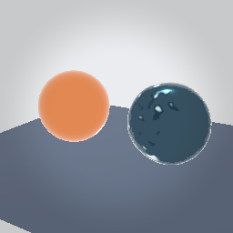

# MaterialX officiel : compatibilité et interopérabilité

Ce guide répond à trois questions différentes : le document est-il valide,
ses définitions et graphes sont-ils résolus, et le rendu est-il équivalent ?
Une réponse positive à l'une ne prouve pas les autres. Les résultats ci-dessous
ne constituent pas une certification générale MaterialX.

## Référence et méthode

La référence documentaire est la [spécification MaterialX 1.39](https://github.com/AcademySoftwareFoundation/MaterialX/blob/bea1e9251d8f936a73930ad19a6f3b37265d46f5/documents/Specification/MaterialX.Specification.md),
les [nœuds standard](https://github.com/AcademySoftwareFoundation/MaterialX/blob/bea1e9251d8f936a73930ad19a6f3b37265d46f5/documents/Specification/MaterialX.StandardNodes.md)
et les [nœuds PBR](https://github.com/AcademySoftwareFoundation/MaterialX/blob/bea1e9251d8f936a73930ad19a6f3b37265d46f5/documents/Specification/MaterialX.PBRSpec.md).
Les définitions et sources de référence sont celles du dépôt officiel au commit
`bea1e9251d8f936a73930ad19a6f3b37265d46f5`, MaterialX **1.39.6** :
[bibliothèques](https://github.com/AcademySoftwareFoundation/MaterialX/tree/bea1e9251d8f936a73930ad19a6f3b37265d46f5/libraries),
[générateur GLSL](https://github.com/AcademySoftwareFoundation/MaterialX/tree/bea1e9251d8f936a73930ad19a6f3b37265d46f5/source/MaterialXGenGlsl)
et [générateur OSL](https://github.com/AcademySoftwareFoundation/MaterialX/tree/bea1e9251d8f936a73930ad19a6f3b37265d46f5/source/MaterialXGenOsl).
Ces sources servent de référence ; aucun générateur officiel GLSL ou OSL n'est
exécuté dans le pipeline WGSL du moteur, et les exemples ci-dessous ne sont pas
une comparaison de pixels avec un renderer officiel.

Le moteur emploie le Core officiel pour la lecture et la validation structurelle,
puis son propre IR et ses générateurs WGSL. Les 28 fichiers chargés par défaut
sont listés dans [default-library-files.json](../src/materialx/default-library-files.json)
et le Core minimal est épinglé à ce commit ; voir [dependencies.md](dependencies.md#materialx-javascript-core-wasm).
La validation `Document.validate()` ne vérifie ni la prise en charge de tous les
nœuds par un backend, ni la fidélité des pixels.

## Comment examiner un matériau

1. Relever les catégories, NodeDefs, types, entrées connectées et littérales,
   les sorties, espaces, unités, couleurs et chemins de textures. L'interface
   **Documentation des nœuds** donne les variantes et entrées des bibliothèques
   chargées ; l'[inventaire consultable](generated/materialx-nodedefs.json)
   contient les NodeDefs sélectionnables par le script, y compris les anciennes
   versions accessibles par nom, leurs types, entrées, valeurs littérales et
   propriétés géométriques par défaut, unités, couleurs et énumérations
   reconnues, ainsi que leurs sorties. `library` désigne les
   fichiers officiels chargés ; `engine`, les définitions du moteur. Une valeur
   absente de l'inventaire ne prouve pas l'absence d'une valeur non reconnue
   ou d'une sémantique dans la bibliothèque officielle.
2. Identifier les éventuelles catégories et types `engine` dans la
   [matrice](#matrice-par-famille-et-backend), et consulter les diagnostics du
   graphe et du backend. Une entrée non renseignée hérite de sa NodeDef
   résolue ; une connexion ou une version explicite peut changer le résultat.
3. Vérifier les restrictions de chaque backend et les textures réellement
   disponibles. Un diagnostic de repli, une valeur neutre ou une approximation
   n'est pas une équivalence. La [liste historique du corpus](materialx-node-coverage.md)
   et [conformance.md](conformance.md) ne couvrent que leurs cas de test, pas
   toute la bibliothèque officielle.
4. Choisir l'[export](#export-et-exemples) adapté et tester le fichier, ses
   dépendances et le rendu dans l'application cible.

## Matrice par famille et backend

`P` : partiel ou limité aux cas indiqués ; `A` : approximation ; `N` : non
pris en charge pour ce cas ; `E` : extension moteur ; `?` : équivalence non
établie. `P` ne signifie pas conforme pour toutes les variantes. Raster et
PT désignent les deux backends MaterialX ; Disney est le backend Disney séparé.
CPU désigne l'évaluation de valeurs et la cuisson, pas un renderer complet.

### Matrice par NodeDef

Dans l'[inventaire JSON](generated/materialx-nodedefs.json), rechercher le nom
`nodedef` puis suivre sa clé `compatibility` dans `compatibilityCases`. Celle-ci
indique un statut pour chacun des quatre backends, une condition et les sources
de preuve. Les statuts sont `partial` (P), `approximated` (A), `unsupported`
(N), `extension` (E) et `unknown` (?). `origin: engine` identifie une extension,
dont les statuts par backend sont distincts ; `extension` seul ne signifie pas
qu'elle fonctionne sur un backend. Le statut s'applique uniquement
au contexte décrit par `condition`, pas à toutes les connexions possibles.
`selectableBy: name` indique une ancienne version sélectionnable uniquement
par son nom explicite ; `variant` indique une variante courante, qui peut
également nécessiter son nom lorsque plusieurs variantes ont le même type.

Le champ `surfaceValueCategoryRegistered` indique seulement que la **catégorie**
figure dans le registre d'abaissement des graphes de valeurs de surface. Il ne
vérifie ni la variante, ni les entrées, ni le résultat. Il reste pertinent
d'examiner les avertissements de compilation même lorsqu'il vaut `true`.

Par exemple, depuis la racine du dépôt en PowerShell :

```powershell
$matrix = Get-Content docs\generated\materialx-nodedefs.json -Raw | ConvertFrom-Json
$node = $matrix.definitions | Where-Object nodedef -eq 'ND_standard_surface_surfaceshader'
$node.inputs | Format-Table
$matrix.compatibilityCases.($node.compatibility) | ConvertTo-Json -Depth 5
```

Le champ `cpuProbe` précise le résultat d'une sonde numérique : une seule
instance non connectée, abaissée comme valeur de surface avec les valeurs
littérales reconnues par l'API de script et des coordonnées fixées. Cette
sonde ne développe pas l'implémentation officielle, ne reproduit pas tous
les défauts géométriques, et ne compare pas avec un générateur officiel.
Les textures sont laissées non testées plutôt que remplacées par une valeur
neutre. Un diagnostic ou une erreur est conservé dans la matrice ; il ne
prouve pas que tous les graphes utilisant le nœud échouent.

À la référence épinglée, 823 NodeDefs sont listées, dont 17 extensions et
deux anciennes versions accessibles par nom. Parmi elles, 610 variantes
disposent d'une sonde CPU réussie sans autre règle particulière. Pour
ces variantes, les statuts raster, PT et Disney restent non établis : la sonde ne démontre ni la
fidélité à MaterialX ni le comportement GPU. Les autres cas sont qualifiés
uniquement dans les conditions indiquées. Ces inconnues ne sont
pas des rejets avérés, et les tableaux par famille ci-dessous ne suffisent pas
à déduire leur statut individuel. La liste n'est donc pas encore une qualification
exhaustive de chaque variante sur chaque backend.

### Sondes GPU isolées

Le [relevé WebGPU](generated/materialx-gpu-probes.json) complète la sonde CPU :
il exécute le même IR dans un shader **compute** sur Chrome, avec les mêmes
coordonnées fixées, puis compare les composantes avec une tolérance de
`1e-4 * max(1, abs(valeur CPU))`. Il contient la version du navigateur,
l'adaptateur et les empreintes SHA-256 des principales sources utilisées. Vérifier ces
empreintes avant de réutiliser le relevé après une modification du moteur.

Sur l'adaptateur NVIDIA Turing utilisé pour ce relevé, 547 variantes numériques
éligibles ont été exécutées : 540 correspondent au CPU, sept diffèrent, aucune
ne rapporte d'erreur. Les sept différences sont `ND_crosshatch_color3`,
`ND_fractal3d_float`, `ND_grid_color3`, `ND_hexagon_float`,
`ND_tiledcircles_color3`, `ND_tiledcloverleafs_color3` et
`ND_tiledhexagons_color3` ; le JSON fournit les valeurs GPU et l'inventaire les
valeurs CPU. Pour six motifs 2D, le chemin CPU utilise ici une coordonnée
de repli `[0, 0]` lorsque l'entrée n'est pas renseignée, alors que le WGSL
utilise les coordonnées de la sonde : ce résultat ne compare donc pas les deux
algorithmes à coordonnées égales.

La sélection exclut les sorties multiples, textures, booléens, entiers et matrices
ainsi que les sondes CPU non évaluées. Les 547 cas comprennent 542 des 610 cas
classés `cpuProbe`. Une correspondance ne démontre ni l'équivalence à MaterialX,
ni le fonctionnement dans les pipelines raster, PT ou Disney. Elle ne modifie
donc pas leurs statuts `unknown`.

Pour reproduire le relevé avec Chrome et WebGPU disponibles :

```powershell
node scripts\materialx-compatibility-gpu.mjs
```

Le script lance son propre serveur Vite sur un port local attribué par le
système. Il remplace le relevé versionné ; `MX_CHROME` peut désigner un
exécutable Chrome spécifique. Le résultat dépend de l'adaptateur et du pilote ;
une erreur ou un résultat non fini est enregistré comme tel, jamais comme succès.

### Vue d'ensemble par famille

| Cas / types et entrées concernés | Raster | PT | Disney | CPU / cuisson | Détails et preuves |
| --- | --- | --- | --- | --- | --- |
| `constant`, `add`, `multiply`, `mix` numériques | P | P | P | P | IR partagé et tests par cas ; variantes et conversions dépendent des types. Disney n'accepte que certains graphes convertibles. |
| `standard_surface`, paramètres de surface | P | P | A | P | Raster/PT évaluent des closures ; Disney convertit un sous-ensemble, avec avertissements et rejets ; la cuisson produit des cartes, pas la closure entière. |
| `open_pbr_surface`, `gltf_pbr`, `UsdPreviewSurface` | P | P | N | P | Prise en charge dépendant des entrées et du graphe ; Disney refuse les familles autres que `standard_surface` et `disney_principled`. |
| `disney_principled` littéral | P | P | A | P | Les conventions du modèle Disney diffèrent ; des entrées connectées sont refusées par sa conversion directe. |
| `BSDF`, `EDF`, `VDF`, `surfaceshader` | P/A | P | P/A | N | Transport et éclairage diffèrent ; l'interpréteur numérique ne retourne pas une closure. La cuisson extrait des cartes de paramètres. |
| Sous-surface `subsurface_bsdf` | A | P | A | P | Raster : repli diffus sans propagation sous la surface ; Disney remplace rayon, couleur et anisotropie ; PT utilise son transport. |
| Transmission / réfraction | A | P | P/A | P | Raster : réfraction de l'environnement, pas des objets derrière ; Disney accepte seulement certains paramètres de milieu. |
| Volume spatial `volumeshader`, `VDF` | A | A | N | P | Champ échantillonné sur une grille CPU 32³ ; les algorithmes raster et PT diffèrent. |
| `image`, `tiledimage`, UDIM et filtres | P | P | P/A | P | Décodage, couleurs, adressage et ressources influencent le résultat ; Disney utilise un échantillonnage au plus proche pour ses graphes acceptés. |
| `triplanarprojection.filtertype="cubic"` | A | A | N | A | Filtre cubique remplacé par linéaire avec avertissement. |
| `position`, `normal`, `tangent`, `bitangent`, `space` | P | P | P | P | Cas objet/modèle/monde pris en charge dans les chemins concernés ; un espace non résolu ou non supporté déclenche un avertissement et un repli. Tangente index 0 seulement dans ces transformations. |
| `geompropvalue` | P | P | P | P | `st`/`UV0` vector2 et certains champs de volume ; autres propriétés : avertissement et valeur par défaut déclarée. |
| `float`, `integer`, `boolean`, `color3`, `vector3` | P | P | P | P | Types numériques des aperçus CPU ; chaque nœud et sortie doit aussi être évaluable. |
| `vector2`, `vector4`, `color4`, matrices | P | P | ? | P | Types et opérations IR existent ; les sorties d'aperçu CPU prises en charge sont plus limitées. |
| `string`, `filename`, types tableau | P | P | P | N | Utilisés pour la résolution et certains paramètres ; pas des valeurs numériques arbitraires à cuire. |
| Unités `unit`, `unittype` | ? | ? | ? | ? | Métadonnées conservées dans le graphe et l'export ; leur conservation ne démontre pas une conversion générale des unités. |
| Espaces colorimétriques et conversions | P | P | A | P | Conversions explicites et ensemble fini de transformations ; les textures, le décodage et le tonemapping doivent être vérifiés séparément. Pas de garantie OCIO générale. |
| Shaders `environment_shader`, `image_shader`, `lens_shader`, AOV, filtre et scatter | E | E | E/? | N | Définitions et sémantiques moteur ; la disponibilité dépend de la fonction et du backend, pas d'un shader de surface MaterialX standard. |
| Préréglages `water`, `lava`, `fire`, etc. | E/P | E/P | ? | P | NodeDefs moteur ; certains s'exportent développés en nœuds standard. Le rendu et les capacités de l'hôte restent à vérifier. |

Un espace `?` ou une variante non listée doit être vérifié, pas supposé
conforme. Les catégories exactes, signatures et défauts se recherchent dans
l'inventaire, l'interface et les définitions officielles : ils ne sont pas
indépendamment certifiés par cette matrice.

### Conditions détaillées

| Domaine | Condition et limite vérifiable | Sources et tests |
| --- | --- | --- |
| Géométrie | Pour une géométrie utilisée sous `transformpoint`, `transformvector` ou `transformnormal`, `object`/`model` et `world` utilisent les matrices d'instance ; autre espace ou espace dynamique : avertissement et repli. La tangente et la bitangente ne prennent en compte que l'index 0 dans ce chemin. | [surface-ir.ts](../src/compiler/surface-ir.ts), [surface-ir.test.ts](../tests/compiler/surface-ir.test.ts) |
| Transformations | `model` est assimilé à `object` ; espaces identiques ou vides : identité. Espace dynamique ou non pris en charge : avertissement et identité. | [surface-ir.ts](../src/compiler/surface-ir.ts), [surface-ir.test.ts](../tests/compiler/surface-ir.test.ts) |
| Propriétés | `geompropvalue` accepte `st` et `UV0` en `vector2` et les champs scalaires nommés dans le contexte volume ; autre cas : avertissement et valeur par défaut. | [surface-ir.ts](../src/compiler/surface-ir.ts), [surface-ir.test.ts](../tests/compiler/surface-ir.test.ts) |
| Unités | `unit` et `unittype` sont conservés dans le graphe et l'export ; aucune conversion générale n'est établie. Normaliser explicitement les valeurs pour l'application cible. | [graph.ts](../src/materialx/graph.ts), [graph-export.ts](../src/materialx/graph-export.ts) |
| Couleurs | Les conversions explicites de [color-transforms.ts](../src/compiler/color-transforms.ts) couvrent notamment sRGB, ACEScg, Adobe RGB et Display P3 vers lin_rec709 ; une étiquette quelconque ne prouve pas une conversion OCIO. | [color-transforms.ts](../src/compiler/color-transforms.ts), [ir-eval.test.ts](../tests/compiler/ir-eval.test.ts) |
| Textures | Résolution du fichier, décodage, adressage, filtrage, UDIM et espace couleur doivent être vérifiés ensemble. La cuisson refuse un fichier absent ou indécodable ; Disney limite la forme des graphes et approxime le filtrage. | [bake.ts](../src/materialx/bake.ts), [disney-texture-graphs.ts](../src/render/pathtracing/disney-texture-graphs.ts), [surface-ir.test.ts](../tests/compiler/surface-ir.test.ts) |
| Valeurs et closures | Les aperçus CPU acceptent les sorties `float`, `integer`, `boolean`, `color3`, `vector3` lorsque le graphe est évaluable ; les closures ne sont pas des valeurs numériques à cuire. Les autres sorties peuvent avoir un aperçu raster sans être cuisibles en CPU. | [BAKING_EXPORT.md](BAKING_EXPORT.md), [ir-eval.ts](../src/compiler/ir-eval.ts) |

Pour `standard_surface` dans Disney, `base` est multiplié dans `base_color`,
`diffuse_roughness` est remplacé par le carré de `specular_roughness`, et la
couleur de transmission par la couleur de base. La sous-surface, le sheen et
le coat sont approximés ; l'opacité colorée est moyennée. La conversion rejette
notamment les terminaux de volume ou displacement, la face arrière, les films
minces, `thin_walled`, certains milieux de transmission et les connexions non
reconnues. Seuls certains graphes de textures sont convertis, avec filtrage au
plus proche et adressage périodique. Les avertissements et erreurs détaillés
figurent dans [disney-standard-material.ts](../src/render/pathtracing/disney-standard-material.ts)
et [disney-texture-graphs.test.ts](../tests/render/pathtracing/disney-texture-graphs.test.ts).

## Écarts et replis vérifiés

| Cas et effet visible | Référence officielle | Code du moteur | Test |
| --- | --- | --- | --- |
| Espace caméra non résolu : avertissement et données monde ; index de tangente non nul : index 0. Placement ou normale peuvent changer. | [Nœuds géométriques 1.39](https://github.com/AcademySoftwareFoundation/MaterialX/blob/bea1e9251d8f936a73930ad19a6f3b37265d46f5/documents/Specification/MaterialX.StandardNodes.md#geometric-nodes) | [surface-ir.ts](../src/compiler/surface-ir.ts) | [surface-ir.test.ts](../tests/compiler/surface-ir.test.ts) |
| Propriété géométrique non prise en charge : avertissement et défaut déclaré, pas la donnée de l'objet. | [geompropvalue](https://github.com/AcademySoftwareFoundation/MaterialX/blob/bea1e9251d8f936a73930ad19a6f3b37265d46f5/libraries/stdlib/stdlib_defs.mtlx) | [surface-ir.ts](../src/compiler/surface-ir.ts) | [surface-ir.test.ts](../tests/compiler/surface-ir.test.ts) |
| `splitlr` et `splittb` utilisent une frontière dure plutôt que l'antialiasing GLSL de référence : contour différent. | [mx_splitlr_float.glsl](https://github.com/AcademySoftwareFoundation/MaterialX/blob/bea1e9251d8f936a73930ad19a6f3b37265d46f5/libraries/stdlib/genglsl/mx_splitlr_float.glsl) | [surface-ir.ts](../src/compiler/surface-ir.ts) | [surface-ir.test.ts](../tests/compiler/surface-ir.test.ts) |
| `triplanarprojection` cubique devient linéaire avec avertissement ; l'image est moins lisse que le filtre demandé. | [NodeDefs standard](https://github.com/AcademySoftwareFoundation/MaterialX/blob/bea1e9251d8f936a73930ad19a6f3b37265d46f5/libraries/stdlib/stdlib_defs.mtlx) | [surface-ir.ts](../src/compiler/surface-ir.ts) | [surface-ir.test.ts](../tests/compiler/surface-ir.test.ts) |
| La conversion Disney de `standard_surface` replie notamment l'opacité colorée sur sa moyenne et refuse les milieux non représentables ; la couleur ou le transport changent. | [standard_surface](https://github.com/AcademySoftwareFoundation/MaterialX/blob/bea1e9251d8f936a73930ad19a6f3b37265d46f5/libraries/bxdf/standard_surface.mtlx) | [disney-standard-material.ts](../src/render/pathtracing/disney-standard-material.ts) | [disney-standard-material.test.ts](../tests/render/pathtracing/disney-standard-material.test.ts) |
| Une texture nécessaire non résolue ou non décodée est refusée par la cuisson ; l'interpréteur IR bas niveau peut lui utiliser une valeur neutre si aucun sampler n'est fourni. | [nœuds de texture](https://github.com/AcademySoftwareFoundation/MaterialX/blob/bea1e9251d8f936a73930ad19a6f3b37265d46f5/documents/Specification/MaterialX.StandardNodes.md#texture-nodes) | [bake.ts](../src/materialx/bake.ts), [ir-eval.ts](../src/compiler/ir-eval.ts) | [ir-eval.test.ts](../tests/compiler/ir-eval.test.ts) |
| Nœud amont sans abaissement WGSL : avertissement et constante neutre ; la contribution peut disparaître. | [nœuds standard](https://github.com/AcademySoftwareFoundation/MaterialX/blob/bea1e9251d8f936a73930ad19a6f3b37265d46f5/documents/Specification/MaterialX.StandardNodes.md) | [surface-ir.ts](../src/compiler/surface-ir.ts) | [surface-ir.test.ts](../tests/compiler/surface-ir.test.ts) |
| Volume spatial discrétisé : les détails plus fins que la grille peuvent disparaître. | [VDF PBR](https://github.com/AcademySoftwareFoundation/MaterialX/blob/bea1e9251d8f936a73930ad19a6f3b37265d46f5/documents/Specification/MaterialX.PBRSpec.md) | [volume-field.ts](../src/render/volume-field.ts) | [volume-field.test.ts](../tests/render/volume-field.test.ts) |
| `chiang_hair_roughness` : le chemin CPU direct utilise la même paire simplifiée pour les trois sorties et ignore `scale_TT` et `scale_TRT` ; les lobes de cheveux peuvent différer. Le comportement GPU n'est pas établi par ce test. | [mx_chiang_hair_bsdf.glsl](https://github.com/AcademySoftwareFoundation/MaterialX/blob/bea1e9251d8f936a73930ad19a6f3b37265d46f5/libraries/pbrlib/genglsl/mx_chiang_hair_bsdf.glsl) | [surface-ir.ts](../src/compiler/surface-ir.ts), [ir-eval.ts](../src/compiler/ir-eval.ts) | [surface-ir.test.ts](../tests/compiler/surface-ir.test.ts) |

Les limites GPU et les replis du viewer sont décrits dans
[INTEGRATION.md](INTEGRATION.md#politiques-de-repli). Les captures peuvent
rejeter une erreur au lieu de changer de backend.

En particulier, les variantes numériques `UsdPrimvarReader`,
`UsdTransform2d` et `glossiness_anisotropy` reçoivent ce repli lorsqu'elles
atteignent directement le lowering de valeurs sans développement préalable.
Cela ne préjuge pas du résultat si un nodegraph d'implémentation est d'abord
résolu et développé.

## Extensions du moteur

[engine-shaders.ts](../src/materialx/engine-shaders.ts) définit les types
`engine_environment_shader`, `engine_image_shader`, `engine_aov_shader`,
`engine_light_filter_shader` et `engine_scatter_shader`, et les catégories
`environment_shader`, `image_shader`, `lens_shader`, `aov_shader`,
`custom_aov_shader`, `light_filter_shader`, `scatter_shader` ainsi que
`ND_engine_volume_material`. Ils ne sont pas des définitions officielles :
fournir la NodeDef seule ne fournit pas son implémentation dans un autre outil.
La lentille, les AOV, gobos et scatter ont des restrictions de backend et
d'entrées précisées dans [SCRIPT_REFERENCE.md](SCRIPT_REFERENCE.md).

| Extension | Raster | PT MaterialX | Disney | CPU et export |
| --- | --- | --- | --- | --- |
| Environnement procédural | Environnement et éclairage | Environnement et éclairage | À vérifier selon la scène | Pré-cuit en carte HDR ; réglages non portables comme shader MaterialX standard. |
| Image, effets écran de lentille | Oui | Oui | Oui | Post-traitement de l'image, hors export du matériau. |
| Projection et ouverture de lentille | Rejet | Oui | Rejet | Paramètres de caméra moteur, pas une surface exportable. |
| AOV intégrés et personnalisés | Non | Oui, sources limitées | Non | Données de rendu moteur ; pas une closure portable. |
| Filtre de lumière / gobo | Non | Lumière spot, motifs limités | Non | Sémantique moteur, sans implémentation externe automatique. |
| Scatter | Instances rendues | Instances rendues | Instances rendues | Placement évalué sur CPU, graphe de densité limité ; instancer de scène, pas shader de surface standard. |
| Préréglages de surface et de volume | Selon le graphe | Selon le graphe | Selon conversion ; volume rejeté | Certains graphes se développent en standard ; le terminal volume moteur reste une dépendance. |

[engine-presets.ts](../src/materialx/engine-presets.ts) ajoute `water`,
`water_caustics`, `lava`, `fire`, `smoke`, `clouds`, `ice`, `mud` et
`wet_sand`. Ce sont des catégories propres au moteur, dont les graphes internes
emploient de nombreux nœuds standard ; il ne faut pas les confondre avec des
NodeDefs officielles. L'API JavaScript (`new Sphere()`, `render.*`,
`postprocess()`, etc.), les réglages de scène et les attributs USD `engine:`
ne sont pas des éléments de la spécification MaterialX.

## Export et exemples

Lancer [p28-materialx-compatibility.js](../examples/scripts/p28-materialx-compatibility.js)
depuis le menu Scripts ou avec
`npm run script -- examples\scripts\p28-materialx-compatibility.js --out docs\images\p28`.
Il affiche une sphère standard et une sphère `Water`, avec un `ImageShader`
moteur appliqué à l'image :

- [p28-standard.mtlx](images/p28/p28-standard.mtlx) : `standard_surface` et
  terminal standard, sans nœud moteur ;
- [p28-water.mtlx](images/p28/p28-water.mtlx) : le préréglage `Water` est
  développé à l'export en nœuds standard, y compris les terminaux surface et
  déplacement. Un hôte externe doit néanmoins implémenter ces nœuds, le temps,
  le déplacement et leurs sémantiques ; la validation ne garantit pas son rendu ;
- le post-traitement `ImageShader`, la caméra et la scène sont des opérations
  du moteur et ne sont **pas** contenus dans ces exports de matériau.

Les deux fichiers fournis ont été validés structurellement avec le Core et les
bibliothèques officielles épinglés par
[core-resolution.test.ts](../tests/materialx/core-resolution.test.ts), sans
promesse d'équivalence de rendu. Ils ne référencent aucune texture. Le lanceur
de script ajoute un `fileprefix` correspondant à son serveur local ; dans ces
copies sans fichiers externes, il a été retiré. Pour un matériau texturé, il
faut au contraire empaqueter les textures et réécrire leurs chemins, par
exemple avec l'export du graphe.

Pour une extension sans implémentation dans l'outil cible, fournir la définition
**et** une implémentation compatible, développer le graphe si possible, ou cuire
les cartes pertinentes. Certains préréglages de volume utilisent le terminal
`ND_engine_volume_material` et ne deviennent donc pas automatiquement
portables à l'export. La [cuisson](BAKING_EXPORT.md) fige les valeurs, UV,
géométrie et temps évalués : elle ne préserve ni la procédure, ni l'animation,
ni nécessairement tous les lobes ou effets de transport. Les shaders d'image,
de caméra, AOV et certaines opérations de scène n'ont pas d'équivalent
MaterialX portable général ; reconstruire l'effet dans l'outil cible.



## Maintenance

À chaque ajout de NodeDef, changement de lowering, backend ou bibliothèque :
actualiser cette matrice, les écarts et leurs tests, les exemples et leurs
exports. Régénérer l'inventaire avec un checkout officiel propre au commit
épinglé :

```powershell
npx vite-node scripts\materialx-compatibility-inventory.ts <chemin-vers-libraries>
```

Le script refuse un autre commit ou des bibliothèques modifiées. Il reflète les
NodeDefs sélectionnables du script, pas la couverture de rendu. Les règles
conditionnelles sont dans [materialx-compatibility-status.ts](../scripts/materialx-compatibility-status.ts)
et la sonde CPU dans [materialx-compatibility-cpu.ts](../scripts/materialx-compatibility-cpu.ts) ;
et leur cohérence avec l'inventaire est vérifiée par
[materialx-compatibility.test.ts](../tests/materialx/materialx-compatibility.test.ts).
Modifier une règle seulement avec une preuve applicable à sa variante et son
contexte ; ne pas déduire la fidélité d'un registre de catégories. Lors d'une mise
à jour MaterialX, changer explicitement la référence épinglée, relancer les
tests de résolution et de rendu pertinents, et conserver les cas non vérifiés
comme tels. Les pistes futures ne sont pas des capacités actuelles.
