# Évolutions réalisées du moteur

Historique des priorités traitées de la feuille de route. Les travaux non
encore réalisés sont suivis dans [ROADMAP_NEXT.md](ROADMAP_NEXT.md).

## Priorité 1 : rendu progressif intelligent

Faire de l'accumulation path tracing un processus pilotable par une cible de
qualité plutôt que par un nombre fixe d'échantillons.

- Estimation du bruit résiduel et de la convergence par zone.
- Échantillonnage adaptatif avec priorité aux pixels les plus bruités.
- Arrêt automatique à une cible de convergence ou à un budget de temps.
- Affichage du nombre d'échantillons, du débit, du temps estimé et de la variance.
- Denoising progressif spatial, puis éventuellement temporel.
- AOV albédo, normales, profondeur, émission, transmission et variance.
- Comparaison déterministe du rendu brut et du rendu débruité.

**Première étape implémentée :** le path tracer estime l'intervalle de confiance
relatif à 95 % de la luminance, réduit les mesures dans une grille de 8 × 8
zones et affiche une carte de convergence dans le viewer. La mesure commence à
8 samples par pixel et est recalculée environ tous les 8 balayages, en pleine résolution.
Elle est informative uniquement : elle ne modifie ni l'ordre d'échantillonnage
ni l'arrêt du rendu.

**Deuxième étape implémentée :** la case « Echantillonnage adaptatif » du backend
Path tracing MaterialX active un mode optionnel, désactivé par défaut. Après au
moins 64 samples effectifs par pixel, les pixels dont l'incertitude estimée est
inférieure ou égale à la cible de bruit (5 % par défaut, désormais configurable)
sont calculés une fois tous les 8 balayages. Les pixels encore bruités restent
calculés à chaque balayage. Les sondes sont décalées entre pixels et peuvent
réactiver un pixel après un événement lumineux rare.

La séquence aléatoire et le jitter utilisent alors le nombre de samples propre
au pixel ; les balayages sautés ne consomment pas de samples. Le mode uniforme
de référence est conservé. Changer de mode relance l'accumulation ; la prévisualisation
basse résolution reste uniforme. Le compteur affiche des **balayages**, et non
des spp identiques partout, lorsque l'adaptatif est actif. La carte continue
d'utiliser les comptes et moments effectivement accumulés par pixel.

Cette première version évite du travail par retour anticipé dans le shader :
elle ne compacte pas les files GPU et ne garantit pas de gain de temps sur
toutes les scènes. Une scène très bruitée peut rester échantillonnée partout.
La décision porte sur la luminance de la radiance accumulée, pas sur la
chrominance ni la variance du fond recomposé aux contours. Le seuil statistique
n'est pas une garantie d'erreur : l'arrêt intermittent dépend des échantillons
observés, peut introduire un biais de sélection et manquer des événements rares
malgré les sondes régulières.

**Troisième étape implémentée :** le backend Path tracing MaterialX propose deux
limites optionnelles, désactivées par défaut :

- « Arret automatique (convergence) » exige que tous les pixels soient mesurables
  et sous la cible configurable, après au moins 64 balayages pleine résolution.
  Trois mesures distinctes consécutives doivent satisfaire cette condition.
  Un pixel encore bruité, une zone incomplète ou une erreur de lecture GPU
  interrompt cette série. Cet arrêt reste fondé sur une estimation de luminance,
  avec les limites statistiques décrites ci-dessus.
- « Budget actif (secondes) » limite le temps cumulé des lots GPU pleine
  résolution terminés. La valeur 0 signifie illimité. Le temps de compilation,
  de prévisualisation, de pause, d'inactivité entre lots et de débruitage CPU
  n'est pas compté. Ce n'est pas un chronométrage GPU précis : la durée inclut
  la soumission et l'attente de fin du lot. L'arrêt intervient à la fin d'un
  lot, donc le budget peut être dépassé de la durée d'un lot.

La première limite atteinte arrête l'accumulation sans modifier la pause manuelle.
Le temps actif et le motif sont affichés ; exposition et tonemapping restent
utilisables. « Relancer le rendu » remet à zéro l'image, le chronomètre et les
mesures, puis reprend le rendu. Changer les limites conserve l'accumulation et
le temps déjà écoulé ; désactiver la limite atteinte permet de continuer.
Une nouvelle scène, une modification de caméra ou de transport, un changement
de résolution ou de mode adaptatif réinitialise également la progression.
Les limites ne s'appliquent ni au raster ni au backend Disney et sont conservées
lors d'une récupération du périphérique WebGPU.

La cible de bruit relative se règle de 0,5 % à 25 % (5 % par défaut). Le même
seuil pilote l'échantillonnage adaptatif, la réduction des mesures, l'arrêt de
convergence et l'estimation du temps restant. Le modifier conserve les samples
et le temps actif, mais remet à zéro la série de confirmation et relance la
mesure par zone sur l'accumulation pleine résolution existante, même en pause.

**Quatrième étape implémentée :** le viewer affiche le débit moyen depuis la
dernière remise à zéro, en spp/s uniformes ou en balayages/s adaptatifs. Ce débit
utilise les balayages complets et le temps actif des lots terminés : ce n'est ni
le nombre de rayons/s, ni un débit de samples effectifs en mode adaptatif.
Le budget restant est affiché séparément, borné à zéro ; un budget nul reste
présenté comme illimité. Les pauses et périodes d'inactivité ne le font pas diminuer.

Après une mesure complète à au moins 64 spp uniformes, le temps actif restant
vers la cible de bruit configurée est extrapolé avec la loi en `1/sqrt(N)`, à partir
du pire pixel mesuré et du débit moyen. Cette projection reste informative même
si l'arrêt automatique est désactivé ; elle exclut les trois mesures de
confirmation et ne prédit pas le temps mural. Une valeur nulle indique que la
cible de bruit est estimée atteinte, pas que l'arrêt automatique est confirmé.
Des événements rares ou une évolution de la variance peuvent invalider la projection.
En mode adaptatif, l'estimation de convergence est explicitement indisponible :
les balayages ne correspondent plus à un nombre uniforme de samples.

Le bruit RMS des zones et le bruit maximal sont affichés à partir de la dernière
mesure complète. En mode uniforme, la variance normalisée moyenne est reconstruite
par `RMS^2 * N / 1.96^2` : c'est la variance de luminance divisée par
`max(abs(luminance), 0.01)^2`, pas une variance HDR absolue. Cette reconstruction
est indisponible en adaptatif, faute de comptes par pixel dans la réduction CPU.
Une mesure incomplète ou une erreur de lecture GPU n'alimente pas ces estimations.
Tous les indicateurs suivent les remises à zéro existantes, sans lecture GPU supplémentaire.

L'exposition et le choix du tonemapping (linéaire, Reinhard ou ACES Filmic) s'appliquent à
l'affichage des trois backends, y compris en pause ou après arrêt automatique,
sans réinitialiser les échantillons accumulés. Une image débruitée mise en cache
est invalidée puis recalculée avec les nouveaux réglages d'affichage.

**Cinquième étape implémentée :** le sélecteur d'affichage du Path tracing
MaterialX propose « Rendu final », « Albedo diffus », « Normales (monde) »,
« Profondeur », « Variance de luminance », « Émission primaire » et
« Transmission matériau ». Changer entre rendu final et variance conserve les
samples. Sélectionner un guide réinitialise l'accumulation ; en pause, il faut
la reprendre. Seul le guide choisi est stocké ; les limites configurées sont
conservées.
Les AOV sont bruts : ni exposition, ni tonemapping, ni débruitage. Le rendu final
retrouve ses réglages et son éventuelle image débruitée ; aucun débruitage
supplémentaire n'est lancé tant qu'une vue AOV est sélectionnée.

Les guides sont moyennés sur les mêmes rayons primaires que la radiance, après
le test d'opacité, sans tirage aléatoire ni intersection supplémentaire. L'albédo
est celui des lobes diffus de la closure évaluée (textures incluses), avec encodage
sRGB pour l'affichage : un matériau purement spéculaire apparaît noir. Les normales
de shading, orientées vers le rayon incident, sont exprimées en espace monde,
renormalisées puis remappées de [-1, 1] à [0, 1]. La profondeur est la distance
depuis l'origine du rayon primaire, en unités de scène ; le gris vaut `1/(1+d)`.
Les valeurs sont conditionnées aux impacts de surface : le fond et les volumes
sans surface primaire sont noirs. Ce ne sont pas des passes après réfraction.

La variance est la variance HDR absolue de luminance des samples, `M2/(N-1)`,
et non celle de la moyenne ni la mesure relative de convergence. Elle utilise
le compte effectif du pixel, même en adaptatif ; l'affichage en gris `V/(1+V)`
compresse la dynamique, et le magenta signale moins de deux samples. Les tuiles non encore calculées reprennent les AOV de la prévisualisation basse
résolution. Ces vues ne sont pas proposées en raster ni dans le backend Disney.
L'émission primaire est la valeur EDF du matériau au premier impact accepté,
moyennée sur tous les rayons (les rayons sans surface contribuent zéro). Elle
ne comprend ni l'émission rencontrée aux rebonds indirects ni les sources
analytiques/environnementales ; l'affichage compresse les valeurs HDR par
`E/(1+E)` puis les encode en sRGB. L'AOV de transmission additionne les teintes
pondérées des lobes `translucent` et `dielectric_transmission`, puis clampe à
[0, 1] et encode en sRGB. Il ne comprend ni atténuation Fresnel ni radiance
réfractée. Le viewer n'accumule que l'AOV sélectionné : un vec4 par pixel, soit
16 octets/pixel en plus du préfixe radiance/moments de 32 octets. Beauté et
variance n'allouent pas ce sidecar ; le buffer fait alors 32 octets/pixel,
contre 48 pour une vue AOV. La prévisualisation basse résolution utilise le
même format à un quart du nombre de pixels, soit environ 40 octets par pixel
de sortie en beauté/variance et 60 en vue AOV pour les deux buffers réunis.
Changer d'AOV réinitialise l'accumulation pour éviter de mélanger des guides ;
passer d'une vue AOV à beauté/variance copie le préfixe radiance/moments et
libère le sidecar. Les buffers suivent les remises à zéro et redimensionnements
existants, sans nouvelle liaison storage ni changement du format de référence.
L'AOV sélectionné peut être exporté à la demande en PNG 8 bits, tel qu'affiché,
ou en PFM flottant 32 bits sans transformation d'affichage. Le PFM est
monochrome pour la variance et RGB pour les autres vues ; les lignes suivent
l'ordre bas-vers-haut du format. Les guides conditionnés aux impacts sont
moyennés par leur couverture, tandis que l'émission reste moyennée sur tous les
rayons. Les pixels non encore échantillonnés et la variance calculée avec moins
de deux samples sont marqués NaN. Le fichier reflète la résolution courante du
path tracer, qui peut être inférieure à la résolution finale pendant la
prévisualisation. La lecture GPU pour l'export est temporaire et n'ajoute pas de
buffer persistant.

Le débruiteur spatial actuel reste inchangé. Le débruitage guidé et temporel
est différé afin de ne pas augmenter les buffers GPU persistants sans décision
explicite sur le compromis mémoire et temps de calcul.

La comparaison brute/débruitée est accessible en vue « Rendu final » lorsque le
débruiteur est activé et l'accumulation en pause. Le viewer recalcule alors le
débruitage depuis l'image figée et affiche le brut à gauche, le résultat
débruité à droite. Les deux côtés correspondent ainsi à la même accumulation ;
la comparaison disparaît à la reprise ou à toute modification de caméra,
résolution, exposition, tonemapping ou paramètres de rendu. Aucun buffer GPU
persistant supplémentaire n'est nécessaire.

La compilation des modules WGSL indépendants est lancée par lots concurrents,
avec un maximum de quatre tâches, et les pipelines GPU utilisent les API
asynchrones quand elles sont disponibles. La génération du code WGSL reste
synchrone sur le thread principal, mais le viewer cède l'exécution entre les
générations d'un lot ; cette approche n'utilise pas de Web Worker.

**Critère d'aboutissement :** le viewer peut atteindre une qualité cible sans
réglage manuel du nombre de samples, tout en exposant une mesure reproductible
de la convergence.

## Priorité 2 : API de bibliothèque réutilisable

Séparer le moteur du viewer ImGui afin de pouvoir l'intégrer dans d'autres
applications.

**Première étape implémentée :** le point d'entrée TypeScript
[`src/engine.ts`](../src/engine.ts) charge une scène USD et pilote les backends
du moteur sur un canvas WebGPU, sans démarrer ImGui.

```ts
import { MaterialXEngine } from './src/engine.ts';

const engine = await MaterialXEngine.create(canvas);
await engine.loadUsd(sceneUrl);
await engine.render({
  backend: 'pathtracing',
  targetNoise: 0.05,
});

// Quand le rendu n'est plus nécessaire :
engine.dispose();
```

`render()` applique la configuration sans attendre une image ni la convergence ;
`onStatus` permet de suivre le rendu. En path tracing MaterialX, `targetNoise`
active l'arrêt automatique ; sans cible explicite le rendu reste progressif.
Le moteur configure le canvas et, par défaut, possède son périphérique WebGPU.
Si un périphérique est fourni, `dispose()` le laisse au code appelant.
L'[exemple minimal](../examples/engine/index.html) est accessible à
`/examples/engine/` avec `npm run dev`. Ce point d'entrée est utilisable
depuis les sources Vite ; aucun paquet autonome n'est encore publié.

**Deuxième étape implémentée :** `engine.objects` liste les objets rendus et leur
chemin de prim USD. `engine.setMaterial()` remplace le matériau d'un objet sans
réécrire le fichier de scène. Sans deuxième argument, la méthode restaure
l'affectation d'origine.

```ts
await engine.setMaterial('/World/Triangle', { url: './orange.mtlx' });
await engine.setMaterial('/World/Triangle'); // Restaurer le matériau USD
```

Les URL relatives sont résolues par rapport à la page hôte. Si
`engine.isCompiledScene` vaut `true`, fournir aussi `compiledUrl`, l'URL du
manifeste `material.json` compatible avec la scène. L'exemple minimal permet
d'appliquer puis de restaurer un matériau dans une scène source.

**Troisième étape implémentée :** `createHeadless()` permet de capturer un
rendu raster sans canvas, ImGui ni boucle d'animation. `capture()` déclenche
le rendu puis renvoie les pixels `RGBA8` après tonemapping, de haut en bas,
sans octets de remplissage entre les lignes.

```ts
const engine = await MaterialXEngine.createHeadless({ width: 640, height: 480 });
try {
  await engine.loadUsd(sceneUrl);
  const { width, height, rgba } = await engine.capture();
  // Passer les pixels à un encodeur ou les comparer à une image de référence.
} finally {
  engine.dispose();
}
```

**Quatrième étape implémentée :** remplacer `capture()` par
`capture({ backend: 'pathtracing', samples: 16 })` pour lancer le path tracing
MaterialX hors écran. Chaque appel repart de zéro et calcule le nombre demandé
d'échantillons par pixel à pleine résolution, sans aperçu, convergence
automatique, échantillonnage adaptatif ni débruitage. Les lots GPU sont bornés
et l'image n'est résolue qu'après le dernier balayage. `capture()` sans option
reste en raster.

Ces captures sont prévues pour un navigateur compatible WebGPU, y compris sans
fenêtre visible si le runner donne accès à WebGPU. L'API ne fournit pas de
runtime Node.js, d'encodeur PNG ni de capture Disney.

**Cinquième étape :** `npm run test:headless-capture` vérifie dans Chrome les
captures raster et path tracing du triangle USD source, sans canvas. Le test
contrôle le format RGBA8 à une largeur non alignée, distingue le triangle du
fond et compare les captures entre elles sur le même périphérique, sans image
de référence propre à un GPU. Il nécessite Node.js 22 ou plus, Chrome et les
assets MaterialX (`MX_CORE_DIR`, `MX_LIB_ROOT`).

Le workflow GitHub Actions lance le raster sur Linux avec SwiftShader
(`MX_CAPTURE_RASTER_ONLY=1`) et échoue si aucun adaptateur WebGPU n'est
disponible. Le test complet a réussi sous Windows ; sous Linux avec
SwiftShader, la première capture path tracing n'a pas terminé dans le délai
de six minutes. L'exécution sur le runner GitHub Actions reste à confirmer.

**Sixième étape :** l'application hôte peut choisir où servir les fichiers
d'exécution via `runtimeAssets`, avec `create()` ou `createHeadless()` :

```ts
const engine = await MaterialXEngine.createHeadless({
  width: 640,
  height: 480,
  runtimeAssets: {
    materialxCore: '/engine-assets/core/',
    materialxLibraries: '/engine-assets/libraries/',
    openUsd: '/engine-assets/openusd/',
  },
});
```

Le premier répertoire contient `JsMaterialXCore.js` et son WASM ; le deuxième
contient l'arborescence standard MaterialX ; le troisième contient `index.js`
et les fichiers associés aux bindings OpenUSD. OpenUSD n'est chargé qu'à la
rencontre d'une couche binaire et nécessite toujours l'isolation inter-origines
(COOP/COEP). Les chemins relatifs utilisent l'URL de base de la page ; les
champs omis conservent les emplacements du viewer. Si les fichiers sont servis
depuis une autre origine, celle-ci doit autoriser leur chargement par CORS.

**Septième étape :** le moteur peut être installé comme paquet npm local.
Depuis le dépôt, générer l'archive :

```powershell
npm run build:engine-package
npm pack .\build-engine
```

Installer le `.tgz` produit avec `npm install <chemin-vers-le-tgz>` dans
l'application hôte, puis utiliser le point d'entrée public :

```ts
import { MaterialXEngine } from 'materialx-webgpu-engine';
```

Le paquet fournit un module ESM pour navigateur et ses déclarations
TypeScript, sans ImGui, scènes de démonstration ni fichiers d'exécution
MaterialX/OpenUSD. L'application hôte sert ces fichiers et indique leurs URL
via `runtimeAssets`. Le paquet reste privé ; cette étape ne publie rien.

`npm run test:engine-package` installe l'archive dans une application
TypeScript temporaire, vérifie ses types, compile l'application avec Vite
et valide une capture raster WebGPU dans Chrome depuis les URL de l'hôte.
Le test nécessite Node.js 22 ou plus, Chrome et les assets MaterialX
(`MX_CORE_DIR`, `MX_LIB_ROOT`).

Avec `MX_CAPTURE_PATH_TRACING=1`, ce même test vérifie aussi le path tracing
du paquet installé : il capture le triangle à 1, 2, puis de nouveau à 1
échantillon par pixel. Les deux captures à 1 échantillon doivent être
identiques octet pour octet ; celle à 2 doit différer. Le test du paquet reste
en raster par défaut. Les deux modes ont été vérifiés dans Chrome sous
Windows ; le workflow Linux n'exécute pas le path tracing.

Cette première version ne garantit pas encore l'équivalence pour des graphes
dépendant de la position ou des normales propres à chaque géométrie ; les autres
reliquats sont listés dans [ROADMAP_NEXT.md](ROADMAP_NEXT.md#priorité-13-baking-et-export--reliquats).

Les travaux restants sont suivis dans [ROADMAP_NEXT.md](ROADMAP_NEXT.md).

**Huitième étape :** le contrat public est stabilisé en version 0.1.0. Les
signatures des deux points d'entrée et tous les types qu'elles atteignent sont
figés dans [engine-api.md](engine-api.md), généré par `npm run api:engine` à
l'aide du compilateur TypeScript. `npm test` et le workflow GitHub échouent si
l'API change sans mise à jour du rapport, et indiquent la première ligne
modifiée. [ENGINE_API.md](ENGINE_API.md) décrit les garanties d'exécution, les
règles de compatibilité des versions 0.x et le journal du paquet.

**Neuvième étape :** l'adaptateur `<materialx-viewer>`, exporté par
`materialx-webgpu-engine/element`, intègre le moteur dans une application
existante sans framework. Ses attributs pilotent la scène, le moteur et la
taille ; ses événements remplacent les callbacks ; `setMaterial()` et les
changements d'attributs sont exécutés dans l'ordre. `npm run
test:engine-package` le vérifie depuis le paquet installé, dans Chrome. Les
adaptateurs React et Three.js n'ont pas été retenus.

**Dixième étape :** les exemples couvrent l'élément dans une page
([element.html](../examples/engine/element.html)) et le rendu automatisé.
`npm run render:engine` rend une scène et des variantes de matériaux en PNG,
en raster ou en path tracing, uniquement via `createHeadless()` et `capture()`.

**Onzième étape :** la capture raster headless est confirmée sur le runner
GitHub Actions : Ubuntu 24.04, Chrome 157 et SwiftShader, test réussi sans
saut. Le path tracing est intégré au workflow
[engine-pathtracing.yml](../.github/workflows/engine-pathtracing.yml). Ce
workflow s'exécute sur un runner auto-hébergé portant le label `webgpu`. Il se
lance à la demande, ou à chaque push et pull request si la variable de dépôt
`WEBGPU_RUNNER` vaut `true`. Il vérifie les captures headless et le paquet
installé en path tracing, puis publie en artefact les rendus de
`render:engine`. La publication du paquet dans un registre n'est pas souhaitée
pour l'instant : il reste privé.

**Critère d'aboutissement atteint :** une application extérieure peut charger
une scène et effectuer un rendu raster ou path tracing avec le paquet installé,
sans dépendre du code interne du viewer.

## Priorité 3 : éditeur de matériaux MaterialX

Étendre l'édition de paramètres actuelle vers un véritable atelier MaterialX
dans le navigateur :

**Première étape :** dans **Matériaux → Graphe du matériau**, le viewer affiche
le graphe de surface résolu de l'objet sélectionné. Les terminaux et les entrées
connectées permettent de naviguer entre les nœuds. Les types et les valeurs
résolues sont consultables sans relancer la compilation. Si le graphe n'est pas
fourni, par exemple pour une scène uniquement précompilée, le panneau l'indique.

**Deuxième étape :** le bouton **Voir le graphe**, à côté du rendu, ouvre
un diagramme défilable de l'objet sélectionné. Les nœuds sont disposés
des entrées vers les sorties ; sélectionner un nœud met ses liens en
surbrillance et affiche ses entrées. Le diagramme reste en lecture seule.

**Troisième étape :** les nœuds du diagramme sont déplaçables à la souris
ou avec les flèches du clavier. Les liens suivent le déplacement et le bouton
**Réinitialiser la disposition** restaure le placement automatique. La
disposition est conservée à la réouverture tant que le même graphe est chargé ;
elle ne modifie pas le matériau et n'est pas enregistrée dans le fichier USD.

**Quatrième étape :** le diagramme permet de modifier les entrées numériques
et booléennes déjà éditables dans le viewer. **Appliquer les valeurs** met à
jour l'aperçu via le même mécanisme que le panneau de paramètres ; les entrées
connectées restent en lecture seule. Les changements ne sont pas sauvegardés
dans les fichiers source.

**Cinquième étape :** sur une entrée littérale éditable de surface, **Insérer
un Constant** crée et connecte un nœud de même type (`float` ou `color3`)
en conservant la valeur courante. Sur ce nœud, **Revenir à une valeur
littérale** retire le nœud et réinjecte sa valeur dans l'entrée. Cette
première opération de topologie est limitée aux entrées pilotées par un
uniforme, hors entrées à unité ou espace colorimétrique explicites. Le
viewer recompile sans relire l'USD ; le document source n'est pas modifié.

**Sixième étape :** **Exporter .mtlx** télécharge un nouveau document MaterialX
avec les valeurs déjà appliquées et les connexions du graphe résolu. Ce premier
export couvre `standard_surface` et `open_pbr_surface` avec des entrées
littérales ou alimentées par des nœuds `constant` (`float` et `color3`). Il
utilise la bibliothèque standard MaterialX et ne réécrit pas le document source.
Un message explique le refus pour les graphes hors de ce périmètre, par exemple
les shaders USD, les textures, le déplacement et les volumes.

**Septième étape :** le même export accepte aussi certaines variantes
standard de `add`, `multiply`, `clamp`, `mix` et `noise2d` (`float` et
`color3`), ainsi que `checkerboard` (`color3`) et `texcoord` (`vector2`).
Les connexions et les nœuds partagés sont conservés sans fichier de texture.
Les variantes non prises en charge et les définitions personnalisées restent
refusées.

**Huitième étape :** **Exporter .mtlx** produit automatiquement un ZIP
lorsque le graphe utilise des nœuds `image` statiques (`float` ou `color3`).
Décompresser l'archive, puis ouvrir le `.mtlx` : les fichiers originaux sont
dans `textures/` et les chemins du document sont relatifs. Les images statiques
partagées sont dédupliquées. L'export est refusé si une image HTTP(S) est
inaccessible ou si le total des textures dépasse 64 Mio. Les graphes sans image
téléchargent toujours un `.mtlx` seul. L'extension aux UDIM et aux séquences est
décrite plus loin ; les sources locales temporaires restent non prises en charge.

**Neuvième étape :** le diagramme affiche les diagnostics de résolution
à côté des entrées du nœud de surface : entrée ignorée car absente du NodeDef,
interface introuvable avec repli sur la valeur par défaut, ou connexion vers
un nœud manquant ou non pris en charge. Ces indications ne changent pas le rendu.

**Dixième étape :** le bouton **Bibliothèque de matériaux**, à côté du rendu,
ouvre le catalogue existant. La recherche combine des mots du nom et du dossier,
sans distinction de casse ou d'accent. L'étoile marque un matériau comme favori ;
le filtre **Favoris uniquement** peut être combiné avec la recherche. Les
favoris sont conservés dans le navigateur. Choisir un résultat applique le
matériau à l'objet sélectionné, comme depuis le sélecteur ImGui.

**Onzième étape :** un Constant créé dans le diagramme peut aussi être
connecté à d'autres entrées littérales éditables de la surface. Les entrées
doivent accepter le même type et la plage de valeurs du Constant. Modifier
le Constant met à jour toutes ses connexions ; retirer un lien secondaire
restaure la valeur précédente de l'entrée. Le Constant ne peut être retiré
qu'après ses liens secondaires.

**Douzième étape :** dans **Voir le graphe**, deux emplacements **A** et **B**
permettent de mémoriser puis de réafficher le matériau appliqué à l'objet
sélectionné, valeurs et connexions comprises. **Afficher A/B** remplace l'état
actif sans changer la caméra ; fermer le diagramme permet de voir le rendu
en entier. Les variantes sont propres à l'objet et ne sont conservées qu'en
mémoire, jusqu'au rechargement de la scène.

**Treizième étape :** une fois les deux variantes enregistrées, **Différences
A/B** affiche les nœuds ajoutés ou retirés et présente les valeurs et
connexions modifiées dans deux colonnes. Cette comparaison du graphe résolu
ne bascule pas le matériau actif et ne relance pas le rendu.

**Quatorzième étape :** **Exporter A** et **Exporter B** téléchargent
directement la variante enregistrée sans l'appliquer à l'objet. Le suffixe
`_A` ou `_B` distingue les fichiers. Les règles habituelles s'appliquent :
`.mtlx` seul ou ZIP avec textures. L'export est durable, mais ne recharge
pas automatiquement les emplacements A/B dans le viewer.

**Quinzième étape :** avec le moteur Disney sélectionné, **Voir le graphe**
affiche les approximations ou le motif de refus de conversion du matériau
de l'objet sélectionné. Le diagnostic utilise le même convertisseur que le
rendu, sans compiler de pipeline ni charger de textures. Il est recalculé
après les modifications appliquées et ne valide pas la scène entière.

**Seizième étape :** l'export du matériau courant et des variantes A/B
conserve aussi les nœuds de calcul standard `subtract`, `divide`, `absval`,
`min` et `max` en `float` ou `color3`, y compris les variantes couleur/scalaires
prévues par la bibliothèque standard. Les connexions sont conservées dans le
document `.mtlx` : les calculs ne sont pas remplacés par des constantes.

**Dix-septième étape :** après avoir enregistré A et B, **Comparer les rendus
A/B** génère deux aperçus côte à côte, en raster ou en path tracing avec un
nombre fixe d'échantillons par pixel pour chaque variante (de 1 à 64).
Les captures hors écran reprennent le cadrage de la scène, à une résolution
limitée à 256 pixels sur le plus grand côté. Elles ne changent ni le matériau
actif ni le moteur du viewer. Fermer le graphe annule la comparaison.

**Dix-huitième étape :** l'export conserve les transformations UV standard
`place2d` et `rotate2d`. Dans un ZIP texturé, les images conservent leurs
connexions aux transformations (y compris les nœuds partagés) et les
paramètres de placement et de rotation restent éditables dans le `.mtlx`.

**Dix-neuvième étape :** **Remplacer le lien** redirige une connexion
secondaire créée dans le diagramme vers un autre Constant compatible, en
une seule opération. **Retirer le lien** rétablit toujours la valeur
littérale qui précédait la toute première connexion. Les connexions
primaires et celles du graphe source ne sont pas modifiées par cette commande.

**Vingtième étape :** **Insérer un Multiply** remplace une valeur scalaire
éditable compatible par sa multiplication avec un facteur initial de `1`.
Le facteur s'édite dans `in2`, entre `0` et `1`. **Revenir à une valeur
littérale** supprime le nœud et conserve le produit. Le nœud reste
exportable en `.mtlx` tant qu'il est connecté.

**Vingt-et-unième étape :** **Insérer un Multiply** est aussi proposé sur
les entrées `color3` compatibles. Le même facteur scalaire multiplie R, V
et B. Le `.mtlx` conserve le nœud standard `ND_multiply_color3FA` et le
retrait du nœud conserve le résultat sous forme de littéral `color3`.

**Vingt-deuxième étape :** modifier `in2` met à jour les uniformes des
pipelines raster et path tracing MaterialX déjà prêts, sans les recompiler.
L'accumulation repart pour le nouveau matériau. Disney prépare à nouveau
ses données matériau au prochain rendu Disney, sans reconstruire le raster.
L'insertion et le retrait du Multiply restent des modifications de topologie.

**Vingt-troisième étape :** **Insérer un Add** est proposé sur les entrées
`float` compatibles dont les deux bornes sont connues. Le décalage `in2`
démarre à `0` et peut être négatif ou positif dans les limites de l'entrée
de surface. Son édition réutilise les uniformes des pipelines MaterialX ;
le `.mtlx` conserve le nœud standard `ND_add_float` et son retrait conserve
la somme sous forme de littéral.

**Vingt-quatrième étape :** si un matériau ne précise pas une borne pour
**Add**, le diagramme reprend la borne correspondante du NodeDef MaterialX.
Une borne écrite sur l'entrée reste prioritaire. Cela rend **Add** disponible,
par exemple, sur une rugosité standard dont le NodeDef fixe la plage à
`[0, 1]`, sans modifier les règles des autres commandes d'édition.

**Vingt-cinquième étape :** **Insérer un Min** plafonne une entrée `float`
compatible ; **Insérer un Max** lui donne un plancher. Le seuil `in2` démarre
à la borne haute pour Min et à la borne basse pour Max : l'insertion ne
change pas la valeur rendue. Le seuil s'édite dans la plage du matériau ou
du NodeDef, sans recompiler les pipelines MaterialX déjà prêts. L'export
`.mtlx` conserve le nœud standard ; son retrait conserve la valeur calculée.

**Vingt-sixième étape :** une sortie d'un nœud arithmétique ajouté par
l'éditeur (Multiply, Add, Subtract, Divide, Power, Min ou Max) peut être reliée à une
autre entrée de surface littérale compatible, comme un Constant. Les liens secondaires
peuvent être remplacés ou retirés ; le retrait restaure le littéral d'origine.
Les plages de sortie sont vérifiées avant de proposer un lien afin de ne pas
élargir silencieusement les valeurs permises par l'entrée destinataire.

**Vingt-septième étape :** **Insérer un Subtract** est proposé sur les entrées
`float` compatibles dont les bornes sont finies. Le décalage `in2` démarre à
`0` et ses limites garantissent que la différence reste dans la plage de
l'entrée. Les uniformes existants sont réutilisés ; l'export `.mtlx` conserve
`ND_subtract_float` et le retrait conserve le résultat calculé.

**Vingt-huitième étape :** **Insérer un Divide** est proposé sur les entrées
`float` compatibles dont la plage est finie et non négative. Le facteur
`in2` démarre à `1` et reste strictement positif ; sa plage garantit un
quotient compris entre la valeur initiale et la borne haute de l'entrée.
L'export `.mtlx` conserve `ND_divide_float` et le retrait conserve le quotient.

**Vingt-neuvième étape :** **Insérer un Power** est proposé sur les entrées
`float` positives à bornes finies, lorsque l'exposant peut varier sans
dépassement de la borne haute. Il démarre à `1`, préserve donc la valeur
initiale, et ses limites excluent les résultats hors plage. L'export `.mtlx`
conserve `ND_power_float` ; le retrait conserve la puissance calculée.

**Trentième étape :** **Add** et **Subtract** fonctionnent aussi sur les
entrées `color3` dont chaque composante possède des limites finies. Un unique
décalage scalaire est borné par l'intersection des plages R, V et B ; les
limites `uimin/uimax` vectorielles des NodeDefs `color3` sont conservées lors
de la résolution. L'export utilise `ND_add_color3FA` ou
`ND_subtract_color3FA`, et le retrait conserve les trois composantes calculées.

**Trente-et-unième étape :** **Min** et **Max** s'appliquent aussi aux entrées
`color3`. Leur seuil scalaire initial est neutre pour les trois composantes ;
ses bornes communes empêchent le plafonnement ou le plancher de sortir une
composante de sa plage déclarée. L'export conserve les NodeDefs
`ND_min_color3FA` et `ND_max_color3FA`.

**Trente-deuxième étape :** l'éditeur ajoute depuis un port tout NodeDef des
bibliothèques MaterialX chargées, quel que soit son type, et ne propose que
les sorties de type identique au port choisi. Il peut aussi relier une sortie
existante, refuse les cycles et restaure la source précédente au débranchement.
Les entrées numériques du nouveau nœud restent éditables et l'export conserve
le NodeDef et les sorties nommées. Les catégories sans lowering WGSL sont
signalées dans la liste et sur chaque nœud atteignable du graphe ; leur
contribution peut être remplacée par une valeur neutre au rendu. Les entrées
littérales non numériques sont éditables ; les chemins `filename` restent en
lecture seule jusqu'au rechargement des assets. Les opérations ajoutées
précédemment, dont **Mix**, restent disponibles par ce même catalogue au lieu
d'ajouter un parcours dédié. La disposition active est mémorisée localement par
objet et matériau ; les variantes A/B utilisent aussi des emplacements de
disposition distincts.

**Trente-troisième étape :** les snapshots A/B sont mémorisés dans le stockage
local du navigateur, par scène, objet et emplacement. Ils sont restaurés à la
demande après rechargement de la scène, graphes, valeurs et paramètres compris ;
les ressources GPU ne sont pas persistées et sont recompilées à la restauration.

**Trente-quatrième étape :** le NodeDef standard `randomcolor` est évalué par
WGSL, avec son seed, ses plages de teinte/saturation/luminosité et le hash du
bruit cellulaire MaterialX. Les entrées `float` et `integer` sont prises en
charge ; le nœud n'est plus signalé comme non pris en charge dans le catalogue.

**Trente-cinquième étape :** le NodeDef standard `grid` produit le motif UV
régulier ou décalé, avec tiling, offset et épaisseur des lignes. Le calcul suit
le nodegraph MaterialX et son résultat est aussi évalué par la référence CPU.

**Trente-sixième étape :** le NodeDef standard `crosshatch` génère ses deux
diagonales, avec tiling, offset, épaisseur et décalage des rangées. Le calcul
reproduit la distance aux segments du nodegraph MaterialX et est couvert par la
référence CPU.

**Trente-septième étape :** le NodeDef standard `tiledcircles` génère le motif
régulier ou décalé, avec contrôle du diamètre, du tiling et de l'offset. Le
lowering reproduit les trois cercles du motif décalé ainsi que le motif régulier
du nodegraph MaterialX ; l'évaluation CPU est couverte par les tests.

**Trente-huitième étape :** le NodeDef standard `tiledcloverleafs` génère le
motif de trèfles régulier ou décalé, avec contrôle de la taille, du tiling et de
l'offset. Les formes sont évaluées comme l'union des quatre cercles du
nodegraph MaterialX, y compris dans les trois cellules du motif décalé.

**Trente-neuvième étape :** les NodeDefs `hexagon` et `tiledhexagons` sont
évalués selon le nodegraph MaterialX, y compris son motif régulier et ses trois
cellules décalées. Le lowering WGSL partage la primitive hexagonale ; les tests
couvrent aussi la référence CPU.

**Quarantième étape :** les primitives `line`, `circle` et `cloverleaf` sont
prises en charge dans les graphes de surface et évaluées en WGSL et sur CPU.
Le trèfle partagé corrige l'échelle de `tiledcloverleafs` ; `crosshatch` inclut
la frontière de ses lignes. Un segment dégénéré est traité comme un point.

**Quarante-et-unième étape :** les rampes `ramplr`, `ramptb` et `ramp4` ainsi
que `checkerboard` sont évalués sur CPU et reconnus dans les graphes de
surface. Leurs lowerings WGSL existants restent partagés entre les variantes
scalaires, vectorielles et colorées correspondantes.

**Quarante-deuxième étape :** les opérations `absval`, `fract`, `floor`, `ceil`
et `modulo` sont reconnues dans les graphes de surface. Les variantes entières
de `floor` et `ceil` produisent une valeur entière WGSL ; `modulo` accepte aussi
les arguments positionnels de l'IR. `fract` utilise `x - floor(x)` pour éviter
une erreur de pliage de constantes négatives observée sur WebGPU.

**Quarante-troisième étape :** les nœuds de composition `over`, `in`, `out`,
`mask`, `matte` et `disjointover` prennent en charge les couleurs RGBA et le
paramètre `mix` selon les formules MaterialX. `inside` et `outside` appliquent
un masque scalaire aux valeurs `float`, `color3` et `color4`. Ces opérations
sont évaluées sur CPU et en WGSL et reconnues dans les graphes de surface.

**Quarante-quatrième étape :** les réductions `mincomponent` et `maxcomponent`
prennent en charge les vecteurs de 2 à 4 composantes et les couleurs à 3 ou
4 composantes ; leur sortie est scalaire. `trianglewave` reproduit le nodegraph
standard, avec une période de 1 et un maximum de 0,5 (malgré le commentaire
MaterialX indiquant 1).
Ces nœuds sont évalués sur CPU et en WGSL et reconnus dans les graphes.

**Quarante-cinquième étape :** les dix transformations de couleur explicites
`cmlib` vers Rec.709 linéaire sont prises en charge pour `color3` et `color4`,
sur CPU et en WGSL : gamma Rec.709, ACEScg/AP1, sRGB, Adobe RGB et Display P3.
Les conversions conservent l'alpha et les valeurs hors gamut prévues par les
nodegraphs MaterialX. Elles ne modifient pas le décodage automatique des textures :
ajouter une conversion sRGB explicite après une texture déjà décodée la décodera
une seconde fois.

**Quarante-sixième étape :** les opérations `creatematrix`, `determinant`,
`transpose`, `invertmatrix` et `transformmatrix` prennent en charge les matrices
33 et 44 sur CPU et en WGSL. Les vecteurs-colonnes suivent l'ordre MaterialX ;
la création depuis des colonnes `vector3` remplit la quatrième coordonnée
homogène selon le NodeDef. Les transformations couvrent les coordonnées 2D
homogènes et les vecteurs 3D/4D. Les entrées non connectées utilisent les
identités des NodeDefs, et les catégories sont reconnues par les diagnostics
des graphes de surface.

**Quarante-septième étape :** le nœud `bump` réévalue son entrée de hauteur
aux texels voisins dans le path tracer compute, puis transforme la normale
obtenue avec la normale, la tangente et la bitangente du matériau. Les
diagnostics de graphes de surface reconnaissent aussi `bump`, `heighttonormal`,
`ramp`, `ramp_gradient`, `luminance` et `viewdirection`.

**Quarante-huitième étape :** `hextilednormalmap` échantillonne les trois
tuiles hexagonales, réoriente les normales tangentes de chaque tuile avant leur
fusion, respecte `flip_g` et applique `strength` avec la normale, la tangente
et la bitangente du matériau. Le lowering réutilise le graphe IR partagé des
images hexagonales et reste évaluable sur CPU, en raster et dans le path tracer.

**Quarante-neuvième étape :** les opérations de composition `premult`,
`unpremult`, `plus`, `minus`, `difference`, `screen`, `overlay`, `burn` et
`dodge` sont reconnues dans les graphes de surface et évaluables sur CPU et en
WGSL. `overlay` sélectionne sa formule selon le fond ; `burn` et `dodge`
retournent zéro pour les composantes dont le dénominateur est inférieur à
`1e-8`, même lorsque `mix` ne vaut pas 1, conformément à l'implémentation
GLSL MaterialX. Pour `unpremult`, un alpha nul laisse la couleur inchangée,
comme indiqué par le NodeDef.

**Cinquantième étape :** les ajustements `hsvadjust`, `saturate`, `contrast` et
`colorcorrect` sont évaluables sur CPU et en WGSL et reconnus dans les graphes
de surface. `colorcorrect` applique la saturation par luminance avant gamma,
lift, gain, contraste et exposition, conformément au nodegraph MaterialX.
Les conversions RGB/HSV gèrent aussi les couleurs à quatre composantes et les
teintes négatives ; `luminance` respecte ses coefficients et conserve l'alpha.

**Cinquante-et-unième étape :** les bruits cellulaires `cellnoise2d` et
`cellnoise3d` utilisent le hash entier de MaterialX sur CPU et en WGSL, à la
place de l'approximation précédente : leur résultat change donc pour les
graphes existants. `randomfloat` prend en charge les NodeDefs à entrée flottante
et entière, leurs bornes et leur seed ; la variante flottante multiplie
l'entrée par 4096 avant le hash, contrairement à la variante entière.
`randomcolor` partage ce hash et accepte également les arguments positionnels.

**Cinquante-deuxième étape :** la catégorie des textures 2D prend en charge
`latlongimage` pour les graphes de surface, en raster et dans le path tracer.
La direction et la rotation, éventuellement connectées, produisent les
coordonnées du nodegraph MaterialX ; l'image utilise un adressage périodique
en U, miroir en V et un filtrage linéaire hors UDIM. Les UDIM et les registres
de textures et samplers utilisent les chemins existants. Un nom de fichier vide
utilise la couleur `default` ; un nom dynamique non résolu produit un avertissement. Comme pour
les autres images du moteur, un fichier nommé mais introuvable ne garantit pas
encore l'utilisation de cette couleur. `triplanarprojection` est traité à la
soixante-quatorzième étape.

**Cinquante-troisième étape :** le nœud procédural 2D `flake2d` expose les
quatre sorties MaterialX : identifiant, valeur aléatoire, présence et normale
du flocon. Son évaluation CPU et WGSL utilise le même voisinage cellulaire et
les mêmes paramètres `size`, `roughness`, `coverage` et repère de surface que
la bibliothèque MaterialX. La taille doit être non nulle. Chaque sortie
connectée recalcule actuellement le motif ; ce nœud peut donc être coûteux.
La variante `flake3d` est traitée à la soixante-treizième étape.

**Cinquante-quatrième étape :** le lowering reconnaît `blur` et reproduit le
nodegraph de la bibliothèque standard MaterialX, qui est actuellement un
pass-through documenté plutôt qu'un flou effectif. Un `size` non nul ou
dynamique déclenche un avertissement explicite ; l'implémentation ne prétend
donc pas fournir la convolution gaussienne décrite par le NodeDef.

**Cinquante-cinquième étape :** les opérations mathématiques `crossproduct`
et `distance` sont acceptées dans les graphes de surface. Elles réutilisent
leurs lowerings WGSL et CPU existants et des tests vérifient le produit vectoriel
et la distance euclidienne sur des vecteurs 3D.

**Cinquante-sixième étape :** le nœud mathématique `round` est accepté pour les
sorties flottantes et vectorielles ainsi que pour la variante entière du NodeDef.
Cette dernière convertit explicitement le résultat arrondi en `i32` dans le WGSL,
comme dans les implémentations MaterialX.

**Cinquante-septième étape :** les six opérations trigonométriques `sin`, `cos`,
`tan`, `asin`, `acos` et `atan2` sont reconnues dans les graphes de surface.
Les lowerings CPU et WGSL existants traitent les scalaires et vecteurs en radians ;
les entrées omises reprennent les valeurs du NodeDef chargé. Pour `atan2`, l'ordre
des entrées est `iny`, puis `inx`, y compris pour les appels IR positionnels.

**Cinquante-huitième étape :** les opérations booléennes `and`, `or`, `xor` et
`not` sont reconnues dans les graphes de surface. Les arguments nommés et
positionnels sont évalués de la même façon sur CPU et en WGSL, avec `false`
comme valeur d'entrée par défaut selon les NodeDefs MaterialX.

**Cinquante-neuvième étape :** les comparaisons `ifequal`, `ifgreater`,
`ifgreatereq` et le sélecteur `switch` sont reconnus dans les graphes de
surface. Les comparaisons à sortie booléenne et les branches matricielles sont
prises en charge sur CPU et en WGSL. `switch` suit les dix entrées du nodegraph
MaterialX : une entrée omise vaut zéro, les indices négatifs sélectionnent
`in1` et un sélecteur supérieur ou égal à 10 retourne zéro. Ce comportement
remplace l'ancien écrêtage sur la dernière entrée fournie.

**Soixantième étape :** les opérations vectorielles `dotproduct`, `magnitude`,
`normalize`, `reflect` et `refract` sont reconnues dans les graphes de surface
et évaluées sur CPU et en WGSL. Réflexion et réfraction utilisent la normale
de surface par défaut et le rapport `ior` du nodegraph MaterialX ; la réflexion
totale interne renvoie un vecteur nul. Pour une entrée nulle, `normalize`
renvoie explicitement zéro sur CPU et GPU, au lieu de dépendre d'un résultat
GLSL indéfini.

**Soixante-et-unième étape :** les ajustements `smoothstep` et `remap` sont
reconnus dans les graphes de surface et acceptent des arguments IR nommés ou
positionnels. Les bornes scalaires peuvent s'appliquer à chaque composante.
Pour `smoothstep`, la borne haute est prioritaire lorsque les bornes sont égales
ou inversées ; pour `remap`, des bornes d'entrée égales renvoient `outlow`
plutôt que le résultat indéfini de la division GLSL. L'évaluation CPU de `mix`
respecte désormais les poids vectoriels composante par composante, comme WGSL.

**Soixante-deuxième étape :** les opérations `power`, `safepower`, `sqrt`,
`ln` et `exp` sont reconnues dans les graphes de surface. Les exposants
scalaires des variantes vectorielles sont diffusés aussi pour les appels IR
positionnels, et `safepower` conserve le signe de sa base. Comme auparavant,
`ln` retourne zéro pour une entrée non positive ; les entrées hors domaine de
`sqrt` ou `power` ne sont pas garanties identiques entre CPU et GPU.

**Soixante-troisième étape :** les opérations de canaux `combine2/3/4`,
`separate2/3/4` et `extract` sont utilisables dans les graphes de surface.
`combine2` assemble aussi les entrées vectorielles des variantes à quatre
composantes, et `combine4` accepte les arguments IR positionnels. `extract`
restitue une colonne entière pour les matrices 3 × 3 et 4 × 4 ; `separate`
respecte les valeurs par défaut déclarées et signale les sorties invalides.
Les indices d'extraction doivent rester dans les bornes : le GPU ne garantit
pas de résultat hors limites et l'évaluation CPU signale les indices matriciels
invalides. Un nœud personnalisé `swizzle` reste non pris en charge et est
signalé comme tel, indépendamment des swizzles internes du compilateur ; la
bibliothèque standard chargée ne définit pas de NodeDef `swizzle`.

**Soixante-quatrième étape :** les masques procéduraux `splitlr` et `splittb`
sont évaluables sur CPU et en WGSL, avec des entrées nommées ou positionnelles,
des coordonnées UV connectées ou géométriques et des sorties scalaires,
vectorielles ou colorées. À l'égalité avec `center`, le moteur choisit la
valeur droite ou haute. Contrairement à l'implémentation GLSL MaterialX utilisant
les dérivées, les deux moteurs de rendu conservent une frontière abrupte sans
antialiasing analytique ; cette approximation déclenche un avertissement.

**Soixante-cinquième étape :** les transformations `place2d`, `rotate2d` et
`rotate3d` sont reconnues dans les graphes de surface et évaluables sur CPU et
en WGSL. `place2d` prend en charge les arguments positionnels et les deux ordres
MaterialX ; un ordre négatif utilise SRT et un ordre supérieur à 1 renvoie zéro,
comme le sélecteur du nodegraph. Sans coordonnée fournie, sa valeur par défaut
est `(0, 0)` plutôt que l'UV géométrique. `rotate3d` utilise l'axe Y par défaut
et le sens de rotation MaterialX corrigé : cela modifie aussi les bruits 3D
unifiés utilisant ce calcul. Les échelles nulles et les axes de rotation nuls
ne garantissent pas de résultat défini.

**Soixante-sixième étape :** `range` utilise l'ordre positionnel des NodeDefs
MaterialX : entrée, bornes d'entrée, gamma, bornes de sortie, puis `doclamp`.
Avec un gamma positif, des bornes d'entrée égales renvoient la borne basse de
sortie, composante par composante, comme pour le `remap` du moteur. Si
`doclamp` est actif et les bornes de sortie inversées, le moteur les ordonne
avant écrêtage. Pour `clamp`, des bornes inversées restent indéfinies sur GPU.
Les cas de gamma nul ou négatif ne garantissent pas un résultat défini.

**Soixante-septième étape :** les modifications de topologie du graphe
MaterialX, y compris les connexions et les variantes A/B, ne relisent plus l'USD.
En raster, seuls les shaders, pipelines et liaisons du matériau modifié sont
préparés ; la géométrie, les autres matériaux et les textures inchangées sont
conservés. Les deux qualités raster déjà préparées sont mises à jour. Leurs
pipelines inutilisés sont conservés pour les retours arrière, dans la limite de
16 par qualité, en plus des pipelines actifs. Une erreur de préparation conserve
l'ancien graphe et les anciennes ressources ; une édition devenue obsolète à
cause d'une modification concurrente est rejetée.

En path tracing MaterialX, la géométrie et les variantes de matériaux inchangés
sont réutilisées, mais le shader commun est réassemblé et recompilé. L'accumulation
repart de zéro ; une capture en cours est annulée. La compilation GPU est
différée jusqu'au prochain rendu : si elle échoue, l'édition reste appliquée et
l'erreur est affichée ; revenir à un graphe valide permet de relancer le rendu.
Le backend Disney reconstruit ses données au prochain rendu. Les graphes de
déplacement et de volume sont également réévalués : une modification du
déplacement, ou la présence d'un volume, conserve la reconstruction complète des
ressources depuis la géométrie source, sans rechargement USD.

**Soixante-huitième étape :** le graphe affiche un aperçu du matériau sur
l'objet sélectionné ou sur un shaderball, en raster ou en path tracing MaterialX
(de 1 à 64 échantillons par pixel). L'image de 256 × 256 pixels est actualisée
à l'ouverture, après application des valeurs ou modification du graphe, et lors
du changement de support ou de moteur. Les captures isolent le matériau et la
géométrie, reprennent l'éclairage, l'exposition et la direction de vue, et
n'interrompent pas le viewer principal. Les demandes sont sérialisées : seule
la plus récente est affichée ; fermer le graphe annule l'aperçu en cours, même
si une compilation GPU déjà lancée peut encore se terminer.

Le déplacement est recuit avant le cadrage. Pour une ancienne scène compilée
sans ressources éditables, l'objet conserve sa géométrie déjà déplacée et le
shaderball utilise le déplacement extrait du graphe ; si la texture nécessaire
est absente du paquet, l'erreur est affichée. La classification raster des
matériaux `UsdPreviewSurface` opaques a aussi été corrigée : ils écrivent de
nouveau la profondeur au lieu d'être traités comme transparents.

**Soixante-neuvième étape :** l'export du matériau courant ou des variantes A/B
préserve les paramètres et connexions des textures, y compris les interfaces
résolues et les noms fournis par des nœuds `constant`. Le ZIP contient les
fichiers originaux et conserve les substitutions `<UDIM>`, `{frame}`,
`{0Nframe}` et les jetons `[nom]` résolus dans le document. Les tuiles UDIM
éparses proviennent de l'inventaire de la scène ou des métadonnées de la scène
compilée, sans sonder de tuiles au hasard. Les mêmes règles s'appliquent aux
différentes images d'une projection triplanaire.

Une séquence nécessite un `framerange` entier et fini, par exemple `1-24` ;
les fichiers inclus correspondent aux numéros de cette plage. `frameoffset`
et `frameendaction` restent éditables et ne décalent pas l'inventaire.
L'archive contient les valeurs courantes des jetons : les modifier ensuite peut
nécessiter d'y ajouter les textures correspondantes. Les NodeDefs personnalisés
restent des références et doivent être disponibles dans l'application cible.

L'export est refusé explicitement si un nom dynamique ou un jeton n'est pas
résolu, si une plage est absente ou invalide, si une tuile ou une image
inventoriée est inaccessible, ou si les fichiers originaux ne sont pas
disponibles. Il est limité à 10 000 fichiers et 64 Mio de textures.

**Soixante-dixième étape :** les conversions numériques `convert` de la
catégorie standard des canaux utilisent le type et la valeur par défaut de
l'entrée du NodeDef, même lorsque celle-ci est omise. Les conversions depuis
un booléen produisent maintenant un WGSL valide ; vers un booléen, le CPU
normalise aussi les entiers non nuls à `true`. L'optimisation conserve ces
résultats. Les conversions vers `surfaceshader` appartiennent à une autre
catégorie et ne sont pas incluses dans cette étape.

**Soixante-et-onzième étape :** les opérations mathématiques `sign` et
`invert` sont reconnues dans les graphes de surface. Les variantes scalaires,
vectorielles et colorées sont évaluées sur CPU et en WGSL, y compris les
variantes `invert` à montant scalaire. Les valeurs par défaut et les arguments
IR nommés ou positionnels sont pris en charge.

**Soixante-douzième étape :** les nœuds de surface `transformpoint`,
`transformvector` et `transformnormal` convertissent entre `object`/`model`
et `world`, sur CPU et en WGSL, en raster et en path tracing MaterialX. Les
matrices sont propres à chaque instance, y compris pour l'opacité. La
translation affecte les points mais pas les vecteurs ; les normales utilisent
la transposée inverse et sont renormalisées. Les espaces égaux ou vides
conservent la valeur d'entrée, avec normalisation pour les normales. Un espace
inconnu ou dynamique déclenche un avertissement et un repli identité ; une
matrice singulière ou dont l'inverse ne tient pas en flottants GPU est refusée
si son inverse est nécessaire.

Lorsqu'ils alimentent une transformation, les nœuds `position`, `normal`,
`tangent` et `bitangent` respectent `object`/`model` et `world`, y compris au
travers de nœuds intermédiaires. Leur espace par défaut est `object`. Les
attributs locaux sont interpolés avant transformation ; le repère tangent utilise
son orientation et, en l'absence de tangente, une base calculée depuis la
normale. Seul l'indice de tangente 0 est pris en charge. Un espace géométrique
inconnu ou dynamique et un autre indice de tangente déclenchent un avertissement.
Les nœuds géométriques hors des entrées de transformation conservent leur
comportement historique en espace monde ; les normales monde utilisées ailleurs
restent approximatives sous échelle non uniforme.

Le path tracer partage les attributs locaux par géométrie entre les instances et
les récupère aussi sur un cache de géométrie préparée. Dès qu'un matériau en a
besoin, ils ajoutent trois indices par triangle de la scène et onze flottants par
sommet concerné partagé, plus un sommet factice, dans le buffer UV existant ;
les limites de taille des buffers GPU continuent de s'appliquer. Un déplacement
doit être cuit avant cette étape, comme le fait le viewer ; le prépass GPU non
cuit est explicitement refusé pour ces matériaux. Les coefficients de volume qui nécessitent les
attributs ou matrices d'instance restent non pris en charge et sont refusés.

Les paquets compilés antérieurs à la première version des transformations qui
contiennent ces nœuds doivent être réexportés. Ceux de la première version
doivent également l'être si une transformation dépend d'un nœud géométrique.
Les autres anciens paquets restent chargeables.

**Soixante-treizième étape :** le nœud `flake3d` expose les mêmes quatre sorties
et utilise le même calcul CPU et WGSL que `flake2d`, avec une position 3D en
espace objet par défaut. Une position et un repère de surface peuvent aussi
être fournis explicitement. Les coordonnées objet sont conservées pour les
instances en raster et en path tracing, y compris avec un cache de géométrie
préparée. Comme pour `flake2d`, une taille nulle ou non finie est invalide et
chaque sortie connectée recalcule le motif. Une position d'interface non résolue
ou une propriété géométrique par défaut inconnue produit un avertissement et un
repli explicite.

Dans un volume, les sorties scalaires exigent une position explicite ou un
défaut de position en espace monde ; `flakenormal` exige aussi un repère
normal, tangent et bitangent fourni explicitement. Le path tracer refuse les
matériaux nécessitant la position objet si leur déplacement n'est pas encore
cuit. Les anciens paquets de scène ou de matériau contenant `flake3d` doivent
être réexportés ; les autres restent compatibles selon les règles précédentes.

**Soixante-quatorzième étape :** `triplanarprojection` prend en charge les six
types MaterialX scalaires, couleurs et vecteurs en raster et en path tracing.
Les trois images et leurs coordonnées projetées suivent `upaxis`, la normale
et le mélange `blend` du nodegraph MaterialX. Position et normale utilisent
l'espace objet par défaut, y compris pour les instances ; elles peuvent aussi
être connectées ou fournies explicitement. Les textures ordinaires et UDIM
réutilisent les registres et samplers du moteur ; une image sans nom ou une
tuile UDIM absente utilise `default`. Comme pour les autres images, un fichier
ordinaire nommé mais introuvable ne garantit pas encore ce repli.

Les noms dynamiques, les séquences ou tokens non résolus et les couches
d'image non prises en charge produisent des avertissements. Le filtrage
`cubic` est approximé par `linear` avec avertissement ; une normale nulle
produit des poids indéfinis et est signalée lorsqu'elle est connue. Les volumes
refusent les attributs d'instance et le baking des textures ; un déplacement
doit être cuit avant le path tracing lorsque la projection utilise des
attributs objet. Les anciens paquets contenant `triplanarprojection` doivent
être réexportés ; les paquets version 3 contenant seulement `flake3d` restent
compatibles.

**Soixante-quinzième étape :** `worleynoise2d` et `worleynoise3d` prennent en
charge les sorties `float`, `vector2` et `vector3`, les styles distance et
solide et le paramètre `jitter`, sur CPU et en WGSL. Comme la bibliothèque
MaterialX, le calcul examine respectivement 9 et 27 cellules, y compris pour
un `jitter` supérieur à 1. Le défaut 2D utilise `UV0` ; le défaut 3D utilise la
position objet propre à chaque instance. Les coordonnées explicites ou
connectées sont prises en compte et les nœuds de position connectés respectent
leur espace. Une propriété géométrique inconnue ou une interface non résolue
produit un avertissement et un repli explicite.

Les volumes refusent les coordonnées UV ou objet implicites, mais peuvent
utiliser des coordonnées explicites et une position monde. En path tracing,
un déplacement doit être cuit lorsque la position objet est nécessaire. Les
paquets de scène ou de matériau antérieurs à la version 5 et contenant
`worleynoise3d` doivent être réexportés ; les paquets version 4 avec
`triplanarprojection` et version 3 avec `flake3d` restent compatibles selon
les règles précédentes.

Audit des NodeDefs signalés « Rendu WGSL incomplet » : `blur` était déjà
évalué comme l'implémentation de référence MaterialX (passe-plat, avec
avertissement si `size` est non nul) mais restait marqué non pris en charge ; il
est maintenant reconnu. Les nodegraphs de la bibliothèque (`glossiness_anisotropy`,
`gltf_anisotropy_image`, ...) sont aplatis à la résolution. Restent hors
lowering : les nœuds `Usd*` (convertis à l'import USD), `geompropvalueuniform`
(chaînes uniformes) et les nœuds de lumière/EDF/volume, traités par leurs
pipelines dédiés.

**Soixante-seizième étape :** le panneau « Compatibilité du matériau » de
**Voir le graphe**, réservé jusqu'ici au moteur Disney, suit le moteur
sélectionné. En raster et en path tracing MaterialX, il liste les avertissements
émis en abaissant le graphe du matériau en WGSL (filtrage `cubic` approximé,
propriété géométrique inconnue, nœud passe-plat...), communs aux deux moteurs,
ainsi que le déplacement appliqué aux sommets sans subdivision et
l'échantillonnage des volumes hétérogènes sur une grille 32³. Le raster ajoute
ses approximations propres : mélange alpha sans tri des surfaces transparentes,
réfraction limitée à l'environnement, subsurface réduit à sa réponse diffuse,
volume en diffusion simple et émission qui n'éclaire pas les autres objets.
Comme pour Disney, le rapport est recalculé à l'ouverture et après chaque
modification appliquée, sans compiler de pipeline.

Tous les travaux de la priorité 3 sont réalisés.

**Critère d'aboutissement :** un utilisateur peut créer ou modifier un graphe
MaterialX, l'évaluer immédiatement et exporter le document obtenu.

## Priorité 3bis : scripting

Réalisé : un matériau MaterialX se crée par un script JavaScript minimal, édité
dans le viewer (bouton « Script » ou F2). Voir [SCRIPTING.md](SCRIPTING.md).

```js
img = new Image();
img.file = "textures/wood.jpg";
surface = new StandardSurface();
surface.base_color = img.out;
```

- les nœuds ne sont pas codés en dur : `new Image()` résout au moment de
  l'instanciation les NodeDefs des bibliothèques MaterialX chargées, qui donnent
  les entrées et sorties ;
- script → XML MaterialX et XML → script ;
- éditeur avec colorisation, IntelliSense et helpers de valeurs ;
- « Appliquer » remplace le matériau de l'objet sélectionné ; sur une scène
  précompilée, le document est compilé à la volée dans le navigateur
  (`compileMaterialDocument`) ;
- l'import aplatit les `nodegraph` (sorties, interfaces, `fileprefix`,
  `colorspace`), intègre les `xi:include`, développe les NodeDefs définis dans
  le document, et « Matériau → Script » convertit le matériau courant ;
- les expressions mathématiques sur des sorties de nœuds (`+ - * / % **`,
  `-x`, `Math.sin`, `Math.pow`...) deviennent des nœuds MaterialX, et
  `condition ? a : b` (avec `> >= < <= == !=`, `&&`, `||`, `!`) devient
  `ifgreater`, `ifgreatereq`, `ifequal`, `and`, `or`, `not` ;
- les scripts pilotent le viewer : `await scene(…)`, `render.backend = …` (et
  les autres paramètres de l'UI), `objects()`, `await load(…)`,
  `await assign(objet, matériau)`, `await render(échantillons)` ;
- `save("rendu.png")` enregistre le rendu en PNG et `save("materiau.mtlx", m)`
  un document MaterialX ;
- un script se lance en ligne de commande : `npm run script -- mon-script.js --out sortie`
  (`scripts/run-material-script.mjs`, Chrome/Edge WebGPU headless) ;
- l'API couvre aussi les priorités suivantes : rendu progressif (`render.adaptive`,
  `noiseTarget`, `stopOnConvergence`, `timeBudget`, `view`, `compare`, `stats()`,
  `converge()`, AOV en PFM), scènes dynamiques (`setTime`, `setTransform`,
  `setVisibility`, `setLight`, `setCamera`, `setVariant`, `setMaterialParameters`,
  `temporalHistory`, `capture` avec flou de mouvement) et exploitation
  (`render.memoryBudget`, `capabilities()`, `diagnostics()`, journal JSON) ;
- `examples/scripts/p1…p7` valident visuellement chaque priorité, depuis la ligne de
  commande ou le menu **Scripts de validation** de l'éditeur.

Tous les objectifs de la priorité 3bis sont atteints.

## Priorité 4 : accélération du path tracer

Optimiser principalement les cas où le moteur est limité par le nombre de
sources, de matériaux ou de triangles, avec des gains mesurés séparément (temps
CPU, temps GPU, mémoire, convergence, latence) et sans modifier la sortie de
référence au-delà des tolérances déclarées. Le point « wavefront plus spécialisé »
a été abandonné.

### Banc de mesure

`npm run bench:engine` mesure chaque scène par l'API publique (`createHeadless`,
`loadUsd`, `capture`) dans un Chrome headless à profil vierge (shaders compilés
à froid) : chargement, premier raster, premier rendu path tracing, capture
chaude de 16 spp (médiane de 5), rechargement, phases internes
(`performance.measure`) et chaque pipeline créé avec la taille de son WGSL.
L'erreur est mesurée contre une image de référence à 1024 spp (`RMSE` par pixel,
`RMSE 8×8` sur des moyennes de blocs) et l'efficacité vaut 1 / (RMSE² × temps).
`--bias-check` rend aussi 1024 spp avec le code courant et compare les moyennes
de blocs 8×8 à la référence : la tolérance déclarée est 0,01.

```sh
npm run bench:engine -- --label avant
npm run bench:engine -- --label apres --baseline bench-results/avant.json --bias-check
```

Options : `--scenes`, `--res` (128), `--spp` (16), `--repeats`, `--reference-spp`,
`--update-references`, `--default-gpu`, `--browser-args "..."`. Les résultats et
les références (propres au GPU) vont dans `bench-results/`, ignoré par Git. Les
références des scènes ajoutées ont été rendues par le code d'avant la priorité 4.

### Résultats

Mesures sur NVIDIA Turing, 128 × 128, références rendues avant les changements :

| Scène | Chargement | 1er rendu PT | Rechargement → PT | Efficacité | Biais 8×8 |
|---|---:|---:|---:|---:|---:|
| hyperion_rect_lights (17 lumières) | 28,9 → 12,6 s | 70,3 → 21,3 s | 8,7 → 3,8 s | ×1,98 | 0,0011 |
| diningroom | 72,9 → 13,0 s | 87,5 → 34,6 s | 33,0 → 3,3 s | ×1,50 | 0,0015 |
| renderman_teapot_tiles | 29,1 → 8,5 s | 49,3 → 21,7 s | 15,0 → 1,2 s | ×1,49 | 0,0010 |
| test_material_disney_gold | 0,8 → 0,6 s | 42,0 → 16,5 s | 0,9 → 0,7 s | ×2,71 | 0,0016 |
| bedroom | 96,4 → 25,0 s | 100,7 → 50,7 s | 83,0 → 11,0 s | ×1,40 | 0,0028 |
| test_veach | 11,4 → 0,9 s | 35,8 → 16,4 s | 2,1 → 1,1 s | ×1,87 | 0,0009 |
| tungsten-material-testball (HDR) | 13,4 → 4,7 s | 39,8 → 18,0 s | 5,0 → 1,0 s | ×2,32 | 0,0027 |
| light_guide_occlusion | 5,2 → 0,2 s | 19,6 → 12,3 s | 0,4 → 0,3 s | ×4,33 | 0,0056 |

Le temps de capture à nombre d'échantillons égal varie de −5 % à +12 % ; le gain
d'efficacité vient de la réduction de l'erreur. Sur `mustang_red` (HDR 4k), le
biais reste dans la tolérance (0,0023) mais le RMSE est dominé par le bruit de
la référence à 1024 spp et ne permet pas de conclure sur l'efficacité.

### Travaux réalisés

- **Compilation des shaders** (WGSL → DXC prenait 35 à 68 s par noyau path
  tracing). Le compilateur inline chaque site d'appel ; l'intégrateur n'a plus
  qu'un site de visibilité, d'évaluation BSDF, d'atténuation des couches et
  d'évaluation glossy du fuzz, partagés par les stratégies lumière,
  environnement et tirage BSDF (boucle à trois stratégies, même ordre des
  nombres aléatoires). La bibliothèque de closures sépare le tirage de direction
  de l'évaluation et n'a plus qu'un site `mx_closure_base_eval` et
  `mx_closure_base_direction`. Code inliné estimé : 1,12 → 0,32 Mo ; compilation
  du noyau ÷1,6 à ÷3,4. Cette étape seule donnait des images identiques (RMSE
  inchangé à 4 décimales).
- **Variantes de shaders.** Les handles de textures et samplers raster sont nommés
  par emplacement de binding : les matériaux structurellement identiques (les
  livres de `diningroom`, par exemple) produisent le même WGSL et partagent un
  pipeline. `viewer:raster-build` : 35,5 → 4,3 s sur `diningroom`, 12,6 → 0,9 s
  sur `bedroom`.
- **Lumières nombreuses.** Sélection proportionnelle à la puissance (20 % de
  sélection uniforme en garde-fou), puis échantillonnage par ré-échantillonnage
  (RIS) avec un réservoir de 8 candidats et un seul rayon d'ombre. La cible tient
  compte de la distance, de l'orientation de l'émetteur et du cosinus récepteur ;
  la MIS avec le tirage BSDF utilise la pdf source, comme les impacts directs
  sur les émetteurs, ce qui garde l'estimateur sans biais. Une ReSTIR
  spatio-temporelle n'a pas été retenue : elle réutilise des échantillons entre
  pixels et images au prix de biais ou de rayons de visibilité supplémentaires,
  incompatible avec l'accumulation progressive de référence.
- **Distributions observées.** Chaque pixel enregistre le résultat de son premier
  rayon d'ombre vers une lumière ; une passe de réduction compte succès et essais
  par lumière et par cellule d'une grille monde 8³, et la visibilité lissée
  (Laplace, plancher 0,05) pondère la cible du réservoir aux images suivantes
  (`light-guide.ts`). Sans buffer supplémentaire dans le noyau (observation dans
  la composante libre des moments, visibilités ajoutées au buffer des lumières).
  Sur la scène de contrôle `scenes/bench/light_guide_occlusion.usda` (douze lumières
  puissantes derrière un mur) : efficacité ×4,22 au lieu de ×3,27 sans guidage.
  Neutre sur les scènes peu occultées.
- **Environnement.** La distribution est construite par CDF marginale et
  conditionnelles normalisées, avec jitter dans le texel, pdf lue dans les mêmes
  tableaux que le tirage (au lieu d'une couleur filtrée au coin du texel), poids
  sin θ et compensation MIS (Karlík et al. 2019) : les zones sous la luminance
  moyenne sont laissées au tirage BSDF. Partagée avec le mode raster de référence
  (`environment-cdf.ts`).
- **Échantillonnage temporel.** Le flux PCG est remplacé par une suite de Sobol
  2D « paddée » brouillée par Owen (Burley 2020) : chaque pixel est stratifié
  dans le temps dans toutes les dimensions. La 2ᵉ dimension de Sobol est
  calculée sans boucle (matrice de Pascal mod 2, théorème de Lucas). Gain
  d'efficacité jusqu'à ×1,8 sur l'HDR. Une répartition spatiale en bruit bleu
  (ordre de Morton d'Ahmed et Wonka 2020, adapté au progressif par blocs de
  16 échantillons) a été mesurée neutre sur le RMSE et le RMSE 8×8, et n'a pas
  été retenue.
- **Caches de géométrie et de BVH, y compris entre chargements.** La clé du cache
  IndexedDB de géométrie préparée hache les nombres en binaire (9,2 → 0,56 s
  pour 8,7 M de nombres) ; les fichiers OBJ/glTF sont identifiés par le SHA-256
  de leurs octets, si bien qu'un succès de cache évite le parsing (avertissements
  de parsing rejoués). La géométrie path tracing empaquetée (BVH compris) est
  gardée dans un cache mémoire LRU de 256 Mo partagé par les viewers et moteurs
  de la page. Le constructeur de BVH travaille sur des tableaux typés (même
  hiérarchie au bit près, ×2,2 à ×2,4) et la soudure des sommets compare des
  valeurs quantifiées au lieu de chaînes (même sortie, ×2,2).

### Points non réalisés, par décision

- **Streaming progressif des textures et tuiles UDIM :** le décodage et l'envoi
  des textures représentent moins de 1,5 s, soit moins de 5 % du chargement
  des scènes du banc ; le coût est dans la géométrie et la compilation, traitées
  ci-dessus. Le streaming avec placeholders reste suivi en priorité 7.
- **Reconstruction adaptative :** l'échantillonnage adaptatif par pixel existe
  depuis la priorité 1 ; le débruitage guidé et temporel reste écarté.
- **Wavefront spécialisé :** abandonné.

## Priorité 5 : scènes dynamiques

Rendre le moteur capable d'animer une scène chargée sans la recharger, en raster
comme en path tracing. Scène de contrôle : `scenes/bench/animated.usda` (caméra
animée, hiérarchie de transformations, grille déformée, objet qui disparaît à
mi-parcours, lumière sphérique qui se déplace et varie, matériau UsdPreviewSurface
à couleur animée, matériau MaterialX à nœud `time`, maillage qui change de
topologie à mi-parcours, variant set `finish`).

### Résultats

Mesures sur NVIDIA Turing, Chrome headless, par l'API publique :

| Opération | Temps par image |
|---|---:|
| `animated.usda` 256², `setTime` + image raster | 3,2 ms |
| `animated.usda` 256², `setTime` + 1 spp path tracing | 9,3 ms |
| idem + `setMaterialParameters` (couleur, sans recompilation) | 9,6 ms |
| `bedroom` 128², déplacer un objet + 1 spp (statique : 27 ms) | 41 ms |
| `diningroom` 128², déplacer un objet de 44 864 triangles + 1 spp (statique : 26 ms) | 65 ms |
| `animated.usda` 256², `setTime` + 1 spp, matériaux animés par l'horloge et l'USD | 12 ms |
| idem, image qui franchit un changement de topologie | 80 à 95 ms |
| `test_veach` 256², Disney : déplacement, masquage ou lumière → 16 spp (GPU par défaut) | 0,8 s (reconstruction : 13,7 s) |

Sur `diningroom`, la mise à jour coûte 35 ms, dont 30 ms pour réécrire les
triangles path tracing et refitter 27 088 nœuds du BVH. Dans le viewer
interactif (canvas 256²), la lecture de l'animation tourne à 43 images/s en
path tracing ; avec 16 spp d'historique temporel, 55 images/s et un bruit
haute fréquence divisé par 4,8 (16,2 → 3,4), au prix de traînées sur les
objets en mouvement.

### Travaux réalisés

- **Pistes temporelles et variants USD.** L'importeur lit les `.timeSamples`
  des attributs et des xformOps, les métadonnées de temps du stage et les
  `variantSet`. Les opinions d'un variant sont plus faibles que les opinions
  locales ; la sélection vient, par force décroissante, de l'option de
  chargement `variantSelections`, d'une couche plus forte, puis des
  métadonnées `variants`. `src/scene/time.ts` évalue le stage composé à un
  instant : interpolation linéaire (sphérique pour les quaternions), valeurs
  tenues pour les types discrets, bornage hors de l'intervalle, `None` bloquant.
- **Transformations, visibilité, lumières et caméra sans rechargement.**
  `src/render/scene-animation.ts` donne l'état animé : transformations,
  visibilité héritée, lumières, caméra et points déformés. Le viewer n'envoie que
  ce qui change : uniformes par objet et filtrage des objets cachés en raster,
  triangles monde et buffer de lumières en path tracing. Les modifications
  explicites (`setTransform`, `setVisibility`, `setLight`) restent
  prioritaires sur l'animation. La visibilité USD statique, auparavant ignorée,
  est appliquée au chargement.
- **Refit incrémental du BVH** (`dynamic-geometry.ts`). Les triangles d'un
  objet sont réécrits avec les mêmes opérations flottantes que la construction
  (résultat identique au bit près à une reconstruction, vérifié par les tests),
  puis seules les feuilles touchées et leurs ancêtres sont refittés ; au-delà de
  25 % des triangles, tout l'arbre est refitté. Les objets cachés sont réduits à
  des triangles dégénérés. Les tableaux partagés avec le cache de géométrie sont
  copiés à la première écriture, et seules les plages modifiées sont envoyées au
  GPU.
- **Géométrie déformable.** Les `points` animés sont retriangulés avec la
  topologie d'origine (gardée dans la géométrie préparée, cache de géométrie en
  version 4) et leurs normales recalculées.
- **Matériaux animés.** `materialParameters` et `setMaterialParameters`
  exposent les paramètres de l'éditeur dans l'API ; les valeurs en uniformes ne
  recompilent pas.
- **Motion blur et accumulation temporelle.** `capture({ shutter })` répartit
  les échantillons sur des sous-images à des instants tirés dans des strates de
  l'intervalle d'obturation, en gardant l'accumulation entre sous-images.
  `render({ temporalHistory })` garde au plus N échantillons par pixel après un
  changement au lieu de repartir de zéro (passe GPU qui borne le compteur
  d'accumulation et met les moments à l'échelle).
- **API et interface.** API publique 0.1.1 (`timeline`, `setTime`,
  `setTransform`, `setVisibility`, `setLight`, `setCamera`, `setVariant`…,
  voir [ENGINE_API.md](ENGINE_API.md)). Le viewer a une section **Animation** :
  curseur de temps, lecture, historique temporel du path tracing et choix des
  variants.

### Reliquats traités

- **Reconstruction du BVH.** Le refit suit l'aire des nœuds internes rapportée
  à celle des feuilles (pondérée par leur nombre de triangles) : un mouvement
  rigide ou une mise à l'échelle de toute la scène la conserve, des
  sous-arbres qui s'écartent la gonflent. Au-delà de 1,5 fois sa valeur après
  construction, un Web Worker reconstruit le BVH par SAH à partir d'une copie
  des triangles (sur le thread principal si les workers sont indisponibles).
  Le résultat est refitté aux positions courantes et adopté sans réinitialiser
  l'accumulation (l'image est inchangée) ; s'il est déjà dégradé, une nouvelle
  reconstruction suit. Sur `diningroom`, après avoir éloigné un objet (rapport
  8,4), 4 spp coûtent 92,5 ms sans reconstruction et 82,9 ms après (85 à 87 ms
  avant le déplacement) ; la reconstruction de 451 000 nœuds prend 5,3 s dans
  le worker sans bloquer le rendu.
- **Horloge des matériaux.** Les nœuds MaterialX `time` et `frame` lisent un
  uniforme caché (`mx_frame`, le code temporel) ajouté à chaque nœud atteint
  par la surface ; `time` vaut `frame / fps`. `setTime` le met à jour comme
  un paramètre de l'éditeur, sans recompilation, en raster, path tracing et
  évaluation CPU. Les entrées UsdPreviewSurface échantillonnées dans le temps
  sont appliquées de la même façon ; une valeur qui active ou désactive un lobe
  reconstruit le matériau.
- **Backend Disney incrémental.** Sa structure à deux niveaux (BLAS locaux, TLAS
  sur les instances) est mise à jour en place : transformations, TLAS
  reconstruit sur les instances visibles dans ses emplacements réservés, refit
  et sommets des BLAS déformés, lumières et matériaux
  (`disney-dynamics.ts`). Une reconstruction complète n'a lieu que si les
  changements ne tiennent pas dans les textures (nouvelle texture de
  matériau). Les objets cachés et les lumières modifiées, auparavant ignorés
  par ce backend, sont pris en compte.
- **Passe de volumes raster.** Sa copie de la scène reçoit les mêmes
  déplacements, masquages et déformations que le path tracer, avec la même
  reconstruction en arrière-plan quand elle tient dans le buffer existant.
- **Maillages subdivisés et changements de topologie.** Un maillage dont les
  attributs de topologie (`faceVertexCounts`, `faceVertexIndices`, trous,
  normales, UV, orientation) sont échantillonnés, dont le nombre de points
  change ou dont la subdivision a été appliquée est préparé à nouveau à
  l'instant voulu. Une triangulation inchangée devient une déformation ; une
  nouvelle remplace la géométrie et reconstruit l'ensemble de rendu, rapide
  grâce aux caches. Dans le viewer, aucun subdiviseur n'est fourni : les
  maillages subdivisés sont rendus par leur cage, déformée par le chemin
  ordinaire.

### Limites et décisions

- Un changement de variant recompose et recharge la scène (rapide grâce aux
  caches de géométrie, de BVH et de shaders).
- Le nombre de lumières (hors dôme) doit rester constant. Les scènes
  précompilées n'embarquent pas la géométrie nécessaire et refusent les
  changements dynamiques.
- Les domaines des volumes (boîte et grille précalculée) restent ceux du
  chargement ; l'horloge des matériaux ne pilote pas le déplacement par
  displacement ni les matériaux de volume.
- Un changement de topologie n'est pas flouté par le motion blur : il est
  appliqué aux instants des images.
- Avec `--force_high_performance_gpu`, la création du pipeline Disney échoue
  sur la machine de mesure (`E_OUTOFMEMORY` D3D12, déjà le cas avant ces
  travaux) ; les mesures Disney utilisent le GPU par défaut.

## Priorité 6 : volumes et effets avancés

Dépasser le rendu de matériaux : volumes hétérogènes, brouillard, fumée et
flammes, caustiques, dispersion, subsurface multi-échelle, cheveux et
instanciation. Les scènes de contrôle sont produites de façon déterministe par
`node scripts/generate-effect-scenes.mjs` :

| Scène | Contenu |
|---|---|
| `scenes/bench/hair_particles.usda` | patch de 900 mèches B-spline bouclées (Chiang), boule de fourrure, nuage de `Points`, foule d'objets par `PointInstancer` |
| `scenes/bench/volumes.usda` | nuage, fumée et flamme NanoVDB (`scenes/bench/volumes/*.nvdb`), bouffées instanciées par `PointInstancer` |
| `scenes/bench/fog.usda` | brouillard homogène englobant la caméra, lampe derrière deux piliers (rais de lumière) |
| `scenes/bench/optics.usda` | prisme dispersif (Abbe 12) éclairé à travers une fente, trois plaques subsurface rétroéclairées à 1 cm, 10 cm et 1 m de libre parcours |

### Modèles et couverture par backend

| Effet | Modèle | Path tracing | Raster |
|---|---|---|---|
| Volumes NanoVDB | lecteur NanoVDB (`src/assets/nanovdb.ts`, grilles float/half/double, fichiers bruts ou ZIP), rééchantillonnage en boîte à 96 voxels max, `geompropvalue` float = champ | delta tracking dans une grille 64³ par matériau de volume, NEE lumières et environnement avec MIS contre la phase HG, transmittance des rayons d'ombre par ratio tracking | passe de volumes : diffusion simple, mêmes grilles |
| Brouillard, fumée, nuages, flammes | matériau de volume par défaut (diffusion = densité, absorption = 0,05·densité, g = 0,2) ; émission corps noir à `800 + 2500·T` K, intensité `8·T⁴` | diffusion multiple, caméra dans le milieu détectée par la normale géométrique | diffusion simple (le brouillard multiple est perdu, voir tolérances) |
| Caustiques | transport unidirectionnel avec NEE et MIS | convergent, bruitées pour des émetteurs petits vus à travers un dioptre | absentes |
| Dispersion | spectrale en path tracing : longueur d'onde héros 380–720 nm tirée selon la réponse sRGB des CMF CIE 1931, IOR de Cauchy avec `n_F − n_C = (n − 1)/Abbe` | spectrale | approximation RGB à trois IOR (`validation.md`) |
| Subsurface multi-échelle | standard_surface (`subsurface_radius × subsurface_scale`) et OpenPBR (`subsurface_radius_scale × subsurface_radius`) donnent au lobe un milieu intérieur (`mx_family_sss_medium`, même albédo et extinction que l'enregistrement paramétrique) | marche aléatoire volumique qui suit l'échelle | réponse diffuse locale, indépendante de l'échelle |
| Cheveux géométriques | `BasisCurves` tessellées en tubes (transport parallèle, `st.u` le long de la fibre → tangente pour le BSDF de Chiang) | ombrage et diffusion multiple entre fibres par le transport ordinaire | éclairage direct et ombres portées, sans diffusion entre fibres |
| Fourrure, particules, instanciation volumétrique | `Points` en icosphères, `PointInstancer` (positions, orientations, échelles, `protoIndices`, `invisibleIds`, animation) y compris de `Volume` | oui | oui |

### Tolérances et mesures

Les tests unitaires fixent les tolérances des modèles :

- NanoVDB : grilles produites par les en-têtes officiels NanoVDB (fixtures
  `tests/fixtures/nanovdb/*.nvdb.gz`), valeurs relues à `1e-6` près (float et
  double), fond et tuiles compris ; l'écriture relit ses propres grilles à
  l'identique.
- Dispersion : IOR de Cauchy à la raie d et `n_F − n_C` à `1e-6` près, poids
  spectraux de moyenne blanche à `1e-2` près sur 20 000 tirages, poids bornés
  par 4, table WGSL identique à la table CPU.
- Courbes : bases linéaire, Bézier et B-spline (extrémités), tubes orientés
  vers l'extérieur de rayon `widths / 2` à `1e-5` près, tangente le long de la
  fibre ; sphères des `Points` à la taille de `widths` ; instances de
  `PointInstancer` et leur animation.
- Subsurface : le code path tracing de standard_surface et d'OpenPBR porte le
  milieu intérieur à l'échelle du rayon ; le raster n'en a pas.

Mesures sur les scènes de contrôle (Chrome headless, GPU par défaut ;
luminance linéaire moyenne, raster/path tracing) :

| Scène | spp PT | Raster / PT | Écart attendu |
|---|---:|---:|---|
| `hair_particles` 256² | 256 | 1,04 | ±10 % (diffusion entre fibres absente en raster) |
| `volumes` 256² | 256 | 0,94 | ±10 % (diffusion simple en raster) |
| `fog` 256² | 512 | 0,50 | raster ≥ 0,4 : la diffusion multiple du brouillard double la luminance |
| `optics` 512² | 512 | 0,93 | ±15 % ; caustique, dispersion et translucidité absentes en raster |

- **Brouillard.** La NEE dans les milieux et la transmittance des rayons
  d'ombre divisent le bruit par 3,7 à 512 spp par rapport à l'intégrateur
  précédent (métrique de bruit haute fréquence 29,3 → 7,9 ; 15,1 à 64 spp).
- **Subsurface.** Sur les plaques rétroéclairées de `optics` (512 spp), la
  composante verte transmise croît avec l'échelle : 58, 130 et 165 (sRGB
  8 bits) pour 1 cm, 10 cm et 1 m ; avant ces travaux, le path tracer
  ignorait le rayon et l'échelle de standard_surface dans le chemin compilé.
- **Coûts.** `optics` 512² à 512 spp : 186 s (marches subsurface comprises) ;
  chargement de `volumes` (5 fichiers NanoVDB, cuisson des grilles) : environ
  13 s.

### Décisions

- **Caustiques.** Pas de photon mapping, de NEE de variété (manifold) ni de
  transport bidirectionnel : ils supposent un intégrateur à plusieurs passes,
  écarté avec l'abandon du wavefront, et alourdiraient le mégakernel. Les
  caustiques restent celles du transport unidirectionnel : correctes mais
  bruitées ; la scène de contrôle élargit l'émetteur (rayon 0,25) pour
  rester exploitable.
- **OpenVDB.** Seul NanoVDB est lu ; les fichiers `.vdb` se convertissent
  avec `nanovdb_convert`. Les champs sont rééchantillonnés à 96 voxels puis
  cuits en 64³ par matériau : les détails plus fins sont filtrés.
- **Dispersion raster.** Le raster conserve l'approximation RGB à trois IOR,
  le transport spectral n'ayant de sens qu'avec l'intégration Monte-Carlo.
- **Cheveux.** Les fibres sont de la vraie géométrie (tubes), sans primitive
  de courbe dans le BVH : coûteux pour les chevelures denses (le nombre de
  côtés descend à 4 puis 3 au-delà de 20 000 et 200 000 sommets de contrôle).

## Priorité 7 : robustesse, portabilité et exploitation

Préparer les usages de production : les limites et échecs prévisibles sont
diagnostiqués (codes stables, journal exportable) au lieu d'être convertis en
rendu incomplet. La référence est [INTEGRATION.md](INTEGRATION.md) ; l'API
passe en 0.1.2 ([ENGINE_API.md](ENGINE_API.md)).

### Travaux réalisés

- **Budget mémoire GPU** (`src/gpu/memory.ts`). Les octets des tampons et
  textures vivants sont comptés en interceptant `createBuffer`,
  `createTexture` et `destroy` sur le périphérique (mips, couches et
  échantillons compris). Option `memoryBudget` et `engine.gpuMemory`.
  Politique : taille maximale des textures de matériaux divisée par deux
  jusqu'à 256 px avec reconstruction du jeu de rendu, puis repli raster du path
  tracer, puis diagnostic `memory-budget-exceeded`. Sur `diningroom` avec
  40 Mio : textures 93,2 → 6,0 Mio, total 201 → 114 Mio, dépassement restant
  signalé, image complète.
- **Repli selon les limites du GPU.** `engine.capabilities` (adaptateur,
  limites, fonctionnalités, support et raison par backend). Les dépassements
  de limites deviennent des `GpuLimitError` typées ; à la construction du
  path tracer ou du backend Disney, les images sont rendues en raster
  (`EngineStatus.fallback`, `backend-fallback`), la capture rejette. Les
  textures plus grandes que `maxTextureDimension2D` sont réduites au lieu
  d'échouer. Le décompte des tampons de stockage inclut désormais le CDF de
  l'environnement (groupe 3), qui faisait échouer la validation du pipeline au
  lieu d'être diagnostiqué. Vérifié sur un périphérique aux limites par défaut
  (8 tampons de stockage) : une scène qui en demande 9 est rendue en raster
  avec la raison affichée.
- **Récupération après perte du périphérique.** Le moteur recrée son
  périphérique et restaure la scène via `InteractiveViewer.snapshotState()` /
  `restoreState()` (entrée, variants, temps, caméra, matériaux remplacés,
  paramètres modifiés, transformations, visibilités, lumières, réglages) ;
  option `onDeviceLost`. Un périphérique fourni par l'appelant est signalé
  perdu. L'application utilise la même restauration (elle rechargeait la
  scène en perdant caméra et modifications). Vérifié en tuant le processus GPU
  de Chrome : `device-lost` puis `device-restored`, rendu repris.
- **Streaming progressif** (option `streaming`, activée dans l'application).
  Aperçus de surfaces neutres pendant l'arrivée de la géométrie, boîtes
  englobantes pour les maillages pas encore préparés (lignes `v` des OBJ,
  points USD), puis scène complète avec textures substituts (512 px,
  tuiles UDIM une à une). Le chargement lui-même a été restructuré : MaterialX,
  environnement et géométrie en parallèle, matériaux compilés dès que le
  runtime est prêt, empreintes des fichiers de géométrie calculées à la
  demande, ordonnancement qui laisse le premier aperçu atteindre l'écran
  avant le travail synchrone (détails dans INTEGRATION.md).
- **Diagnostics structurés** (`src/diagnostics/journal.ts`). Champ `code`
  de `Diagnostic` ; journal horodaté des 1000 derniers diagnostics avec
  détails convertis en JSON et emplacement WGSL ; `exportDiagnostics()` et
  bouton **Exporter les diagnostics** de l'application. Les erreurs WebGPU non
  capturées sont désormais journalisées par le moteur.
- **Télémétrie locale** (`telemetry: true`, `engine.telemetry()`) : phases
  du chargement, temps GPU par catégorie via `timestamp-query` injecté dans
  les passes (`src/gpu/timing.ts`), octets envoyés au GPU, mémoire,
  convergence.
- **Tests navigateurs et GPU.** `npm run test:gpu-matrix` (Chrome et Edge sur
  GPU haute performance, basse consommation et SwiftShader : 6 configurations
  sur 6 passent les captures raster et path tracing) ;
  `npm run test:playwright:browsers` (Chrome rend l'exemple, vérifié au
  pixel ; Chromium Playwright, Firefox et WebKit affichent la raison de
  l'absence de WebGPU).
- **Rendu golden en CI** (`npm run test:golden`, `tests/golden/`). Quatre
  cas raster sur SwiftShader, exécutés par le workflow GitHub à chaque push,
  et deux cas path tracing (moyennes 8×8) sur l'exécuteur GPU auto-hébergé ;
  différences publiées en artefact. Les références path tracing NVIDIA passent
  sur Intel (écart 0,0002 pour 0,01 toléré).
- **Documentation** : [INTEGRATION.md](INTEGRATION.md) (intégration, exigences
  par backend, politiques de repli et de budget, streaming, perte du
  périphérique, codes de diagnostic, télémétrie, matrice de tests, limites
  connues).

### Mesures du streaming

`npm run bench:streaming -- --repeat 3` : médianes de 3 chargements à froid
(profil Chrome neuf : aucun cache de géométrie, de BVH ni de shaders), canvas
512², GPU NVIDIA T500. « Avant » est le chargement complet du commit
précédent ; « 1er aperçu » est la première image affichée en streaming.

| Scène | Avant (s) | Streaming : 1er aperçu (s) | Part du chargement d'avant | Streaming : chargement complet (s) |
|---|---:|---:|---:|---:|
| bedroom | 33,9 | 0,76 | 2,2 % | 39,2 |
| diningroom | 21,5 | 0,52 | 2,4 % | 24,6 |
| hyperion_rect_lights | 14,1 | 0,77 | 5,5 % | 18,5 |
| renderman_teapot_tiles | 11,7 | 0,76 | 6,5 % | 13,0 |
| test_material_disney_gold | 8,1 | 0,42 | 5,2 % | 6,6 |
| test_veach | 7,4 | 0,43 | 5,8 % | 7,2 |
| tungsten-material-testball | 6,6 | 1,18 | 17,9 % | 7,2 |
| light_guide_occlusion | 3,9 | 0,41 | 10,5 % | 4,1 |
| **Total** | **107,1** | **5,25** | **4,9 %** | |

Ces mesures sont bruitées (jusqu'à ±15 % entre passages non entrelacés). Une
comparaison entrelacée avant / après sur trois scènes (médianes de 3) donne
pour le chargement complet à froid : hyperion 14,1 → 13,7 s, teapot
11,5 → 11,5 s, diningroom 22,4 → 22,8 s ; à chaud (caches remplis), le
streaming ajoute 0,1 à 0,4 s.

### Décisions

- **Critère des 5 %.** Interprété comme le délai de la première image
  affichée rapporté au chargement complet actuel : 4,9 % sur l'ensemble des
  scènes de référence. Deux petites scènes restent au-dessus : un seul gros
  OBJ à télécharger avant toute boîte (tungsten), et une scène de 3,9 s dont
  le premier aperçu est retardé à 200 ms par conception.
- **Aperçus neutres pendant la géométrie.** Les pipelines des matériaux sont
  créés par appel de dessin (matériau × format de sommets) : un aperçu avec les
  vrais matériaux à mi-chargement n'en compilait qu'une partie et retardait le
  rendu final de plusieurs secondes.
- **Textures après la géométrie.** Décodées plus tôt, elles concurrençaient les
  téléchargements de géométrie (jusqu'à ×4 sur `renderman_teapot_tiles`).
- **Streaming optionnel.** Désactivé par défaut dans l'API (le chargement
  complet garde son coût à chaud), activé dans l'application ; jamais en rendu
  hors écran ni avec Disney.
- **Mémoire estimée par interception.** WebGPU n'expose pas la mémoire ; les
  surcoûts du pilote ne sont pas comptés, et seules les textures de matériaux
  sont réduites.
- **Firefox, WebKit, SwiftShader.** Pas de contournement : le moteur signale
  l'absence de WebGPU ; SwiftShader sert au raster en CI, pas au path tracing.

## Priorité 8 : primitives et scènes par script

Construire une scène de lookdev sans fichier USD. Le script de démonstration est
[p8-primitives.js](../examples/scripts/p8-primitives.js) (menu **Scripts de
validation** de l'éditeur) ; [p8-parchemin.js](../examples/scripts/p8-parchemin.js)
illustre la déformation.

```js
surface = new StandardSurface();
surface.base_color = [0.8, 0.2, 0.1];
ball = new Sphere();
ball.radius = 0.5;
ball.translate = [0, 0.5, 0];
ball.material = surface;
```

| Raster | Path tracing (256 spp) |
|---|---|
| 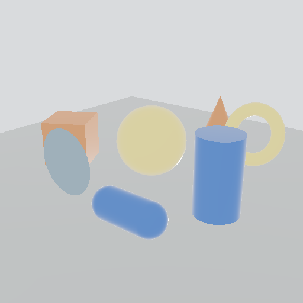 | 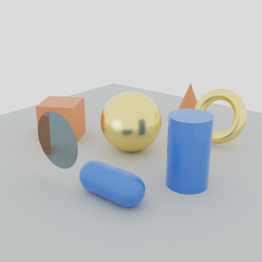 |

| Déplacement et masquage (sans rechargement) | Rayon, résolution et matériau modifiés |
|---|---|
| 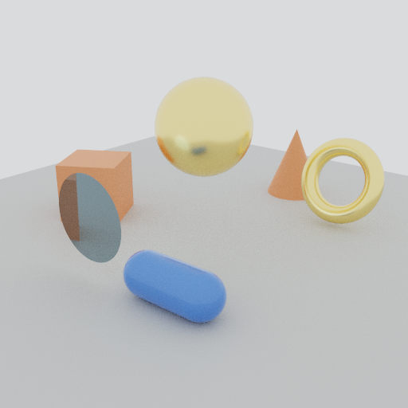 | 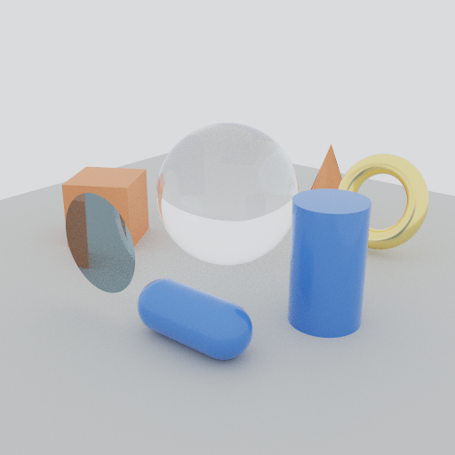 |

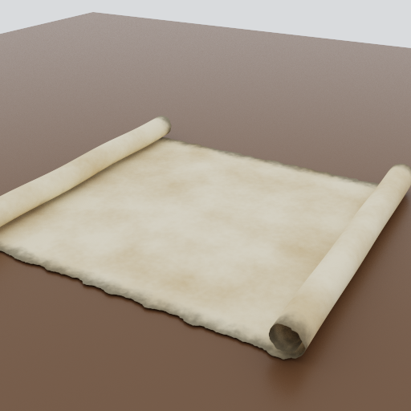

### Travaux réalisés

- **Primitives** (`src/scene/primitives.ts`) : `Sphere`, `Cube`, `Cylinder`,
  `Cone`, `Capsule`, `Torus`, `Plane`, `Disk`, triangulées avec normales lisses
  et coordonnées `st` (les tangentes en découlent dans `prepareMesh`), orientées
  selon `axis`. Les formes de révolution partagent un tour (profil tourné autour
  de l'axe) ; les triangles dégénérés des pôles et du sommet du cône sont omis et
  chaque triangle est orienté selon ses normales. `resolution` règle les
  segments (3 à 1024) ou les subdivisions par côté : un `Plane` subdivisé sert de
  grille pour le displacement.
- **Scripts** (`src/materialx/script-api.ts`, `script-scene.ts`) :
  `x = new Sphere()`, propriétés lues et écrites comme des entrées de nœud
  (dimensions, `resolution`, `axis`, `translate`, `rotate`, `scale`, `visible`,
  `material`), initialisation `new Cube({ … })`, `x.path`, `x.remove()`. Les
  primitives forment une couche USD en mémoire chargée par le chemin d'import
  en mémoire du viewer (`ScriptHost.loadStage`, `importUsdaLayer`). Les
  changements sont envoyés avant la commande suivante et en fin de script : un
  déplacement ou un masquage passe par `setTransform` / `setVisibility` sans
  rechargement ; toute autre modification reconstruit la scène en gardant la
  caméra.
- **Déformation** : `x.deform = (position, uv, normale) => [x, y, z]` déplace
  chaque sommet ; les normales sont recalculées (soudées par position).
  L'objet est alors écrit en `Mesh`. Ce déplacement en JavaScript précède le
  displacement procédural sur GPU de la priorité 9.
- **Export USD** : `save("scene.usda")` écrit la couche (gprims implicites ;
  tore, disque et objets déformés en `Mesh` avec `engine:primitive`) et un
  `<matériau>.mtlx` par matériau à côté. Le fichier se recharge avec `scene()`
  et donne les mêmes objets et matériaux.
- **Import des gprims implicites USD** (`Sphere`, `Cube`, `Cylinder`, `Cone`,
  `Capsule`, `Plane`) avec les valeurs par défaut UsdGeom et
  `engine:resolution` ([usd-import.md](usd-import.md)). Sans matériau, ils
  reçoivent un `standard_surface` coloré par `primvars:displayColor` : un
  maillage non lié n'était dessiné par aucun backend.
- **Éditeur** : complétion des classes après `new`, propriétés après `x.`,
  aide au survol, aides de valeur (curseurs, axe) sur les lignes
  `x.radius = …` ; `objects()` liste les primitives.

### Décisions

- **Une scène scriptée remplace la scène chargée.** Ajouter des primitives à
  une scène USD chargée par URL demanderait de composer une couche en mémoire
  avec des couches distantes soumises à la politique de racine d'assets ; ce
  n'est pas fait.
- **Pas de classe `Grid`** : la bibliothèque standard a un nœud `grid` (motif)
  qu'elle masquerait. Une grille est un `Plane` avec `resolution`.
- **Rotations écrites en `rotateZ`, `rotateY`, `rotateX` séparés** plutôt
  qu'en `rotateXYZ` : l'ordre est explicite dans tous les outils USD et la
  matrice est celle de `transform()`.
- **Matériau par défaut limité aux gprims et aux primitives écrites en
  `Mesh`** : les autres maillages non liés gardent leur comportement, pour ne
  pas modifier les scènes existantes.
- **Intersection analytique des sphères** dans le path tracer : non faite. La
  tessellation (48 segments) suffit en lookdev et garde un seul chemin de
  géométrie pour les deux backends.

## Priorité 9 : displacement procédural

Le déplacement prend en charge les cartes de hauteur et les graphes IR scalaires
ou vectoriels. Le bake CPU évalue les graphes, y compris textures et nœuds
procéduraux ; les horloges reliées au déplacement reconstruisent la géométrie sur
`setTime`. Une passe compute WebGPU traite les graphes compatibles avec textures 2D
8 bits au-delà de 4 096 sommets ; les petits maillages, UDIM, images haute précision
et entrées géométriques avancées restent sur CPU.

Pour `Plane`, `maxEdgeLength` adapte la grille à une longueur d'arête en espace
objet, et `maxScreenEdgeLength` l'adapte à une longueur projetée en pixels. Les
modes sont exclusifs et partagent `vertexBudget`. Le viewer recalcule la grille
après chargement, changement de caméra/projection ou de résolution, animation de
caméra et transformation d'objet. Le maillage est découpé contre le volume de
vue avant de mesurer les arêtes projetées, afin qu'une surface traversant le plan
de caméra n'épuise pas le budget. Les deux modes rejettent explicitement toute
demande qui dépasse leur budget.

Le critère est validé par un terrain animé uniquement par un graphe MaterialX
`displacementshader`, rendu en raster et en path tracing. Le script utilise le
mode caméra adaptatif :
[p9-terrain.js](../examples/scripts/p9-terrain.js).

| Terrain au temps initial | Terrain animé |
|---|---|
| 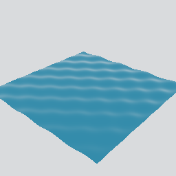 |  |


## Priorité 10 : documentation intégrée des nœuds MaterialX

Le workbench propose un panneau dockable et recherchable, alimenté par les
NodeDefs réellement chargées : signatures, entrées et valeurs par défaut,
sorties, variantes et descriptions (y compris les descriptions héritées).
L'attribution renvoie à la bibliothèque standard MaterialX sous licence
Apache-2.0. Chaque page indique les statuts raster/path tracing de
`conformance.md` et l'appartenance au corpus de
`materialx-node-coverage.md`, sans déclarer non pris en charge un nœud absent
de ces matrices.

Un exemple JavaScript est généré pour chaque NodeDef, avec des valeurs
représentatives pour les catégories courantes. Les exemples connectables
alimentent une sphère de prévisualisation ; les sorties sans connexion de
surface directe restent exécutables et affichent leur limite. Les vignettes
sont rendues à la demande dans un viewer temporaire indépendant de la scène
éditée. « Ouvrir dans l'éditeur » charge l'exemple sans l'exécuter.

F1 sur un nœud sélectionné dans les graphes de script et de matériau ouvre sa
page. Les complétions CodeMirror exposent les descriptions des NodeDefs et de
leurs entrées. Le test de référence exécute un exemple généré pour chaque
NodeDef de la bibliothèque standard installée.

Le script d'illustration est [p10-node-reference.js](../examples/scripts/p10-node-reference.js) ;
il apparaît automatiquement dans le menu Scripts.

| Matériau en raster | Matériau en path tracing |
|---|---|
| 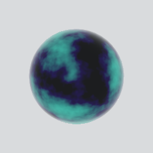 | 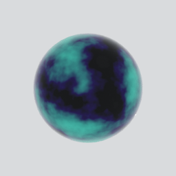 |

## Priorité 11 : aperçus par nœud et bibliothèque de matériaux

Chaque graphe de matériau lance en arrière-plan des captures raster basse
résolution, sérialisées dans un viewer isolé : chaque sortie est reconstruite
avec ses dépendances et connectée à une surface de présentation. Les vignettes
apparaissent dans les nœuds et le détail du nœud sélectionné offre un choix de
sortie pour les NodeDefs multi-sorties. Une édition invalide les captures et
relance la génération ; les types qu'il est impossible de raccorder à une
surface affichent une erreur explicite. La scène éditée n'est jamais modifiée
pour calculer un aperçu.

La bibliothèque conserve le catalogue MaterialX compilé local et fournit une
recherche, des favoris, des vignettes raster calculées à la demande dans le
viewer isolé et un glisser-déposer sur la zone de l'objet sélectionné. Les
sources distantes disponibles sont :

- **AmbientCG** : catalogue de l'API v3, téléchargement des archives 1K JPG et
  conversion en MaterialX avec les cartes couleur, rugosité et normale
  disponibles. L'API peut bloquer les requêtes cross-origin par CORS ; dans ce
  cas, la bibliothèque propose le site du fournisseur et l'import manuel de
  l'archive ZIP. La carte de déplacement et l'opacité ne sont pas importées.
- **Physically Based** : données JSON CC0 converties en `standard_surface`
  (couleur, métallicité, rugosité, couleur spéculaire et IOR).
- **GPUOpen MaterialX Library** : importer l'archive ZIP téléchargée sur le
  site, ou un `.mtlx` accompagné de ses textures sélectionnées. Les fichiers
  et textures sont résolus depuis le paquet et conservés dans le navigateur.

Les téléchargements distants requièrent un accès réseau et les règles CORS de
leur source ; les erreurs de catalogue, de téléchargement, de paquet et de
rendu sont affichées dans la bibliothèque. Les archives ZIP sont limitées à
64 Mio compressés et 128 Mio décompressés ; les formats ZIP64 et multi-disques
ne sont pas pris en charge. Les imports restent disponibles durant la session
du navigateur ; après rechargement, il faut les importer à nouveau. Les
favoris, eux, sont conservés localement.

Le script d'illustration est
[p11-material-previews.js](../examples/scripts/p11-material-previews.js) ;
il apparaît automatiquement dans le menu Scripts.

| Matériau en raster | Matériau en path tracing |
|---|---|
|  |  |

## Priorité 21 : étude du chargement des bibliothèques MaterialX sans WASM

L'étude et le prototype d'archive sont documentés dans
[dependencies.md](dependencies.md#library-archive-and-wasm-decision) ; le
benchmark reproductible est
[bench-materialx-library-archive.mjs](../scripts/bench-materialx-library-archive.mjs).

**Décision :** conserver MaterialX Core WASM en production. L'archive ZIP
préserve exactement les 28 documents standard et réduit leur taille locale de
881,881 à 86,518 octets, mais ne remplace ni leur parsing XML ni leur import.
Le Core reste également nécessaire pour résoudre et valider les documents de
scène MaterialX. Les mesures de parsing en mémoire n'indiquent pas de gain
significatif ; le bénéfice réseau d'une requête unique reste à mesurer dans le
navigateur avant d'adopter l'archive.

## Priorité 22 : build minimal de MaterialX Core WASM

Le runtime conserve uniquement les bindings Core et Format utilisés par le
moteur, tout en préservant la lecture XML avec XIncludes, l'import de
bibliothèques, la validation, la résolution des NodeDefs et implémentations,
les graphes, les valeurs typées et la libération déterministe des objets
Embind. La génération d'IR et de WGSL reste en TypeScript ; GenShader WASM
n'est pas ajouté.

Le build reproductible
([`build-materialx-core-minimal.mjs`](../scripts/build-materialx-core-minimal.mjs))
est épinglé à MaterialX 1.39.6 et utilise les bindings minimaux versionnés.
`npm run build` lance ce build isolé, suivi du packaging et de l'optimisation
`wasm-opt --all-features -Oz`. Le benchmark comparable
([`bench-materialx-core-build.mjs`](../scripts/bench-materialx-core-build.mjs))
mesure les deux builds après la même optimisation.

Sur l'environnement local, la paire JS/WASM réduite passe de 1,007,253 à
669,044 octets bruts et de 313,628 à 208,359 octets gzip (−33,6 % dans les
deux cas). Le WASM seul passe de 872,202 à 543,131 octets. La médiane de
démarrage Node passe de 56,5 à 16,7 ms (−70,4 %). Les sept suites ciblées
MaterialX et compilation graphe passent : 77 tests, notamment le chargement
WASM, les XIncludes, la résolution de graphes, les matériaux USD et la
compilation.

Les détails de l'inventaire, des tailles et de la méthode de benchmark sont
dans [dependencies.md](dependencies.md#core-wasm-minimum-build).

## Priorité 12 : environnement et post-traitement

La bibliothèque d'extension déclare deux types MaterialX sémantiques `shader` :
`engine_environment_shader` et `engine_image_shader`. `EnvironmentShader`
génère un ciel directionnel, un dégradé ou un éclairage studio, avec soleil,
exposition, orientation et vitesse d'animation. Il est cuit en image HDR
lat-long linéaire ; le raster et le path tracer utilisent la même image, et la
CDF d'importance sampling est reconstruite avec elle à chaque changement de
temps. La scène peut donc être éclairée sans fichier HDRI.

`ImageShader` applique exposition, contraste, saturation et vignettage en
coordonnées écran après la résolution raster ou l'affichage path tracing. La
passe intervient aussi pour les AOV et ne modifie pas l'accumulation. Le tone
mapping existant (`render.tonemap`) reste en amont. Les entrées des deux nœuds
acceptent des valeurs littérales ; les connexions vers d'autres nœuds et les
effets LUT/bloom ne sont pas encore pris en charge.

Le script d'illustration est
[p12-environment-postprocess.js](../examples/scripts/p12-environment-postprocess.js) ;
il apparaît automatiquement dans le menu Scripts.

| Éclairage procédural en raster | Éclairage et étalonnage en path tracing |
|---|---|
| 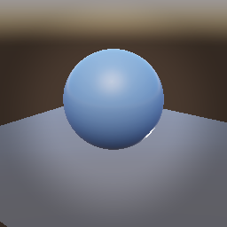 | 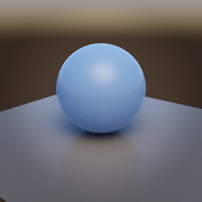 |

## Priorité 13 : baking et export de scènes

Le baker CPU produit les cartes de base, rugosité, métal, normale et hauteur,
réutilisant l'interpréteur IR et le résolveur de textures. Pour les exports de
scène, les triangles sont rasterisés dans l'espace UV ; position, normale et
tangente sont interpolées depuis le maillage, et les textures sont cuites par
instance pour tenir compte des différences de géométrie et d'espace objet.
Les images non résolues et les valeurs non finies sont signalées explicitement.

Le graphe du matériau exporte un paquet MaterialX autonome. Le GLB embarque les
cartes PBR et la géométrie visible. L'export USD est un ZIP avec scène USDA
hiérarchique, attributs de scène, caméras, lumières, géométrie triangulée à la
pose courante et documents MaterialX référencés par les matériaux USD. Les
sorties numériques courantes des nœuds (`float`, `integer`, `boolean`, `color3`
et `vector3`) sont prévisualisées comme des images UV planes non déformées ; les
autres types gardent le rendu raster existant.

Les limites restantes et l'usage des exports sont détaillés dans
[BAKING_EXPORT.md](BAKING_EXPORT.md).

Le script d'illustration est
[p13-baked-material.js](../examples/scripts/p13-baked-material.js) ; il apparaît
automatiquement dans le menu Scripts.

| Matériau en raster | Matériau en path tracing |
|---|---|
|  | 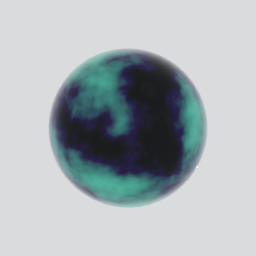 |

## Priorité 14 : lookdev et projets

La comparaison A/B rend les deux variantes du même objet à pleine résolution,
avec la même caméra et le même éclairage, puis permet de déplacer le séparateur
sur une vue commune. Les préréglages studio, extérieur et dégradé produisent des
environnements HDR procéduraux (pas des HDRI photographiques). Le turntable
capture un PNG ou une séquence ZIP en path tracing, pour un objet tournant sur
place ou une lumière orbitant autour de l'origine.

L'historique global conserve jusqu'à 100 commandes et couvre les modifications
éditables de matériaux, transformations, visibilités, lumières et réglages de
rendu décrits dans [SCRIPTING.md](SCRIPTING.md). Il reste distinct de l'historique
texte de CodeMirror ; les opérations continues ou non restaurables sont exclues
et documentées.

Le projet versionné `.mxproject` restaure en un seul fichier une scène de
primitives produite par script, ses matériaux MaterialX intégrés et modifiés,
le script éditable, la caméra, le temps et les réglages de rendu. L'import
valide le contenu avant restauration. Pour éviter une sauvegarde incomplète,
les scènes USD/glTF externes, textures et dépendances externes de script sont
explicitement refusées ou signalées ; le détail du périmètre est dans
[SCRIPTING.md](SCRIPTING.md).

Le script d'illustration est
[p14-lookdev-project.js](../examples/scripts/p14-lookdev-project.js) ; il apparaît
automatiquement dans le menu Scripts.

| Comparaison de matériaux en raster | Comparaison de matériaux en path tracing |
|---|---|
| 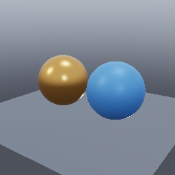 | 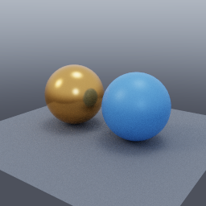 |

## Priorité 15 : opérations booléennes

`Union`, `Difference` et `Intersection` construisent des maillages à partir
d'opérandes fermés, avec `manifold-3d` chargé en WASM. Les arbres booléens sont
créés et imbriqués dans les scripts avec les propriétés `base` et `tool` ; les
opérandes sont masqués dans la scène et leurs transformations sont prises en
compte. Les maillages produits conservent leurs UV et leurs normales, y compris
sur les surfaces issues d'une soustraction. Les entrées ouvertes, les
références invalides et les cycles déclenchent des diagnostics explicites.

Le script d'illustration
[p15-boolean-operations.js](../examples/scripts/p15-boolean-operations.js)
présente les trois opérations et apparaît automatiquement dans le menu Scripts.

| Union, différence et intersection en raster | Opérations booléennes en path tracing |
|---|---|
| 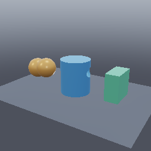 | 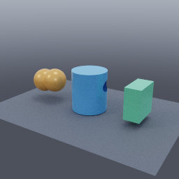 |
