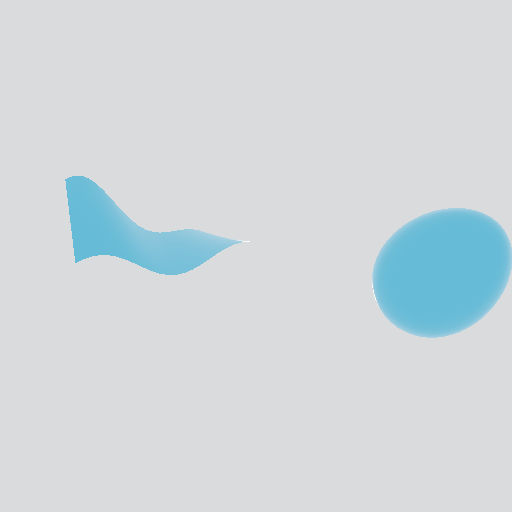

# Pistes d'évolution du moteur

Le moteur sait déjà charger des scènes USD variées, compiler des graphes
MaterialX multi-matériaux, rendre avec des backends raster et path tracing, et
valider la fidélité des BSDF sur GPU. Les prochaines évolutions doivent donc
prioriser la transformation de ce socle technique en outil de rendu complet,
mesurable, réutilisable et extensible.

Les priorités 1 (rendu progressif), 2 (API de bibliothèque), 3 (éditeur de
matériaux MaterialX), 3bis (scripting), 4 (accélération du path tracer), 5
(scènes dynamiques), 6 (volumes et effets avancés), 7 (robustesse,
portabilité et exploitation), 8 (primitives et scènes par script), 9
(displacement procédural), 10 (documentation intégrée des nœuds), 11
(aperçus par nœud et bibliothèque de matériaux), 12 (environnement et
post-traitement), 13 (baking et export de scènes), 14 (lookdev et projets),
15 (opérations booléennes), 16 (shaders d'extension) et 17 (surfaces complexes),
ainsi que l'étude urgente de la priorité 21 (chargement des bibliothèques
MaterialX sans WASM), la priorité 22 (build minimal du Core WASM) et l'étude de
la priorité 25 (graphe de scène équivalent au script) et la priorité 23
(paramètres de shaders déclarés par script) sont traitées ; leur
historique est dans
[ROADMAP_DONE.md](ROADMAP_DONE.md). Les limites connues sont recensées dans
[INTEGRATION.md](INTEGRATION.md#limites-connues).

Les priorités suivantes visent à passer d'un moteur de rendu MaterialX à un
outil de création : construire des scènes, explorer et documenter les nœuds,
étendre MaterialX à de nouveaux types de shaders, exporter le résultat et
continuer à optimiser le runtime livré au navigateur.

Pour les animations restituer un fichier vidéo et non pas une série d'images.

## Priorité 18 : déformation volumique de surfaces complexes

Déformer une surface (primitive, maillage importé, surface complexe de la
priorité 17) par un champ défini dans l'espace plutôt que sommet par sommet,
pour plier, tordre ou faire onduler des objets entiers et les animer :

- **déformeurs paramétriques** : courbure (bend), torsion (twist), effilement
  (taper), cisaillement, vague, sphérisation, chacun avec son axe, sa zone
  d'influence et une atténuation ;
- **déformation par treillis (FFD)** : une grille de points de contrôle
  englobe l'objet ; déplacer ces points déforme tout ce qui est à l'intérieur
  (interpolation de Bézier ou B-spline) ;
- **champs volumiques** : déplacement lu dans un bruit 3D, un graphe MaterialX
  évalué en 3D (`vector3` en fonction de la position) ou une grille NanoVDB de
  vitesses, avec intégration sur plusieurs pas pour suivre un écoulement ;
- **pile de déformeurs** non destructive, appliquée dans l'ordre, partagée par
  plusieurs objets (un même champ de vent courbe tous les brins d'herbe) ;
- évaluation sur GPU (passe compute, comme le displacement procédural de la
  priorité 9), normales et tangentes recalculées, BVH reconstruit ou réajusté
  à chaque image ;
- animation par l'entrée `time` et par les paramètres des déformeurs, avec flou
  de mouvement (positions aux bornes de l'obturateur) ;
- script dans le style objet :
  `bend = new Bend(); bend.angle = 90; bend.axis = "Y"; flag.deformers = [bend, wind];` ;
- export USD : géométrie déformée écrite en `Mesh` (avec échantillons
  temporels si animée), paramètres des déformeurs en attributs `engine:`.

**Critère d'aboutissement :** un drapeau ondulant au vent (champ de bruit), un
ruban tordu (twist) et un objet importé déformé par treillis sont animés en
temps réel en raster, rendus avec flou de mouvement en path tracing, et
exportés en USD.

**En cours :** une première pile CPU partageable sur les primitives scriptées
propose les déformeurs paramétriques, un vent 3D, des champs MaterialX et NanoVDB et un treillis de Bézier pour
les primitives et les maillages USDA statiques importés, exportés en USD avec
leurs paramètres et échantillons temporels. L'exemple
[p18-deformers.js](../examples/scripts/p18-deformers.js) est disponible dans
le menu Scripts. [p18-animated-wind.js](../examples/scripts/p18-animated-wind.js)
produit la [vidéo raster du drapeau](images/p18/p18-animated-wind.mp4), sa
[vidéo avec flou](images/p18/p18-animated-wind-blur.mp4) et son
[USD](images/p18/p18-animated-wind.usda).
[p18-animated-ribbon.js](../examples/scripts/p18-animated-ribbon.js) produit
la [vidéo raster du ruban](images/p18/p18-animated-ribbon.mp4), sa
[vidéo avec flou](images/p18/p18-animated-ribbon-blur.mp4) et son
[USD](images/p18/p18-animated-ribbon.usda).
[p18-imported-lattice.js](../examples/scripts/p18-imported-lattice.js) produit
une [vidéo raster](images/p18/p18-imported-lattice.mp4), une
[vidéo path tracing avec flou](images/p18/p18-imported-lattice-blur.mp4) et un
[USD](images/p18/p18-imported-lattice.usda) du maillage importé.
[p18-materialx-field.js](../examples/scripts/p18-materialx-field.js) produit
une [vidéo](images/p18/p18-materialx-field.mp4) et un
[USD](images/p18/p18-materialx-field.usda) du champ MaterialX animé.
L'exemple [p18-nanovdb-field.js](../examples/scripts/p18-nanovdb-field.js)
produit une [vidéo](images/p18/p18-nanovdb-field.mp4) et un
[USD](images/p18/p18-nanovdb-field.usda) d'un champ de vitesses NanoVDB.
Le support d'autres formats et des attributs USD complexes et le calcul GPU
restent à réaliser.

Sur la machine de développement, `node scripts/bench-p18.mjs` mesure 24 mises à
jour des USD exportés à 512 × 512 (`setTime`, `render(1)`, puis attente de la
file GPU déjà soumise). Les temps au 95e percentile observés sont 35,3 ms pour
le drapeau, 33,5 ms pour le ruban et 20,2 ms pour le treillis importé. Cette
mesure courte porte sur des géométries précuites, dépend du matériel et de la
charge, et ne garantit pas que l'image suivant le rappel ait déjà été soumise :
elle ne démontre ni l'évaluation GPU des piles ni le temps réel.

## Priorité 19 : rendu distribué multi-serveur et multi-GPU

WebGPU n'expose qu'un adaptateur par page : le multi-GPU passe par un processus
par GPU. Le serveur de rendu distant ([REMOTE_RENDER.md](REMOTE_RENDER.md)) lance
déjà Chrome headless sur un GPU choisi ; un coordinateur répartit le travail
entre plusieurs de ces nœuds, sur une ou plusieurs machines :

- **coordinateur** : liste de nœuds (URL, jeton, GPU), découverte de leurs
  capacités (`capabilities()`), mesure de leur débit, retrait d'un nœud
  défaillant sans perdre le rendu ;
- **path tracing par échantillons** : chaque nœud accumule la même image avec
  une graine différente ; le coordinateur somme les accumulations pondérées par
  leur nombre d'échantillons. Robuste à des GPU de vitesses différentes (une
  T500 et un iGPU contribuent chacun à leur rythme) et compatible avec la
  convergence et l'arrêt sur cible de bruit (variance combinée) ;
- **répartition par tuiles** en option pour les très hautes résolutions
  (mémoire par nœud), avec rééquilibrage des tuiles selon le débit mesuré ;
- **animations par images** : chaque nœud rend des images entières de la
  timeline, le coordinateur assemble la séquence ;
- **transfert en flottant** : accumulations HDR (somme des radiances, moments
  pour la variance, nombre d'échantillons) au lieu des images WebP actuelles,
  compressées ; débruitage et tonemapping faits une seule fois sur l'image
  combinée ;
- **même scène partout** : le script et ses ressources sont envoyés à chaque
  nœud ; empreinte de scène vérifiée pour refuser un nœud qui n'a pas les mêmes
  assets ou la même version du moteur ;
- **multi-GPU local** : plusieurs nœuds sur une même machine, chacun forcé sur
  un adaptateur (`--gpu high-performance|low-power`) ;
- viewer : progression par nœud (échantillons, débit, état), image combinée
  affichée au fil de l'eau ; script : `render.nodes = ["https://…", …]` ou
  configuration du coordinateur ;
- banc de mesure : accélération obtenue avec 1, 2 et 4 nœuds, et surcoût de
  transfert.

**Critère d'aboutissement :** une image path tracée converge plus vite avec deux
nœuds qu'avec un seul (gain mesuré, hétérogénéité des GPU comprise), sans biais
par rapport au rendu d'un nœud unique (`--bias-check`), et une séquence animée
est répartie image par image.

## Priorité 20 : systèmes de particules animés

Compléter le scatter shader de la priorité 16, qui répartit des instances sur
une surface, par des systèmes évoluant dans le temps :

- émission continue ou par impulsion, durée de vie, vitesse, taille et couleur
  initiales, avec graine déterministe pour des rendus reproductibles ;
- forces configurables : gravité, vent et turbulence procédurale, avec
  collisions simples contre le sol et les objets de la scène ;
- simulation sur GPU, intégrée à la timeline des scènes dynamiques ; historique
  des positions pour le flou de mouvement en path tracing ;
- rendu en points, sprites orientés caméra ou instances de géométrie, avec
  matériau MaterialX par système (émission pour les étincelles, transmission
  pour les gouttes) ;
- presets scriptables, notamment chute d'eau (gouttes et embruns), étincelles
  avec traînées, pluie et neige ; le preset de feu de la priorité 17 peut
  réutiliser ce système pour ses braises.

**Critère d'aboutissement :** une chute d'eau et une gerbe d'étincelles animées
s'obtiennent par script, restent reproductibles à graine fixée et se rendent
en raster comme en path tracing, avec flou de mouvement en path tracing.

## Priorité 21 : création et rendu de poils et de cheveux

Ajouter un système de mèches générées sur une surface, adapté au pelage comme
aux cheveux :

- création scriptable et par graphe à partir d'une surface émettrice, avec
  densité, longueur, épaisseur, orientation, graine et matériau MaterialX ;
- contrôles de peignage, courbure, ondulation et regroupement des mèches, avec
  limites explicites pour garder une géométrie et un temps de rendu maîtrisés ;
- représentation partagée et compacte, sans créer un objet indépendant par
  poil, consommable par les chemins raster et path tracing ;
- statut documenté pour les courbes, les ombres, la transparence et les
  backends, ainsi que des scripts d'exemple pour un pelage court et une coiffure.

**Critère d'aboutissement :** un script et un graphe produisent un pelage et une
coiffure reproductibles à graine fixée ; les deux se rendent avec ombres en
raster et en path tracing, sans explosion du nombre d'objets de scène.

## Priorité 26 : sélection, édition et mouvements de caméra

- Sélectionner les caméras présentes dans la scène et enregistrer des vues
  nommées pour passer rapidement d'un cadrage à l'autre.
- Piloter la vue par orbite, panoramique et déplacement avant/arrière, avec
  recentrage sur la sélection et commandes de réinitialisation.
- Modifier les paramètres de caméra (projection, focale ou champ de vision,
  plans de clipping, cible et profondeur de champ lorsque le backend le permet).
- Créer des mouvements et transitions reproductibles entre des poses ou vues
  nommées ; permettre leur lecture, leur arrêt et leur édition sur la timeline.
- Inclure les modifications de caméra dans l'annuler/rétablir, les projets et
  l'API de script. Garder la même caméra pour les rendus raster et path tracing.
- Coordonner l'export des séquences avec la priorité 24, sans redéfinir ici le
  format vidéo ou la stratégie de rendu hors ligne.

**Critère d'aboutissement :** enregistrer deux vues, passer de l'une à l'autre,
créer et relire un mouvement de caméra, puis annuler/rétablir et sauvegarder/
rouvrir le projet sans dérive de cadrage entre les backends.

## Priorité 27 : déploiement Azure du rendu distribué

Déployer le rendu multi-serveur de la priorité 19 sur Azure, en distinguant
l'aperçu interactif des rendus hors ligne :

- **validation GPU** : tester Chrome headless et WebGPU sur une VM GPU Azure,
  vérifier l'adaptateur effectivement utilisé, les pilotes, la mémoire et le
  rendu ; comparer Windows et Linux avant de choisir une image de worker ;
- **prototype interactif** : démarrer avec une puis deux VM GPU Spot et un
  coordinateur sans GPU, hébergé indépendamment des workers ; mesurer le temps
  de démarrage, la progression et le gain par rapport à un seul nœud ;
- **montée en charge** : étudier Azure Virtual Machine Scale Sets pour gérer
  les workers interactifs et leur disponibilité ; ajouter une capacité à la
  demande si une progression plus prévisible est nécessaire, sous réserve de
  disponibilité et de quota ;
- **rendu hors ligne** : évaluer Azure Batch avec un pool de VM GPU Spot pour
  les images d'animation et les blocs de rendu indépendants ; prévoir si
  nécessaire un socle de VM dédiées et le redimensionnement du pool ;
- **reprise et stockage** : conserver scènes, ressources, résultats et
  checkpoints dans un stockage durable ; reprendre les tâches interrompues
  sans compter deux fois leurs contributions. Les VM Spot peuvent être
  évincées ou indisponibles et le checkpoint reste à la charge de l'application ;
- **sécurité et exploitation** : authentifier les utilisateurs, isoler les
  workers et leurs accès réseau, limiter les ressources des scripts, protéger
  les secrets, superviser les jobs et prévoir l'arrêt des ressources inutilisées ;
- **coûts et capacité** : comparer le coût par image terminée et les délais
  avec Spot et à la demande, en incluant démarrage, compilation, stockage et
  travail perdu ; vérifier les quotas GPU et la capacité par région et SKU.

Le coordinateur, les accumulations HDR, la fusion et la distribution du rendu
relèvent de la priorité 19 ; ce chantier valide leur déploiement et leur
exploitation sur Azure, sans supposer que Batch remplace le coordinateur.

**Critère d'aboutissement :** un rendu interactif progresse sur deux workers
GPU Azure et une courte séquence est distribuée sur Azure Batch ; une
interruption Spot est reprise sans résultat perdu ni contribution comptée deux
fois. Les mesures documentent le gain, le coût par image, les délais de
démarrage et la fidélité par rapport au rendu sur un seul nœud.

## Priorité 28 : écarts avec l'implémentation officielle de MaterialX

Documenter précisément ce que le moteur conserve, étend, approxime ou ne prend
pas en charge par rapport à MaterialX officiel, pour éviter de confondre un
document `.mtlx` valide avec un matériau portable et un rendu fidèle :

- **référence explicite** : préciser la version de la spécification, des
  bibliothèques standard et des générateurs de shaders officiels utilisés pour
  la comparaison ; distinguer conformité du document, résolution des
  `nodedef`/`nodegraph` et équivalence du rendu ;
- **matrice de compatibilité** : recenser nœuds, types, entrées, valeurs par
  défaut, espaces géométriques, unités, espaces colorimétriques, textures et
  closures ; qualifier chaque cas comme conforme, partiel, approximé,
  non pris en charge ou extension, séparément pour raster, path tracing
  MaterialX, Disney et évaluation CPU/baking ;
- **extensions du moteur** : inventorier les nœuds et types ajoutés, notamment
  les shaders d'environnement, de caméra/lentille, d'image/AOV, les filtres de
  lumière/gobos, le scatter et les préréglages de surfaces complexes ;
  distinguer les graphes composés de nœuds standard des catégories ou
  sémantiques propres au moteur, ainsi que l'API JavaScript et les attributs
  USD `engine:` qui ne font pas partie de MaterialX ;
- **interopérabilité et export** : expliquer ce qui reste utilisable dans un
  outil MaterialX externe, ce qui exige les définitions d'extension, ce qui
  peut être développé en graphes standard ou baké, et ce qui ne dispose
  d'aucun équivalent ; ne pas présenter le baking comme une équivalence
  procédurale ou animée ;
- **écarts vérifiés** : associer chaque écart à sa source officielle, au code
  concerné, à son effet visible et aux tests disponibles ; documenter les
  rejets explicites et les éventuels replis, sans déduire la fidélité d'une
  simple compilation réussie ;
- **livrables** : un guide comparatif central relié à
  [INTEGRATION.md](INTEGRATION.md) et à
  [SCRIPT_REFERENCE.md](SCRIPT_REFERENCE.md), une matrice consultable et de
  petits exemples comparant un graphe standard, une extension exportable et
  une fonctionnalité propre au moteur ;
- **maintenance** : mettre à jour cette documentation lors d'un ajout
  d'extension, d'un changement de sémantique ou d'une mise à jour de la
  bibliothèque officielle ; séparer les limites actuelles des travaux prévus.

**Critère d'aboutissement :** pour un matériau donné, la documentation permet
de déterminer ses dépendances au moteur, les différences selon le backend et
la stratégie d'export vers un outil MaterialX officiel. Les écarts sont sourcés
et illustrés par des cas reproductibles, sans annoncer une conformité globale
non démontrée.

## Pistes exploratoires

- **Shaders implicites / SDF** (métaboules, fractales, booléens lisses) :
  spectaculaires, mais limités au path tracer et hors du BVH.
- **Shaders NPR / toon** (ombrage cel, contours) : raster uniquement, hors du
  cœur physique du moteur.
- **Ménage de `docs/`** : fusionner ou archiver les rapports intermédiaires
  `VOLUMESHADER_*`.

## Ordre recommandé

1. Displacement procédural (9), puis surfaces complexes (17) qui en sont la
   première application visible, puis déformation volumique (18), qui
   réutilise la passe compute du displacement.
2. Documentation des nœuds (10), qui profite des primitives (8) pour ses vignettes.
3. Environnement et post-traitement (12), à faible risque d'architecture.
4. Baking (13), qui alimente les aperçus et la bibliothèque (11).
5. Lookdev et projets (14), puis opérations booléennes (15).
6. Surfaces complexes (17), puis systèmes de particules (20) pour les effets
   animés comme les gouttes et les braises.
7. Création de poils et cheveux (21), après le scatter et les particules, pour
   réutiliser leurs surfaces émettrices, graines et instances.
8. Rendu distribué (19), dès que les scènes de la priorité 17 rendent le path
   tracing trop long sur un seul GPU.
9. Étude du format vidéo de transport des rendus (24), après les scènes
    dynamiques (5) et l'export des rendus (13).
10. Sélection, édition et mouvements de caméra (26), après le lookdev et les
    projets (14), les scènes dynamiques (5) et l'étude de format vidéo (24).
11. Déploiement Azure du rendu distribué (27), après le socle multi-serveur
    (19) ; la validation d'une VM GPU peut commencer dès maintenant.
12. Écarts avec MaterialX officiel (28), à mener en parallèle des shaders
    d'extension (16) et des surfaces complexes (17), puis à maintenir avec
    chaque évolution du compilateur et des exports.
