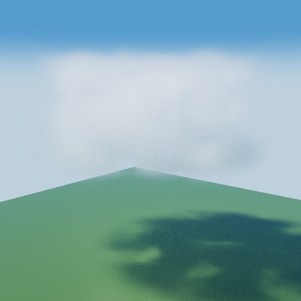
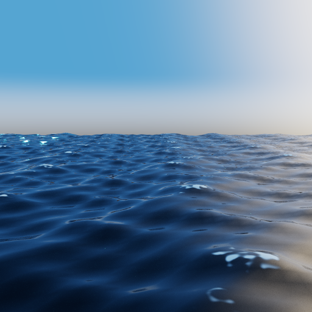
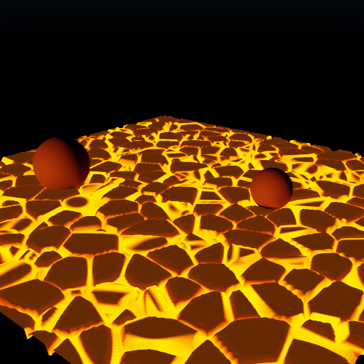
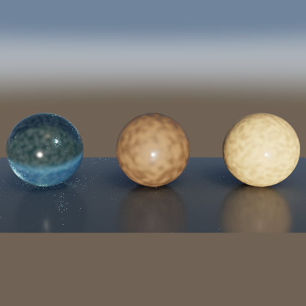

# Pistes d'évolution du moteur

Le moteur sait déjà charger des scènes USD variées, compiler des graphes
MaterialX multi-matériaux, rendre avec des backends raster et path tracing, et
valider la fidélité des BSDF sur GPU. Les prochaines évolutions doivent donc
prioriser la transformation de ce socle technique en outil de rendu complet,
mesurable, réutilisable et extensible.

Les priorités 1 (rendu progressif), 2 (API de bibliothèque), 3 (éditeur de
matériaux MaterialX), 3bis (scripting), 4 (accélération du path tracer), 5
(scènes dynamiques), 6 (volumes et effets avancés), 7 (robustesse,
portabilité et exploitation), 8 (primitives et scènes par script), 9
(displacement procédural), 10 (documentation intégrée des nœuds), 11
(aperçus par nœud et bibliothèque de matériaux), 12 (environnement et
post-traitement), 13 (baking et export de scènes), 14 (lookdev et projets),
15 (opérations booléennes) et 16 (shaders d'extension), ainsi que l'étude
urgente de la priorité 21 (chargement des bibliothèques MaterialX sans WASM)
et la priorité 22 (build minimal du Core WASM) sont traitées ; leur historique est dans
[ROADMAP_DONE.md](ROADMAP_DONE.md). Les limites connues sont recensées dans
[INTEGRATION.md](INTEGRATION.md#limites-connues).

Les priorités suivantes visent à passer d'un moteur de rendu MaterialX à un
outil de création : construire des scènes, explorer et documenter les nœuds,
étendre MaterialX à de nouveaux types de shaders, exporter le résultat et
continuer à optimiser le runtime livré au navigateur.

## Priorité 17 : surfaces complexes (eau, lave, feu, fumée, nuages, …)

Des surfaces « vivantes » prêtes à l'emploi, construites uniquement avec les
briques précédentes (primitives 2D, displacement procédural animé, volumes,
émission) et livrées comme matériaux MaterialX paramétrables :

- **eau** : houle et vagues procédurales (somme d'ondes de Gerstner ou spectre
  de bruit) en displacement animé, normales de détail, transmission et IOR,
  absorption volumique par profondeur, écume selon la pente ou la crête ;
- **lave** : croûte sombre fissurée (Worley/Voronoi), émission par température
  (corps noir) dans les fissures, écoulement animé par advection de bruit,
  displacement de la croûte ;
- **feu** : flammes en volume émissif borné par une primitive (cône ou
  capsule), densité et température tirées d'un bruit 3D advecté vers le haut et
  atténué avec la hauteur, émission par corps noir (cœur bleu-blanc, pointes
  orangées), surmontées de fumée (ci-dessous) ; éclairage de la scène par
  le feu en path tracing (volume émissif échantillonné, scintillement animé) et
  repli raster en lumière ponctuelle teintée ; braises en particules (`Points`)
  émissives optionnelles ;
- **fumée** : volume diffusant et absorbant (albédo élevé, fumée claire de bois ;
  albédo faible, fumée noire d'incendie) borné par une primitive ou un panache ;
  densité tirée d'un bruit fractal 3D advecté vers le haut, qui s'élargit, se
  dilue et se disperse avec la hauteur et le vent ; anisotropie de diffusion
  (Henyey-Greenstein) pour le contre-jour ; variante colorée (fumigène) ;
  ombres portées et diffusion multiple en path tracing, passe volume en raster ;
  source libre ou attachée à un feu, à une cheminée ou à de la lave ;
- **nuages** : volumes à très forte diffusion (albédo proche de 1) en couche
  d'altitude ou en nuages isolés bornés par des primitives ; forme par bruit de
  Perlin-Worley à plusieurs échelles érodé sur les bords, profil vertical par
  type (cumulus à base plate et sommet bourgeonnant, stratus en nappe, cirrus
  fibreux), couverture et densité réglables ; diffusion multiple
  approchée (lobes avant/arrière, assombrissement « powder » sur les bords) et
  liseré argenté en contre-jour ; ombres portées sur le sol, éclairage par le
  ciel de la priorité 12 ; dérive animée par le vent ; repli raster par
  marche de rayons à pas réduit ;
- autres préréglages : glace (diffusion sous-surfacique, inclusions), boue ou
  sable mouillé (mélange selon un masque d'humidité) ;
- chaque surface expose quelques paramètres de haut niveau (vitesse, échelle,
  couleur, intensité) plutôt que tout le graphe, en `nodegraph` réutilisable ;
- script : `water = new Water(); water.speed = 0.5; pool.material = water;` ;
- éclairage cohérent : la lave éclaire la scène en path tracing (émission
  échantillonnée), l'eau réfracte et caustiques au path tracer ;
- vérification raster/path tracing et rendus golden pour chaque préréglage.

**Critère d'aboutissement :** une scène « plan d'eau », une scène « coulée de
lave », un « feu de camp », un panache de fumée et un ciel de cumulus
s'obtiennent en quelques lignes de script, animés et sans texture externe ; le
feu éclaire la scène, sa fumée et les nuages projettent des ombres en path
tracing.

**Avancement et choix de précision :** les huit préréglages disposent de graphes
procéduraux, d'exemples et d'animations ; les horloges des volumes reconstruisent
effectivement leurs champs. Le feu éclaire maintenant les surfaces par
échantillonnage de sa véritable émission volumique, sans lumière ponctuelle en
path tracing. L'estimateur est vérifié contre l'atténuation Beer-Lambert et la
décroissance géométrique ; les grilles émissives sont échantillonnées par
importance. Les nuages utilisent la diffusion multiple HG plutôt qu'un
assombrissement artificiel de leur densité. La flamme actuelle est une flamme
de suie orange/jaune ; le cœur bleu chimique n'est pas simulé.

La comparaison des nuages a aussi révélé un éclairage inadapté au PT : une
lumière ponctuelle proche servait de soleil et blanchissait la diffusion
multiple. Les exemples utilisent maintenant un `DistantLight` à rayons
parallèles, un ciel diffus sans second soleil, 1 024 échantillons et une
profondeur de 24 sur ordinateur. L'exposition n'est pas modifiée.

| Raster : diffusion simple | PT : diffusion multiple et ombre volumique sur le sol |
|---|---|
|  |  |

**Passe de réalisme (path tracing) :** les rendus les plus visibles ont été
revus à 512 px avec 256 à 768 échantillons.

- **Eau** : cinq vagues directionnelles dispersives (les longues vont plus vite)
  à crêtes aiguisées remplacent la somme de deux sinus ; l'écume est la crête
  rompue par un bruit animé (traînées plutôt que taches blanches). L'exemple est
  une mer au large : grand plan, caméra rasante, soleil latéral, fond
  absorbant. Le reflet de Fresnel du ciel et les éclats solaires viennent du
  path tracer.
- **Lave** : la température du corps noir et l'émission décroissent du centre
  des fissures (jaune-orangé) vers leurs bords (rouge sombre) avec une
  modulation de bruit animée ; fissures plus fines, plaques plus grandes et
  relief réduit.
- **Glace** : la double comptabilisation sous-surface + transmission, source du
  bruit chromatique, est supprimée. La glace est un diélectrique clair
  (IOR 1,31) avec des inclusions blanchâtres diffuses.
- **Boue et sable** : seule la lumière de l'exemple était trop forte pour les
  unités actuelles (intensité 45 au lieu de 6) ; les matériaux sont inchangés.

| Eau | Lave | Glace, boue, sable mouillé |
|---|---|---|
|  |  |  |

**Baking des volumes procéduraux :** le path tracer évalue maintenant les
grilles 64³ avec un compute shader WGSL généré depuis l'IR MaterialX, puis
rapatrie les coefficients pour calculer le majorant et la CDF d'émission. Cela
évite les plus de 100 s mesurées pour un baking 64³ par l'interpréteur CPU.
L'évaluation CPU reste la référence et le repli pour les volumes alimentés par
des champs USD ; les rendus P17 devront encore être régénérés et vérifiés
visuellement avec cette résolution accrue.

La priorité reste **en cours** : la superposition de milieux, la convergence
des caustiques physiques de l'eau, la finesse des volumes (ci-dessus) et
l'acceptation visuelle de tous les profils de nuages restent à résoudre ou à
vérifier. Les captures de documentation ne
remplacent pas les tests golden. Les petites scènes de régression P17 sont
régénérables avec `npx vite-node scripts/build-p17-golden-fixtures.ts` et
utilisent uniquement les graphes exportés, sans texture externe.

## Priorité 18 : déformation volumique de surfaces complexes

Déformer une surface (primitive, maillage importé, surface complexe de la
priorité 17) par un champ défini dans l'espace plutôt que sommet par sommet,
pour plier, tordre ou faire onduler des objets entiers et les animer :

- **déformeurs paramétriques** : courbure (bend), torsion (twist), effilement
  (taper), cisaillement, vague, sphérisation, chacun avec son axe, sa zone
  d'influence et une atténuation ;
- **déformation par treillis (FFD)** : une grille de points de contrôle
  englobe l'objet ; déplacer ces points déforme tout ce qui est à l'intérieur
  (interpolation de Bézier ou B-spline) ;
- **champs volumiques** : déplacement lu dans un bruit 3D, un graphe MaterialX
  évalué en 3D (`vector3` en fonction de la position) ou une grille NanoVDB de
  vitesses, avec intégration sur plusieurs pas pour suivre un écoulement ;
- **pile de déformeurs** non destructive, appliquée dans l'ordre, partagée par
  plusieurs objets (un même champ de vent courbe tous les brins d'herbe) ;
- évaluation sur GPU (passe compute, comme le displacement procédural de la
  priorité 9), normales et tangentes recalculées, BVH reconstruit ou réajusté
  à chaque image ;
- animation par l'entrée `time` et par les paramètres des déformeurs, avec flou
  de mouvement (positions aux bornes de l'obturateur) ;
- script dans le style objet :
  `bend = new Bend(); bend.angle = 90; bend.axis = "Y"; flag.deformers = [bend, wind];` ;
- export USD : géométrie déformée écrite en `Mesh` (avec échantillons
  temporels si animée), paramètres des déformeurs en attributs `engine:`.

**Critère d'aboutissement :** un drapeau ondulant au vent (champ de bruit), un
ruban tordu (twist) et un objet importé déformé par treillis sont animés en
temps réel en raster, rendus avec flou de mouvement en path tracing, et
exportés en USD.

## Priorité 19 : rendu distribué multi-serveur et multi-GPU

WebGPU n'expose qu'un adaptateur par page : le multi-GPU passe par un processus
par GPU. Le serveur de rendu distant ([REMOTE_RENDER.md](REMOTE_RENDER.md)) lance
déjà Chrome headless sur un GPU choisi ; un coordinateur répartit le travail
entre plusieurs de ces nœuds, sur une ou plusieurs machines :

- **coordinateur** : liste de nœuds (URL, jeton, GPU), découverte de leurs
  capacités (`capabilities()`), mesure de leur débit, retrait d'un nœud
  défaillant sans perdre le rendu ;
- **path tracing par échantillons** : chaque nœud accumule la même image avec
  une graine différente ; le coordinateur somme les accumulations pondérées par
  leur nombre d'échantillons. Robuste à des GPU de vitesses différentes (une
  T500 et un iGPU contribuent chacun à leur rythme) et compatible avec la
  convergence et l'arrêt sur cible de bruit (variance combinée) ;
- **répartition par tuiles** en option pour les très hautes résolutions
  (mémoire par nœud), avec rééquilibrage des tuiles selon le débit mesuré ;
- **animations par images** : chaque nœud rend des images entières de la
  timeline, le coordinateur assemble la séquence ;
- **transfert en flottant** : accumulations HDR (somme des radiances, moments
  pour la variance, nombre d'échantillons) au lieu des images WebP actuelles,
  compressées ; débruitage et tonemapping faits une seule fois sur l'image
  combinée ;
- **même scène partout** : le script et ses ressources sont envoyés à chaque
  nœud ; empreinte de scène vérifiée pour refuser un nœud qui n'a pas les mêmes
  assets ou la même version du moteur ;
- **multi-GPU local** : plusieurs nœuds sur une même machine, chacun forcé sur
  un adaptateur (`--gpu high-performance|low-power`) ;
- viewer : progression par nœud (échantillons, débit, état), image combinée
  affichée au fil de l'eau ; script : `render.nodes = ["https://…", …]` ou
  configuration du coordinateur ;
- banc de mesure : accélération obtenue avec 1, 2 et 4 nœuds, et surcoût de
  transfert.

**Critère d'aboutissement :** une image path tracée converge plus vite avec deux
nœuds qu'avec un seul (gain mesuré, hétérogénéité des GPU comprise), sans biais
par rapport au rendu d'un nœud unique (`--bias-check`), et une séquence animée
est répartie image par image.

## Priorité 20 : systèmes de particules animés

Compléter le scatter shader de la priorité 16, qui répartit des instances sur
une surface, par des systèmes évoluant dans le temps :

- émission continue ou par impulsion, durée de vie, vitesse, taille et couleur
  initiales, avec graine déterministe pour des rendus reproductibles ;
- forces configurables : gravité, vent et turbulence procédurale, avec
  collisions simples contre le sol et les objets de la scène ;
- simulation sur GPU, intégrée à la timeline des scènes dynamiques ; historique
  des positions pour le flou de mouvement en path tracing ;
- rendu en points, sprites orientés caméra ou instances de géométrie, avec
  matériau MaterialX par système (émission pour les étincelles, transmission
  pour les gouttes) ;
- presets scriptables, notamment chute d'eau (gouttes et embruns), étincelles
  avec traînées, pluie et neige ; le preset de feu de la priorité 17 peut
  réutiliser ce système pour ses braises.

**Critère d'aboutissement :** une chute d'eau et une gerbe d'étincelles animées
s'obtiennent par script, restent reproductibles à graine fixée et se rendent
en raster comme en path tracing, avec flou de mouvement en path tracing.

## Priorité 21 : création et rendu de poils et de cheveux

Ajouter un système de mèches générées sur une surface, adapté au pelage comme
aux cheveux :

- création scriptable et par graphe à partir d'une surface émettrice, avec
  densité, longueur, épaisseur, orientation, graine et matériau MaterialX ;
- contrôles de peignage, courbure, ondulation et regroupement des mèches, avec
  limites explicites pour garder une géométrie et un temps de rendu maîtrisés ;
- représentation partagée et compacte, sans créer un objet indépendant par
  poil, consommable par les chemins raster et path tracing ;
- statut documenté pour les courbes, les ombres, la transparence et les
  backends, ainsi que des scripts d'exemple pour un pelage court et une coiffure.

**Critère d'aboutissement :** un script et un graphe produisent un pelage et une
coiffure reproductibles à graine fixée ; les deux se rendent avec ombres en
raster et en path tracing, sans explosion du nombre d'objets de scène.

## Priorité 23 : paramètres de shaders déclarés par script

Permettre à un script de marquer explicitement les entrées de n'importe quel
shader comme modifiables depuis l'UI. L'éditeur expose uniquement les entrées
déclarées, conserve leurs types et valeurs et applique les modifications au
matériau sans réexécuter le script entier.

**Critère d'aboutissement :** un même script expose des paramètres d'un shader
de surface et d'un autre type de shader ; seuls les paramètres marqués apparaissent
dans l'UI et leurs modifications sont visibles dans le rendu.

## Priorité 24 : étude de l'enregistrement des animations

Étudier l'export d'une animation rendue à partir de la timeline de scène, en
comparant une séquence d'images et un fichier vidéo. Examiner la capture en temps
réel et le rendu hors ligne, la cadence et la plage temporelle, la résolution,
la stabilité du path tracing, ainsi que l'export de la caméra et des changements
de matériaux/transforms. Recommander un format et un flux d'utilisation adaptés
au navigateur et au script API ; cette priorité est une étude, sans imposer
d'avance un format de sortie.

**Critère d'aboutissement :** un prototype capture une courte animation
reproductible ; les mesures et la recommandation justifient le format retenu,
les compromis de qualité/performance et les commandes nécessaires à une future
intégration UI/script.

## Priorité 25 : étude d'un graphe de scène équivalent au script

Étudier un graphe visuel représentant les mêmes opérations que l'API de script,
sans réduire la scène à un graphe de matériaux :

- **rendu** : nœuds pour le backend, la résolution, la qualité, le rendu, la
  capture et l'enregistrement, avec des entrées/sorties explicites ;
- **objets** : nœuds de géométrie et de scène (création ou référence d'objet,
  transformation, visibilité), comportant des sous-nœuds `surface`,
  `displacement` et, à terme, les autres terminaux de shader ;
- **partage** : un même nœud de surface, déplacement ou autre shader peut être
  connecté à plusieurs objets ; modifier le nœud partagé met à jour tous ses
  utilisateurs sans dupliquer le graphe ;
- **équivalence avec les scripts** : comparer la création et l'exécution des
  graphes avec l'API existante, et étudier la conversion dans les deux sens,
  les expressions/structures difficiles à représenter, l'animation et le
  diagnostic des erreurs ;
- **architecture et UX** : préciser les types de ports, les références aux
  objets et matériaux, la gestion des cycles et des dépendances, le regroupement
  des sous-graphes, ainsi que l'intégration aux éditeurs de script et de
  matériaux existants.

Cette priorité est une étude : choisir un modèle de graphe et un flux de travail
avant de généraliser l'interface ou de remplacer le script.

**Critère d'aboutissement :** une recommandation argumentée et un prototype
minimal montrent le même rendu obtenu par script et par graphe, avec une surface
et un déplacement partagés entre au moins deux objets.

## Priorité 26 : sélection, édition et mouvements de caméra

- Sélectionner les caméras présentes dans la scène et enregistrer des vues
  nommées pour passer rapidement d'un cadrage à l'autre.
- Piloter la vue par orbite, panoramique et déplacement avant/arrière, avec
  recentrage sur la sélection et commandes de réinitialisation.
- Modifier les paramètres de caméra (projection, focale ou champ de vision,
  plans de clipping, cible et profondeur de champ lorsque le backend le permet).
- Créer des mouvements et transitions reproductibles entre des poses ou vues
  nommées ; permettre leur lecture, leur arrêt et leur édition sur la timeline.
- Inclure les modifications de caméra dans l'annuler/rétablir, les projets et
  l'API de script. Garder la même caméra pour les rendus raster et path tracing.
- Coordonner l'export des séquences avec la priorité 24, sans redéfinir ici le
  format vidéo ou la stratégie de rendu hors ligne.

**Critère d'aboutissement :** enregistrer deux vues, passer de l'une à l'autre,
créer et relire un mouvement de caméra, puis annuler/rétablir et sauvegarder/
rouvrir le projet sans dérive de cadrage entre les backends.

## Priorité 27 : déploiement Azure du rendu distribué

Déployer le rendu multi-serveur de la priorité 19 sur Azure, en distinguant
l'aperçu interactif des rendus hors ligne :

- **validation GPU** : tester Chrome headless et WebGPU sur une VM GPU Azure,
  vérifier l'adaptateur effectivement utilisé, les pilotes, la mémoire et le
  rendu ; comparer Windows et Linux avant de choisir une image de worker ;
- **prototype interactif** : démarrer avec une puis deux VM GPU Spot et un
  coordinateur sans GPU, hébergé indépendamment des workers ; mesurer le temps
  de démarrage, la progression et le gain par rapport à un seul nœud ;
- **montée en charge** : étudier Azure Virtual Machine Scale Sets pour gérer
  les workers interactifs et leur disponibilité ; ajouter une capacité à la
  demande si une progression plus prévisible est nécessaire, sous réserve de
  disponibilité et de quota ;
- **rendu hors ligne** : évaluer Azure Batch avec un pool de VM GPU Spot pour
  les images d'animation et les blocs de rendu indépendants ; prévoir si
  nécessaire un socle de VM dédiées et le redimensionnement du pool ;
- **reprise et stockage** : conserver scènes, ressources, résultats et
  checkpoints dans un stockage durable ; reprendre les tâches interrompues
  sans compter deux fois leurs contributions. Les VM Spot peuvent être
  évincées ou indisponibles et le checkpoint reste à la charge de l'application ;
- **sécurité et exploitation** : authentifier les utilisateurs, isoler les
  workers et leurs accès réseau, limiter les ressources des scripts, protéger
  les secrets, superviser les jobs et prévoir l'arrêt des ressources inutilisées ;
- **coûts et capacité** : comparer le coût par image terminée et les délais
  avec Spot et à la demande, en incluant démarrage, compilation, stockage et
  travail perdu ; vérifier les quotas GPU et la capacité par région et SKU.

Le coordinateur, les accumulations HDR, la fusion et la distribution du rendu
relèvent de la priorité 19 ; ce chantier valide leur déploiement et leur
exploitation sur Azure, sans supposer que Batch remplace le coordinateur.

**Critère d'aboutissement :** un rendu interactif progresse sur deux workers
GPU Azure et une courte séquence est distribuée sur Azure Batch ; une
interruption Spot est reprise sans résultat perdu ni contribution comptée deux
fois. Les mesures documentent le gain, le coût par image, les délais de
démarrage et la fidélité par rapport au rendu sur un seul nœud.

## Priorité 28 : écarts avec l'implémentation officielle de MaterialX

Documenter précisément ce que le moteur conserve, étend, approxime ou ne prend
pas en charge par rapport à MaterialX officiel, pour éviter de confondre un
document `.mtlx` valide avec un matériau portable et un rendu fidèle :

- **référence explicite** : préciser la version de la spécification, des
  bibliothèques standard et des générateurs de shaders officiels utilisés pour
  la comparaison ; distinguer conformité du document, résolution des
  `nodedef`/`nodegraph` et équivalence du rendu ;
- **matrice de compatibilité** : recenser nœuds, types, entrées, valeurs par
  défaut, espaces géométriques, unités, espaces colorimétriques, textures et
  closures ; qualifier chaque cas comme conforme, partiel, approximé,
  non pris en charge ou extension, séparément pour raster, path tracing
  MaterialX, Disney et évaluation CPU/baking ;
- **extensions du moteur** : inventorier les nœuds et types ajoutés, notamment
  les shaders d'environnement, de caméra/lentille, d'image/AOV, les filtres de
  lumière/gobos, le scatter et les préréglages de surfaces complexes ;
  distinguer les graphes composés de nœuds standard des catégories ou
  sémantiques propres au moteur, ainsi que l'API JavaScript et les attributs
  USD `engine:` qui ne font pas partie de MaterialX ;
- **interopérabilité et export** : expliquer ce qui reste utilisable dans un
  outil MaterialX externe, ce qui exige les définitions d'extension, ce qui
  peut être développé en graphes standard ou baké, et ce qui ne dispose
  d'aucun équivalent ; ne pas présenter le baking comme une équivalence
  procédurale ou animée ;
- **écarts vérifiés** : associer chaque écart à sa source officielle, au code
  concerné, à son effet visible et aux tests disponibles ; documenter les
  rejets explicites et les éventuels replis, sans déduire la fidélité d'une
  simple compilation réussie ;
- **livrables** : un guide comparatif central relié à
  [INTEGRATION.md](INTEGRATION.md) et à
  [SCRIPT_REFERENCE.md](SCRIPT_REFERENCE.md), une matrice consultable et de
  petits exemples comparant un graphe standard, une extension exportable et
  une fonctionnalité propre au moteur ;
- **maintenance** : mettre à jour cette documentation lors d'un ajout
  d'extension, d'un changement de sémantique ou d'une mise à jour de la
  bibliothèque officielle ; séparer les limites actuelles des travaux prévus.

**Critère d'aboutissement :** pour un matériau donné, la documentation permet
de déterminer ses dépendances au moteur, les différences selon le backend et
la stratégie d'export vers un outil MaterialX officiel. Les écarts sont sourcés
et illustrés par des cas reproductibles, sans annoncer une conformité globale
non démontrée.

## Pistes exploratoires

- **Shaders implicites / SDF** (métaboules, fractales, booléens lisses) :
  spectaculaires, mais limités au path tracer et hors du BVH.
- **Shaders NPR / toon** (ombrage cel, contours) : raster uniquement, hors du
  cœur physique du moteur.
- **Ménage de `docs/`** : fusionner ou archiver les rapports intermédiaires
  `VOLUMESHADER_*`.

## Ordre recommandé

1. Displacement procédural (9), puis surfaces complexes (17) qui en sont la
   première application visible, puis déformation volumique (18), qui
   réutilise la passe compute du displacement.
2. Documentation des nœuds (10), qui profite des primitives (8) pour ses vignettes.
3. Environnement et post-traitement (12), à faible risque d'architecture.
4. Baking (13), qui alimente les aperçus et la bibliothèque (11).
5. Lookdev et projets (14), puis opérations booléennes (15).
6. Surfaces complexes (17), puis systèmes de particules (20) pour les effets
   animés comme les gouttes et les braises.
7. Création de poils et cheveux (21), après le scatter et les particules, pour
   réutiliser leurs surfaces émettrices, graines et instances.
8. Rendu distribué (19), dès que les scènes de la priorité 17 rendent le path
   tracing trop long sur un seul GPU.
9. Paramètres de shaders déclarés par script (23), en prolongement de l'API de
   scripting (3bis) et de l'édition de paramètres.
10. Étude de l'enregistrement des animations (24), après les scènes dynamiques
   (5) et l'export des rendus (13).
11. Étude du graphe de scène équivalent au script (25), en prolongement du
    scripting (3bis), des primitives (8) et des paramètres de shaders (23).
12. Sélection, édition et mouvements de caméra (26), après le lookdev et les
    projets (14), les scènes dynamiques (5) et l'étude d'enregistrement (24).
12. Déploiement Azure du rendu distribué (27), après le socle multi-serveur
    (19) ; la validation d'une VM GPU peut commencer dès maintenant.
13. Écarts avec MaterialX officiel (28), à mener en parallèle des shaders
    d'extension (16) et des surfaces complexes (17), puis à maintenir avec
    chaque évolution du compilateur et des exports.
