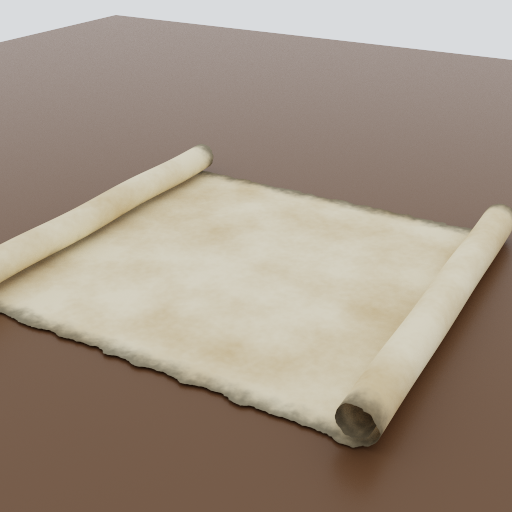

# Scripts de matériaux MaterialX

Le viewer permet de créer un matériau MaterialX avec un script JavaScript
minimal. Ouvrir l'éditeur avec l'icône **Script** de la barre latérale ou la
touche **F2**. Comme la vue, les contrôles de rendu (F3) et le graphe du matériau,
c'est un panneau ancrable : on le déplace par son onglet (bords, onglets d'un autre
panneau), on le redimensionne avec les séparateurs, et les boutons de son en-tête le
réduisent (il se rouvre depuis la barre latérale), le détachent en fenêtre flottante ou
l'agrandissent. La disposition est conservée d'une visite à l'autre.

La liste complète des commandes, avec leurs arguments et valeurs de retour, est dans
[SCRIPT_REFERENCE.md](SCRIPT_REFERENCE.md).

## Enregistrer et rouvrir un projet

Après exécution d'un script qui crée des primitives, **Enregistrer projet**
télécharge un fichier JSON versionné `.mxproject`. **Ouvrir projet** restaure
sans réexécuter le script son texte éditable, la scène et ses matériaux
MaterialX incorporés, leurs modifications de graphe et de paramètres, les
transformations, visibilités et lumières modifiées, le temps, la caméra, la
résolution et les réglages de rendu, y compris environnement et post-traitement
procéduraux. Le moteur et ses bibliothèques MaterialX standard restent nécessaires.

La scène courante doit être une scène de primitives créée par script. Les scènes
externes USD/glTF, les textures, inclusions MaterialX, couches USD externes,
matériaux compilés et sélections de variantes USD ne sont pas pris en charge :
la sauvegarde affiche une erreur au lieu de créer un projet incomplet.
Le texte du script est conservé tel quel : ses éventuelles dépendances externes
ne sont pas incorporées pour une **réexécution**, qui peut nécessiter ces fichiers.
Les instantanés A/B, captures turntable, historique et échantillons accumulés ne
font pas partie du projet. Une erreur d'ouverture est affichée ; si elle se
produit pendant la reconstruction, recharger la scène précédente manuellement.

## Annuler / rétablir

Les boutons **Annuler** et **Rétablir** du panneau Rendu interactif conservent
jusqu'à 100 commandes en mémoire. Ils couvrent les modifications des paramètres
et graphes de matériaux éditables (y compris l'application de A/B), les
transformations, visibilités et lumières modifiées par script, ainsi que les
contrôles de rendu : moteur, qualité raster, environnement et préréglages,
débruitage, échantillonnage adaptatif, AOV, limites, exposition, tonemapping,
pause et historique temporel. Un nouveau changement après annulation efface
la branche à rétablir. Une modification de matériau dont le graphe ne peut pas
être capturé est refusée avec une erreur.

Cet historique ne comprend pas le texte du script (Ctrl+Z reste celui de
CodeMirror), les déplacements de caméra, la résolution, la profondeur, le
temps ou la lecture d'animation, les variantes USD, les changements de scène
ou d'assignation de matériau, ni les captures, comparaisons ou échantillons
accumulés. Le chargement d'une scène ou d'un projet, une assignation, un
changement de variante, de résolution, profondeur ou temps, le démarrage de
l'animation, les réglages de rendu/environnement/post-traitement par script et
la perte du GPU effacent l'historique pour éviter des restaurations incohérentes.
Une pause ou reprise du rendu déclenchée par le script efface aussi l'historique.
Le déplacement interactif de la caméra n'est pas enregistré ; une caméra
changée par script efface l'historique. Ces commandes ne sont pas sauvegardées
dans le projet. Si une opération ou une restauration échoue, l'erreur est
affichée et l'historique est vidé : l'opération peut avoir partiellement modifié
la scène et doit alors être vérifiée manuellement.

## Éclairage et comparaison A/B

Dans **Rendu interactif**, le menu Éclairage propose des environnements HDR
procéduraux studio, extérieur et dégradé ; ce ne sont pas des HDRI
photographiques. « Environnement de la scène » revient à l'environnement
importé. Le choix d'un préréglage active Envmap et remplace l'environnement
procédural précédemment activé par script ; les lumières de la scène restent
actives.

Dans le graphe du matériau d'un objet, enregistrer A et B puis ouvrir
« Comparer les rendus A/B » produit deux instantanés à la résolution de rendu.
Le curseur sépare A et B sur la même vue ; relancer la comparaison après une
modification de scène ou de caméra. Le path tracing accepte de 1 à 64
échantillons par pixel.

## Turntable et capture

Dans **Rendu interactif**, choisir **Path tracing**, puis ouvrir **Turntable /
capture**. Sélectionner un objet ou une lumière de la scène, l'angle initial,
le nombre d'images et les échantillons par image. « Capturer une image »
télécharge un PNG à l'angle choisi ; « Capturer la séquence » télécharge un ZIP
de PNG numérotés sur un tour complet, sans répéter la première image. La
résolution et le cadrage sont ceux du viewer ; la vue path tracing sélectionnée
est capturée. La rotation s'effectue autour de Y mondial : l'objet tourne autour
de son origine et la lumière autour de l'origine du monde.
Les dômes d'environnement ne sont pas proposés comme lumières turntable.

La progression et les erreurs apparaissent dans le panneau. **Annuler la
capture** interrompt le travail entre lots GPU ; aucune séquence partielle n'est
téléchargée. Les transformations et les réglages de lumière préexistants sont
restaurés même en cas d'erreur ou d'annulation. La lecture de l'animation est
mise en pause ; relancez-la manuellement. La subdivision adaptative reste celle
de la scène avant la capture ; elle est recalculée après restauration.

## Syntaxe

```js
img = new Image();               // créer un nœud : variable = new <Nœud>()
img.file = "textures/wood.jpg";  // valeur d'une entrée
surface = new StandardSurface();
surface.base_color = img.out;    // connexion : entrée = nœud.sortie
surface.specular_roughness = 0.3;
```

- Le nom de la variable devient le nom du nœud MaterialX (`img`, `surface`).
  `const`/`let`/`var` sont acceptés et ignorés (sauf dans l'en-tête d'une
  boucle `for`).
- Les classes sont les catégories MaterialX en PascalCase :
  `standard_surface` → `StandardSurface`, `fractal3d` → `Fractal3d`,
  `surfacematerial` → `Surfacematerial`.
- Valeurs : nombres, booléens, chaînes et tableaux (`[0.8, 0.2, 0.1]`). Un
  nombre affecté à une couleur ou un vecteur est répété sur chaque composante.
- `noeud.out` (ou une autre sortie, ex. `sep.outr`) connecte une sortie ; un
  nœud à sortie unique peut être affecté directement (`m.fg = img`).
- `noeud.colorspace = "srgb_texture"` fixe l'espace colorimétrique du nœud ;
  l'export l'écrit sur ses entrées `filename`, là où le moteur le lit.
- Sans `Surfacematerial`, l'export ajoute un `surfacematerial` nommé
  `material` relié au dernier shader de surface.
- Les NodeDefs `EnvironmentShader` et `ImageShader` sont des terminaux
  MaterialX dédiés ; ils ne sont pas convertis en matériau de surface. Activez-les
  avec `await environment(shader.out)` et `await postprocess(shader.out)`.
- Le reste du langage JavaScript reste disponible (boucles, fonctions, `await`).

## Nœuds résolus à l'instanciation

Aucun nœud n'est codé en dur : `new Image()` cherche, au moment de son
exécution, les `<nodedef>` de catégorie `image` dans les bibliothèques
MaterialX servies sous `/materialx/libraries` (stdlib, pbrlib, cmlib, bxdf).
Les entrées (type, valeur par défaut, `enum`, bornes UI) et les sorties
viennent du NodeDef choisi ; l'héritage (`inherit`) et la version par défaut
sont pris en compte.

Pour un nœud polymorphe, la variante par défaut est la sortie `color3`, puis
`float`, `vector3`... avec le nom de NodeDef le plus simple. Un argument
choisit une autre variante :

```js
noise = new Fractal3d("float");             // type de sortie
blend = new Mix("ND_mix_color3_color3");    // nom de NodeDef
```

Chaque affectation est vérifiée : entrée inconnue, type de valeur incorrect ou
connexion entre types différents produisent une erreur avec la ligne fautive.

## Expressions mathématiques

Les opérateurs et les fonctions `Math` appliqués à une sortie de nœud
construisent les nœuds MaterialX correspondants ; sur des nombres ou des
tableaux, ils calculent normalement (composante par composante pour les
tableaux).

```js
n = new Fractal3d("float");
rough = Math.abs(n.out) * 0.4 + 0.1;   // absval, multiply, add
tint = [1, 0.5, 0] * n.out;            // multiply color3 × float (ND_multiply_color3FA)
wave = Math.sin(n.out * 10);           // multiply, sin
```

| Script | Nœud |
|---|---|
| `+ - * / % **` | `add`, `subtract`, `multiply`, `divide`, `modulo`, `power` |
| `-x` | `multiply` par -1 |
| `Math.sin cos tan asin acos atan2` | `sin`, `cos`, `tan`, `asin`, `acos`, `atan2` |
| `Math.abs floor ceil round sqrt exp log sign` | `absval`, `floor`, `ceil`, `round`, `sqrt`, `exp`, `ln`, `sign` |
| `Math.pow min max` | `power`, `min`, `max` |

La variante est choisie d'après les types : une couleur multipliée par un
`float` utilise la variante `…FA` ; à défaut, l'ordre des opérandes est échangé
pour les opérations commutatives, ou un nœud `convert` est inséré. Le nœud
prend le nom de la variable qui reçoit le résultat (`rough`).

## Conditions

MaterialX n'a ni boucle ni branchement : un graphe calcule une valeur par
pixel. Les boucles et `if` du script s'exécutent donc **à la construction** du
graphe (une boucle peut créer plusieurs nœuds). Une condition sur une sortie de
nœud, évaluée par pixel, s'écrit avec `? :` et devient un nœud de sélection :

```js
veins = n.out > 0.05 ? [0.92, 0.88, 0.82] : [0.18, 0.12, 0.1];  // ifgreater
band = n.out > 0.3 && !(n.out > 0.8) ? 1 : 0;                   // ifgreater, not, and, ifequal
```

- `a > b ? x : y` → `ifgreater(value1=a, value2=b, in1=x, in2=y)` ; `<` échange
  `value1`/`value2` ; `>=`/`<=` → `ifgreatereq` ; `==` → `ifequal` ; `!=`
  échange les branches.
- `&&`, `||`, `!` sur des comparaisons → nœuds booléens `and`, `or`, `not` ;
  une condition booléenne sélectionne via `ifequal` (variante `…B`).
- Sans sortie de nœud, `? :`, `&&` et `||` gardent leur comportement JavaScript
  (une seule branche évaluée).
- `if (n.out > 0.5)` est refusé : la valeur n'est connue qu'au rendu.

## Piloter le viewer

Un script peut charger une scène, régler le rendu, affecter des matériaux et
lancer le rendu. Ces opérations s'exécutent avec **Appliquer** ; la validation
en direct les vérifie sans les exécuter.

```js
await scene("./scenes/standard-shader-ball/standard-shader-ball.usda");
render.backend = "pathtracing";
render.depth = 6;

surface = new StandardSurface();
surface.base_color = [0.8, 0.1, 0.1];
for (const object of objects()) await assign(object, surface);

wood = await load("./scenes/mtlx-library/…/wood.mtlx");   // matériau chargé, modifiable
await assign("/World/Floor", wood);
await render(64);                                          // attend 64 échantillons
```

| Fonction | Effet |
|---|---|
| `await scene(chemin)` | Charge une scène (USD, glTF) |
| `objects()` | Chemins des objets de la scène |
| `render.<paramètre> = valeur` | Paramètres de rendu (tableau suivant) |
| `await assign(objet, matériau)` | Affecte un shader de surface ou un `surfacematerial` du script (avec les nœuds en amont), ou un fichier `.mtlx` |
| `await load(chemin)` | Ajoute au script les nœuds d'un document `.mtlx` et retourne son matériau |
| `await render(n)` | Relance le rendu ; avec `n`, attend `n` échantillons du path tracer (ou son arrêt sur convergence ou budget de temps) |
| `await save("rendu.png")` | Enregistre le rendu affiché en PNG |
| `await save("aov.pfm")` | Enregistre l'AOV path tracing sélectionné (`render.view`) en PFM 32 bits |
| `await save("diagnostics.json")` | Enregistre le journal des diagnostics |
| `await save("materiau.mtlx", matériau)` | Enregistre le document MaterialX d'un matériau du script |
| `await save("scene.usda")` | Enregistre la scène des primitives du script et ses documents MaterialX |
| `log(…)`, `check(condition, "message")` | Message ; vérification qui arrête le script si la condition est fausse |

Les shaders d'extension de la priorité 12 s'emploient dans les deux backends :

```js
sky = new EnvironmentShader();
sky.model = "sky";                 // "gradient", "sky" ou "studio"
sky.animationSpeed = 18;           // rotation en degrés par unité de temps
await environment(sky.out);        // carte HDR + CDF utilisées par le path tracer

grade = new ImageShader();
grade.contrast = 1.08;
grade.saturation = 0.92;
grade.vignette = 0.28;
await postprocess(grade.out);      // après le rendu, aussi pour les AOV
```

Le shader d'image agit après le tone mapping intégré (`render.tonemap`) et ne modifie
pas l'accumulation path tracing. Les paramètres des deux terminaux sont actuellement
des valeurs littérales ; les connexions depuis d'autres nœuds ne sont pas encore évaluées.

| Paramètre `render.` | Valeurs |
|---|---|
| `backend` | `"raster"`, `"pathtracing"`, `"disney"` |
| `resolution` | 128, 256, 512, 1024, `"1024x768"` |
| `depth` | profondeur du path tracing, 0–64 |
| `quality` | qualité raster : `"interactive"`, `"reference"` |
| `environment`, `denoise` | booléens |
| `exposure`, `tonemap` | EV ; `"none"`, `"reinhard"`, `"acesFilmic"` (sans perte d'échantillons) |
| `view` | `"beauty"`, `"albedo"`, `"normal"`, `"depth"`, `"variance"`, `"emission"`, `"transmission"` |
| `adaptive` | échantillonnage adaptatif |
| `noiseTarget` | cible de bruit relative, 0,005–0,25 |
| `stopOnConvergence`, `timeBudget` | arrêt automatique à la cible ; budget de temps actif en secondes (0 : illimité) |
| `paused`, `compare` | pause ; comparaison brut/débruité (en pause, débruitage actif) |
| `temporalHistory` | échantillons gardés après un changement dynamique (0 : relance) |
| `memoryBudget` | budget mémoire GPU en Mio (0 : sans budget, textures et path tracer rétablis) |

Rendu progressif, scènes dynamiques et exploitation :

| Fonction | Effet |
|---|---|
| `stats()` | `{ backend, drawnBy, fallback, pathTracer, samples, adaptive, paused, elapsed, stopReason, samplesPerSecond, noise, maxNoise, variance, remaining, budgetRemaining, time, warnings, gpuMemory }` |
| `await converge(secondes)` | Attend l'arrêt du path tracer (`stopOnConvergence` ou `timeBudget` requis) |
| `await capture("x.png", { samples, shutter: [ouverture, fermeture], steps })` | Rendu path tracing de `samples` échantillons enregistré ; avec `shutter`, flou de mouvement sur l'intervalle |
| `timeline()`, `time()`, `await setTime(t)` | Intervalle `{ start, end, fps }` d'une scène animée ; instant courant ; évaluation à un instant |
| `transform({ translate, rotate, scale })` | Matrice 4×4 (rotations X, Y puis Z en degrés) |
| `setTransform(objet, matrice)`, `setVisibility(objet, visible)` | Déplace, masque ou affiche un objet ; sans valeur, rétablit celle de la scène |
| `lights()`, `setLight(lumière, { intensity, exposure, color, transform })` | Lumières ; modification (sans valeur : rétablie) |
| `setCamera({ eye, target, fov })` | Place la caméra (champ vertical en degrés) |
| `variants()`, `await setVariant(prim, set, variante)` | Variant sets ; sélection (recomposition) |
| `materialParameters(objet)`, `await setMaterialParameters(objet, { id: valeur })` | Paramètres en uniformes, modifiés sans recompilation |
| `capabilities()`, `diagnostics()` | Adaptateur, limites, support par backend et `mobile` (GPU mobile détecté) ; journal `{ level, code, message }` |

Les actions (`setTime`, `setTransform`, `setLight`...) s'exécutent dans l'ordre du script :
`await` est facultatif, mais une erreur non attendue arrête le script à la prochaine
synchronisation. `check` est ignorée par la validation en direct de l'éditeur, qui ne charge
pas les scènes ; les requêtes de scène (`objects()`, `lights()`...) y répondent comme pour une
scène vide après un `scene()`.

Dans le viewer, `save` télécharge le fichier. En ligne de commande, il l'écrit
dans le dossier `--out` :

```bash
npm run script -- mon-script.js|dossier [autre.js ...] --out sortie [--xml materiau.mtlx] [--timeout ms] [--gpu high-performance|low-power|default] [--headed]
```

Le script s'exécute dans Chrome/Edge avec WebGPU (`MX_CHROME` désigne
l'exécutable) devant un serveur Vite local ; `--xml` écrit aussi le matériau du
script. Avec plusieurs scripts, chacun s'exécute dans une page neuve et écrit
dans `sortie/<nom du script>` ; la commande échoue si l'un d'eux échoue. `--gpu`
choisit l'adaptateur : le GPU dédié par défaut, comme `npm run bench:engine`. Sur la
machine de mesure, le path tracing y est 4,5 à 8 fois plus rapide que sur l'iGPU Intel.

Un script qui n'utilise aucune de ces fonctions garde le comportement simple :
**Appliquer** affecte son matériau à l'objet sélectionné.

Le volet **Rendu distant** de l'éditeur exécute le script sur un serveur GPU et
affiche son rendu au fil de la progression : voir [REMOTE_RENDER.md](REMOTE_RENDER.md).

## Créer une scène de primitives

Sans fichier USD, un script construit sa scène avec des primitives (`Sphere`, `Cube`,
`Cylinder`, `Cone`, `Capsule`, `Torus`, `Plane`, `Disk`) qu'il modifie comme des nœuds :

```js
paper = new StandardSurface();
paper.base_color = [0.87, 0.76, 0.55];

sheet = new Plane({ width: 2.4, length: 1.5, resolution: 240, material: paper });
// Enroule les extrémités : chaque sommet est déplacé, les normales sont recalculées.
sheet.deform = (p, uv, n) => Math.abs(p[0]) < 0.72 ? p : [Math.sign(p[0]) * 0.72, 0.1, p[2]];
ball = new Sphere();
ball.radius = 0.3;
ball.translate = [0, 0.3, 0];

await render(64);
ball.translate = [0, 0.8, 0];      // déplacé sans recharger la scène
await render(64);
await save("scene.usda");          // couche USD et documents MaterialX
```

Les primitives forment une scène USD en mémoire qui remplace la scène chargée. Elle est
reconstruite quand une forme, un matériau ou une déformation change, et seulement déplacée
quand `translate`, `rotate`, `scale` ou `visible` changent. `save("….usda")` l'écrit avec un
document `.mtlx` par matériau ; le fichier se recharge ensuite avec `scene(...)` comme une scène
ordinaire. La [référence](SCRIPT_REFERENCE.md#primitives-scène-par-script) liste les classes et
leurs propriétés.



## Scripts de validation des priorités

[examples/scripts](../examples/scripts) contient un script par priorité de
[ROADMAP_DONE.md](ROADMAP_DONE.md), sur des scènes exigeantes. Chacun enregistre
ses images et vérifie par `check` les comportements mesurables (arrêt sur
convergence, réduction des textures, repli raster...) :

| Script | Contenu |
|---|---|
| `p1-progressive-rendering.js` | 17 lumières rectangulaires : convergence uniforme et adaptative à 8 %, budget de temps, six AOV en PNG et PFM, comparaison brut/débruité, exposition et tonemapping |
| `p2-library-api.js` | Shader ball : six matériaux de la bibliothèque × trois backends × deux résolutions, captures déterministes |
| `p3-material-editing.js` | Marbre procédural profond (bruits imbriqués, conditions par pixel), nodegraph importé et retouché, matériau courant → script, paramètres en uniformes |
| `p4-path-tracer-acceleration.js` | Sept scènes du banc : chargement, première image, débit, rechargement par les caches ; guidage des lumières ; HDR |
| `p5-dynamic-scenes.js` | Scène animée : séquences raster et path tracing, variant, overrides, paramètres, historique temporel, flou de mouvement |
| `p6-volumes-effects.js` | Volumes NanoVDB, brouillard, prisme dispersif, subsurface multi-échelle, cheveux, foule instanciée |
| `p7-robustness.js` | Capacités, erreurs prévisibles, scène précompilée figée, budget mémoire jusqu'au repli raster puis retour, journal |
| `p8-primitives.js` | Scène de primitives matérialisées sans fichier USD : raster et path tracing, déplacement sans rechargement, forme et matériau modifiés, export USD, suppression |
| `p8-parchemin.js` | Feuille enroulée par `deform` et matériau procédural de vieux parchemin aux bords abîmés |
| `p17-water.js`, `p17-lava.js`, `p17-fire.js`, `p17-smoke.js`, `p17-clouds.js` | Matériaux procéduraux animés en raster et path tracing ; feu (avec braises émissives) et lave éclairent la scène par `PointLight` en raster, par leur seule émission en path tracing |
| `p17-cloud-profiles.js`, `p17-surface-presets.js` | Profils cumulus/stratus/cirrus et presets glace/boue/sable mouillé |
| `p17-fire-smoke-light.js`, `p17-caustics.js` | Fumée superposée à la flamme et éclairée par son seul volume émissif ; caustiques physiques au fond de l'eau à 256, 1 024 et 4 096 échantillons |

```bash
npm run script -- examples/scripts --out renders/validation --timeout 7200000
```

Dans le viewer, le menu **Scripts de validation** de l'éditeur charge un script
(pour le lire ou le modifier) et **Lancer** l'exécute ; ses messages s'affichent
pendant l'exécution et les fichiers enregistrés sont téléchargés.

## Éditeur

- **Colorisation** : nœuds, variables, entrées, sorties, fonctions du viewer ;
  une entrée ou un paramètre de rendu inconnu est souligné en rouge.
- **IntelliSense** (automatique ou Ctrl+Espace) : classes après `new`, variantes
  dans `new Mix("`, entrées et sorties après `variable.` (les sorties en premier
  à droite d'un `=`), paramètres et valeurs après `render.`, fonctions après
  `Math.`, et fonctions du viewer (`scene`, `assign`...).
- **Helpers de valeurs** : sur une ligne `noeud.entree = valeur`, un contrôle
  adapté au type modifie la valeur : sélecteur de couleur, case à cocher,
  curseur et champ numérique (bornes du NodeDef), liste pour les `enum`,
  composantes des vecteurs.
- **Script → XML** / **XML → Script** : conversion dans les deux sens.
- **Matériau → Script** : convertit le matériau de l'objet sélectionné, tel que
  le moteur l'a résolu (valeurs modifiées dans l'interface comprises, textures en
  URL absolues), y compris sur les scènes précompilées. Appliquer ce script
  redonne le même rendu.
- **Appliquer** (Ctrl+Entrée) : exécute le script ; s'il ne pilote pas le
  viewer (voir plus haut), remplace le matériau de l'objet sélectionné.
  Sur une scène source (USD, glTF), la scène est rechargée avec le document.
  Sur une scène précompilée, le document est compilé à la volée dans le
  navigateur sur un quad sonde (comme `npm run compile:scenes` pour la
  bibliothèque, sans écrire de paquet) puis lié à l'objet ; raster et path
  tracer l'utilisent. Les textures relatives sont résolues par rapport à la
  page du viewer.
- **Exporter .mtlx** télécharge le document ; Échap ferme l'éditeur.

L'éditeur est construit sur CodeMirror 6 (chargé à la première ouverture) : historique
d'annulation, recherche (Ctrl+F), repliage, appariement des parenthèses. Les boutons de
sa barre d'outils sont des icônes ; leur nom et leur raccourci s'affichent au survol.

- **Info-bulles** : au survol d'une classe, d'une entrée ou d'une sortie, type, valeur
  par défaut, plage, `enum` et NodeDef ; au survol d'une fonction du viewer, de
  `render.<paramètre>` ou de `Math.<fonction>`, leur documentation.
- **Erreurs** soulignées à la ligne fautive, avec un marqueur dans la marge.
- **Exécution** : ▶ (Ctrl+Entrée) exécute ; **Pause / Reprendre** (F6) suspend le script
  avant sa prochaine instruction **et** l'accumulation du path tracer, y compris pendant un
  `await render(n)` ; **Arrêter** (Maj+F5) interrompt le script, même pendant une opération du
  viewer. La ligne en cours d'exécution est surlignée.
- **Débogueur** (F5) : un clic dans la marge gauche pose un point d'arrêt. Le script s'y arrête,
  l'onglet **Variables** montre les variables du script, puis **Pas à pas** (F10) ou
  **Continuer** (F8). Les fonctions non `async` du script s'exécutent sans pause.
- **Onglets** : **Console** (messages `log` horodatés, erreurs avec lien vers la ligne),
  **Variables**, **Graphe**, **XML**.
- **Graphe** (litegraph) : le graphe du script, mis à jour à chaque validation. Les valeurs
  se modifient dans les nœuds, et un lien tiré d'une sortie vers une entrée (ou détaché)
  **réécrit le script** (`noeud.entree = …`, Ctrl+Z pour annuler) ; un lien **lâché dans le
  vide** crée le nœud à son autre extrémité, choisi dans une liste filtrée par type (depuis une
  sortie : un nœud qu'elle alimente ; depuis une entrée : un nœud qui l'alimente) ; clic droit :
  ajouter une entrée ou un nœud en amont ; double-clic : ligne qui crée le nœud. Seuls les nœuds
  affectés à une variable (`x = new …()`) sont modifiables ainsi.
- **Mes scripts** : scripts nommés enregistrés dans le navigateur (IndexedDB, Ctrl+S),
  import et export de fichiers `.js`. Le script en cours est conservé d'une visite à l'autre.
- **Partage** : l'icône lien copie une adresse `#script=…` (script compressé). Elle ouvre
  l'éditeur avec ce script **sans l'exécuter**.
- **Modèles** : scripts types à insérer (rendu d'une scène, comparaison de matériaux,
  convergence et AOV, séquence animée…).

## Import des documents MaterialX

Un script n'a pas de `nodegraph` : l'import les **aplatit**. Les nœuds des
graphes rejoignent le script (préfixés par le nom du graphe en cas de conflit,
ex. `NG_img`), les sorties de graphe (`nodegraph="NG" output="out"`) se
connectent au nœud qui les produit, et les entrées d'interface (`interfacename`)
sont remplacées par leur valeur ou leur connexion. Les `fileprefix` imbriqués
sont appliqués aux chemins de texture, le `colorspace` des textures est
conservé, et les versions explicites de NodeDef (`nodedef="…_100"`) sont
respectées. Les éléments sans effet sur l'ombrage (`look`, `materialassign`,
`backdrop`...) sont ignorés.

Un nœud dont le NodeDef est **défini dans le document** (`<nodedef>` +
`<nodegraph nodedef="…">`) est remplacé par les nœuds de son implémentation,
préfixés par le nom de l'instance en cas de conflit ; ses entrées, ou à défaut
les valeurs par défaut du NodeDef, alimentent l'interface du graphe. Le script
ne contient ainsi que des nœuds des bibliothèques standard. Une implémentation
en code source ou récursive est refusée avec un message explicite.

Les **`<xi:include>`** sont intégrés avant la conversion (`inlineIncludes`) :
chaque document inclus n'est lu qu'une fois et ses `fileprefix` deviennent
absolus, pour que ses textures restent résolues par rapport à son propre
dossier. Dans l'éditeur, les `href` relatifs d'un XML collé sont résolus par
rapport à la page du viewer.

Sur la bibliothèque `scenes/mtlx-library`, 804 documents sur 869 (dont 507 avec
nodegraphs) se convertissent ; le reste est invalide au sens MaterialX (entrées
inexistantes, conversions implicites, noms dupliqués) ou utilise
`viewdirection`, défini dans `nprlib` que le moteur ne charge pas. Les rendus
d'origine et convertis vérifiés (nodegraphs, `colorspace`, `xi:include`) sont
identiques au pixel près.

## Code

- [src/materialx/script-api.ts](../src/materialx/script-api.ts) : bibliothèque de
  NodeDefs, exécution des scripts (instrumentation des lignes, arrêt, pauses du
  débogueur), conversions XML ⇄ script.
- [src/materialx/script-editor.ts](../src/materialx/script-editor.ts) : langage
  (colorisation, complétions, info-bulles, réécriture des entrées depuis le graphe)
  et bouton de la barre latérale.
- [src/materialx/script-editor-view.ts](../src/materialx/script-editor-view.ts) :
  éditeur CodeMirror, exécution, débogueur, onglets, rendu distant.
- [src/materialx/script-store.ts](../src/materialx/script-store.ts) : brouillon,
  Mes scripts (IndexedDB), liens de partage ;
  [script-templates.ts](../src/materialx/script-templates.ts) : modèles.
- [src/ui/node-graph-view.ts](../src/ui/node-graph-view.ts) : vue litegraph
  (`@comfyorg/litegraph` 0.17.2, version figée : le paquet n'est plus publié),
  partagée avec la boîte de dialogue « Graphe du matériau ».

## Tests

```bash
npx vitest run tests/materialx/script-api.test.ts tests/materialx/script-editor.test.ts
npm run test:playwright        # Chromium headless
npm run test:playwright:demo   # navigateur visible et ralenti
```

L'application du matériau n'est testée que si le navigateur expose WebGPU
(ignorée en headless).
